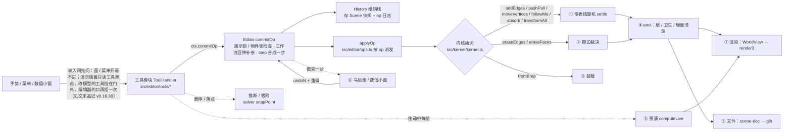

# CatsUp 代码流程图（pipelines）

> created 20261026 by Claude Opus 5.5 · as-of v0.14.70 / 2026-10-26
> 家族规矩（根 CLAUDE.md「代码流程图」节；user 2026-10-26「可以维护一个ai docs讲一下pipeline是什么。然后项目claude.md要求改的时候需要更新。不同操作可以走不同的共用pipeline」「要不pipeline规则升级成家族级别吧 反正就是那种代码流程图」「对，理一下你测的那些性能优化里面每一步都干了啥」）：
> **改流程（新动词 / 新共用流程 / 改某一步 / 新工作流亚种 / 性能改动）同一个 commit 更新这份。** 每一步写：干什么 · 碰多少东西（随**整个模型**涨 = O(N)，还是只随**这次改动**涨 = O(改动)）· 实测。
> 实测口径（下文所有数字）：node / 无头 Chromium，本机；「光滑球」= `tmp` 基准脚本造的 UV 球（1472 / 12096 / 48768 三角，导入成一个组件），挪 / 擦赤道附近一个点 / 一条边。

---

## 0. 总图



---

## 1. 哪个操作走哪条流程（+ 工作流亚种参数）

| op（`src/editor/ops.ts`） | 内核动词 | 流程 | 亚种 / 参数 |
|---|---|---|---|
| `addEdges`（画线 / 矩形 / 圆 / 弧 / 偏移出的线） | `addEdges` | ① 结算（手势边 → 无主胞腔可出生） | `harden`（描过软边变硬，DT90）、`layers` / `curve` |
| `pushpull` | `pushPull` | ① 结算（帽 + 侧壁像） | 帽边不带 `CAP_EXCLUDE`（fold）；被推那块的折线先退回普通边 |
| `move`（挪点 / 挪边 / 挪面） | `moveVertices` | ① 结算（被挪膜的像；不平 → 自动折面） | **`creaseLayers`**：折缝 = 硬线（缺省）/ `["fold"]`（`Mode.workflow.autofold = "fold"` 时 commitOp 统一补上） |
| `followme` | `followMe` | ① 结算（扫掠分片组） | 站环 / 末帽不带 fold |
| `absorb`（复制粘贴 / 移动复制） | `absorb` | ① 结算 | — |
| `transformPool` / `applyScale` / `setAxes`（组件原点） | `transformAll` → `moveVertices` | ① 结算（池里全部顶点） | 镜像变换：`transformAll` 先整体互换两侧（DT8） |
| `mirror`（镜像指令） | `src/editor/mirror.ts mirrorGeometry` → `moveVertices` + `addEdges` | ① 结算 | 删对面 / 消中缝 / 融合阈值（马前炮）；组件 = 负变换实例 |
| `eraseEdges` / `eraseFaces` / `eraseSelection` | `eraseEdges` / `eraseFaces` | ② 擦边裁决 | **橡皮亚种**：`Mode.workflow.eraseNonCoplanar` = `burst`（缺省）/ `fold`（→ `Kernel.foldPlan` 分类：折 = `setEdgeLayers fold`、照常 = `eraseEdges`、非流形 = 拒绝） |
| `setEdgeLayers`（软化 / 硬化 / 折线） | `setEdgeLayer` | 不结算，只改层 → ④ | — |
| `weldEdges` / `explodeCurves` | 曲线登记 | 不结算 | 焊边认回圆（DT88） |
| `makeGroup` / `makeComponent` / `explode` / `copyGroup` | 快照搬家（`extractSnapshot` / `transformSnapshot`）+ ③ 装载 + ① absorb | ③ + ① | 建组件马后炮选原点 |
| `eraseInstance` / `rename` / `purgeDefs`（清理没人用的组件，0.18 I10，2026-10-30 Opus） | 场景骨架（定义平表 / 实例表）；`purgeDefs` 先用 `src/scene/resources.ts liveDefs`（从模型根沿「谁摆着谁」走）复核单子全是孤儿，有一个活的整条拒绝 | 不结算（骨架类撤销） | **定义的生死**：只有 `purgeDefs` 删定义（守卫 `test/orphan-defs.test.ts`）；炸开 / 合并 / 删实例都留着定义（v0.18.3 起，以前炸开最后一份会删）。清点 = `census`：随定义数 + 实例数 + 活着组件的面数涨（资源页打开时才算） |
| 换父亲（层级窗拖一行，0.18 I3；身份地基 ID-2 起不走 paste） | `object-tree.ts moveRowOp` → 一条 `moveInstance`（保 GUID，世界位置换算成目标组件本地）→ 窗口用 `editor.oneStep` 把「退到根 → 提交 → 走进新父亲 → 选中」并成一步 | 不结算（骨架类） | 判落点 = 通用 `src/app/ui/tree-drag.ts dropAt`（只吃行深度）；碰的东西 = 这一份实例 + 两个组件的实例表 |
| `importScene` | ③ 装载（op 带提交前装好的膜） | ③ | 上方向 / 文件单位（马后炮重做） |
| 插件指令 `planar`（老名 `makePlanar`）/ 修复指令 | 规划纯函数（`src/editor/repairs/planar/plan.ts` 等）→ `moveVertices` | ① | 作用域：有选区 = 选区，没选 = 整个物体；含子物体（DT85）。拍平（v0.14.63 DT104）：候选 = 弯折小于阈值的边，硬 / 软 / 折线都算；按候选连成片，**整片每张面和目标平面夹角 ≤ 阈值才拍**，不然当曲面（圆柱侧面）→ 退回只按硬边分片、同样过这关，过不了不拍、报片数 |
| 修复指令 `mesh.mergeReversed`（合并重合反向面，v0.18.40） | 规划纯函数 `src/editor/repairs/merge-reversed/plan.ts`（按「这圈点」分桶找成对的 → 定方向 → 每对删一张）→ `meshDelete` | 网格体直接改，不走结算机 | 作用域 = 整个网格体（修复窗对「这一层」说话）；规划 O(面的环长之和)，只在开物件菜单 / 修复板时数；不加 op，撤销、镜像护栏（topo，先问）都是现成的；导入 / 导出 / 转换永远不走这里（user 11-04）。 |
| 插件指令 `gridSnap`（吸到格点 DT4 / 拉正 DT101 合租；老名 `snapToGrid`） | 规划纯函数 `src/editor/repairs/grid-snap/plan.ts planGridSnap`（拉正 = 格子坐标里逐根轴：和轴几乎垂直的边两端点这根轴的坐标拉成一样，连成伙取同一个值，范围外的点当锚；圆 / 弧只沿法向那根轴拉平） → 拷贝上试 `moveVertices` → 会破的面先 `addEdges` 三角化对角线 → 真 `moveVertices` | ① | `creaseLayers` = 软边（缺省）/ 硬边；格子 = 物体自己的坐标架（缺省）/ 世界格点；圆 / 弧整条平移（缺省）/ 逐点；还破 = 整步拒绝 |
| 插件指令 `hierarchy`（恢复层级，DT99；老名 `restoreHierarchy`） | 规划纯函数 `src/editor/repairs/hierarchy/plan.ts`（`piecesOf` 连通块 → `classifyShapes` 形状比对：重心对重心 + 两个「离重心距离最少撞车」的点定旋转 + 整件逐点 / 边 / 面 / 层验）→ 场景层搬家（`extractSnapshot` → `mintGroup` / `mintDef` + `mintInstance`）→ 源池 `eraseFaces` / `eraseEdges` | ②（删源块；块是连通分量，碰不到别人） | `dedupe`（形状一样的合成组件，缺省开）、`mirror`（镜像对上的也算一样 = 负变换实例，v0.14.65 缺省开）；坦克全合并 201 块约 0.7 s；含子物体 = 修复逐池跑、**深的池先跑**；菜单只用便宜数法（块数 + 素组数，400 盒 6 ms），真跑 400 盒 141 ms |
| `setDrawFrame`（坐标架）/ `addGuide` / `paintFaces` / `setHidden` / 层表 | 场景字段 / 面层 | 不结算 | `addGuide` 四种：参考线 / 参考点（卷尺 / 量角器）、参考圆 / 参考球（圆规，DT50）；都住池的参考几何层（`scene/guides.ts`），内核零感知，只进「推断 / 吸附」和 ⑦ 渲染 |

**工作流亚种**（`src/editor/mode.ts Mode.workflow`，缺省 = 硬表面 / SketchUp）：同一套代码按工作台分叉，不另抄一份。现在只有两个口：`eraseNonCoplanar`（破 / 折）、`autofold`（硬线 / 折线）。现有三个工作台（物体 / 硬表面建模 / 表面）全用缺省；自由建模工作台（以后）用折线那一支（那边的工具也不叫橡皮，user 10-26）。

---

## ① 像表结算机（`src/kernel/settle.ts`；立宪页 §3）

一句话：**动词不碰图，只交一张像表（「做完以后每张膜长什么样」的多边形）；机器按坐标认领胞腔。** 每一段的计时 = `perf.last["settle.<段>"]`（常开）。

| 段（计时名） | 干什么 | 碰多少 | 实测（4.9 万三角挪一个点；改前 → 现在） |
|---|---|---|---|
| `identity.pre` | 被消耗的膜出库、记旧环边；在**新线段附近**的边上拍「操作前是否二度共线 / 是否裸线」 | O(改动)（空间网格 `edgesNear`） | 0.4 ms |
| `identity.kept` / `identity.bury` | 随葬第一相：被消耗膜的旧环边若不在任何像上、也没有活膜引用 → 现在就删 | O(改动) | ≈ 0 |
| `insert` | 把手势线 / 裸线 / 折缝 / 像的环段插进图（`insertSegment`，sticky 3 µm），记手势边 / 脏边 | O(改动) | 1 ms |
| `planarize` | 只围绕脏边自愈：交叉切开、骑边合并 | O(改动) | 3.5 ms |
| `touched.planes` | 被碰平面 = 像的平面 + 被消耗膜的平面 + **含任一脏边的平面** | **O(平面数)**（扫全部平面；先用「平面穿不穿过脏边包围盒 ± τ」一次判断筛） | 12 → 1.7 ms（v0.14.47 包围盒先筛） |
| `touched.discover` | 从脏顶点上两两相邻的边张出候选平面，登记进平面表（`PlaneRegistry.ensure`） | O(改动) × 登记 | **52 → 0.6 ms**（v0.14.47 平面表按「规范法向 + 距离」分桶，原来每次登记逐条比全部平面） |
| `touched.scope` | 每张被碰平面上这次要用的边集 S（影响域）：① 脏边 + 被消耗膜旧环 ② 沿裸线可达 ③a 像的盒 + 脏边的盒（± 2τ）③b 手势出生胞腔走出整个外环（+ 它的盒）④ 受影响膜的环 ⑤ 双胞平面跨平面认领补边 | O(改动)（不写死尺度，v0.14.46） | 43 → 8–13 ms（v0.14.47：③a 不再罩裸线可达那一大圈——赤道一圈边恰好在 z = 0 上 → 2 m 的盒；⑤ 每张像只查一次盒） |
| `touched`（τ-flatten 轮） | 同一平面组里 3D 相距 (r, 2τ] 的东西投影后相交 / 骑边 → 并成一个，再 planarize + 重算 S，到不动点 | O(改动) | ≈ 1 ms |
| `regions` | 每张被碰平面在 S 上切胞腔（`groupCoplanar` → `findRegions`），清理被碰而没用了的平面 | O(改动) | 8 → 2 ms（v0.14.47 只删被碰的那几张，原来拼全表保留集 + 整表 prune） |
| `identity.rings` | 受影响膜按顶点 id 读环 = 身份像 | O(改动) | 3 ms |
| `claims` | 每张像按绕数认领胞腔（平行 2.6° 内、代表点离像 ≤ τ，认领不到放宽 3τ） | O(像 × 被碰平面的胞腔) | 0.4 ms |
| `decide` | 逐胞腔裁决：有 XOR 参与 = 认领数奇偶，否则 ≥ 1 即填；身份（一对一保 id / DIVIDE / MERGE / BURST / BIRTH）；无主胞腔外环含手势边 = BIRTH | O(改动) | 0.2 ms |
| `faceLinks` | 只给变了的膜重建「边 → 膜」链接 | O(改动) | 0.1 ms |
| `bury` | 随葬第二相：结算后没膜的边只许是用户画的线 | O(改动) | ≈ 0 |
| `dissolve` | ⑪a 新段打层（含折缝 `creaseLayers`）→ ⑩ 因本次操作变成二度共线的顶点并成一条边 | ⑪a 的 `layerSegs` 那一行**扫全部边**（推拉 / 画线才有）；其余 O(改动) | ≈ 0 |
| `layers` | ⑪ 边层 / 曲线清掉删了的边、⑫ 登记新曲线、断弧规则 | O(改动) | **5.6 → 0.01 ms**（v0.14.47 按删除记录增量清，原来扫全部层） |

合计（光滑球挪一个点）：1.2 万三角 0.2 s → **9–14 ms**；4.9 万三角 1.6–1.9 s → **17–38 ms**（v0.14.46 去 1 m 余量 + v0.14.47 上面几段）。
裁判 = 差分 oracle（`test/settle-differential.test.ts`：同一串随机操作，局部机 vs 全局机逐步比；「冂 封口」四个尺度 + 放大档）。

---

**挪点末尾多一步（v0.15.6，FM80）**：本次挪过的顶点的邻边里，软 + 恰两张不同膜 + 两膜同一平面的 → 走 ② 擦边裁决的 MERGE（局部化后 O(被碰平面)），看不见的 180° 软边不留。硬缝不自愈（FM79）。

## ② 擦边裁决（`Kernel.eraseEdges` → `FaceStore.snapshotEraseVerdicts` / `reconcileErase`）

| 步 | 干什么 | 碰多少 |
|---|---|---|
| 曲线展开 | 擦一段 = 整条曲线 | O(改动) |
| 裁决快照 | 每条要擦的边：从它的 faceLinks 取相邻膜（v0.15.4 前扫全部膜），看它在哪个环上 → 外环 = BURST、洞 = ABSORB、同平面两张共享 = MERGE | O(改动) |
| 删边 | `removeEdge` | O(改动) |
| 重算 | **v0.15.4 局部化（Fable 账单 T2，证明 `proofs/20261027-erase-localization.md`）**：只对「并组成员 / 整理膜所在的平面」切胞腔，输入 = 那张平面 τ 内的全部边（一次扫边挑出）；faceLinks 增量维护。v0.15.4 前 = 全部平面重切 | **O(E × 被碰平面数) + O(被碰平面上的边)**（以前 O(模型) 还略超线性） |

实测：光滑球擦一条边（v0.15.4 前）80 三角 14 ms · 350 三角 37 ms · 1472 三角 184 ms · 12096 三角 11 s；**全合并坦克（32220 面 / 48503 边）擦 50 条软边 76 s → 45 ms，200 条 → 76 ms，1 条 45 ms（v0.15.4，local 与 global 面数 / 边数相同）**。剩下随模型涨的只有那一次扫边（48503 条 ≈ 几毫秒）。

---

## ③ 装载 / 导入

- `Kernel.fromBrep(snapshot)`：按存档的路直接装（平面按存储参数精确注册 `PlaneRegistry.restore`，不结算）。打开文件、撤销到快照、op 带装好的膜（`importScene` / 建组件）都走它。
- 外来 glb：`src/format/gltf-import.ts`（glb → 节点树 / 三角，Y-up → Z-up，上方向 / 单位）→ `src/scene/import-build.ts castImport`（共用网格 = 共用定义）→ `src/kernel/from-triangles.ts`（干净的三角走 fromBrep 快路径；骑边 / 交叉 / 同平面盖住的交给 ① 的 absorb 切）。实测：1.2 万三角 ≈ 1.5 s（v0.14.39 起）。

---

## ④ 每步之后（`Kernel.emit`）

1. 事件进日志；面层按事件血缘走（DIVIDE 子膜继承、MERGE 取首个、BURST 清；`FaceLayers.applyEvents`）。
2. **折线卫生**（DT87）：恰好两张不共面的膜，否则退回普通边。O(折线数)。
3. **增量清理**（v0.14.47）：图 / 膜库记删除记录（`drainRemovedEdges` / `drainRemovedFaces`；id 不复用），边层 / 面层 / 曲线只清这批（`pruneIds` / `pruneEdges`）。原来每步全量扫。守卫 = fuzz 的「层不漏」不变量。

---

## ⑤ 拖动预演（`Editor.computeLive`，每帧）

| 步 | 干什么 | 碰多少 | 实测（无头浏览器拖赤道一个点；1.2 万 / 4.9 万三角） |
|---|---|---|---|
| `live.clone` | 当前池的内核整份拷一份（图 + 膜库 + 平面表 + 层 + 曲线） | **O(池)** | 15 / 75 ms |
| `live.run` | 在拷贝上跑这一帧的动词（走 ①） | O(改动) | 25 / 45 ms |
| `liveWorld` | 合成视图：在手里的那份换成拷贝 | O(槽) | — |
| `poolMesh.sync` | 池网格（`editor/pool-mesh.ts`）跟到这一帧的拷贝：沿克隆族谱找原件、并两边的改动日志（`kernel/change-log.ts`）→ 只重建**改过的面 / 边 + 它们顶点周围一圈**（扇内平滑法线会变） | **O(改动)** | 2–13 ms（4.9 万三角）；坦克 0.5–1.4 ms（node，只碰 39 面 55 边） |
| `poolMesh.upload` | 改过的那几段登记成局部上传（`addUpdateRange`，相隔不远的并成一段） | O(改动) | ≈ 0.1 ms |

以前这一行是 `buildKernelGeom`：渲染把拷贝**整池重建几何**，O(池)，4.9 万三角 0.4 s（v0.14.48 修了并查集平方级之后）；v0.14.52 换成上面两行（DT96 渲染那半）。

剩下的（DT96 内核那半，等周二 Fable 审）：内核事务回滚——预演副本每个手势拷一次，每帧回滚上一帧再做这一帧（各表遍历顺序要原样恢复；对拍「回滚 = 没动过」）。现在一帧的大头 = `live.clone` + `live.run`：整份拷内核在全合并坦克（3.2 万面）上 95–166 ms、分件坦克最大的零件（1.1 万面）25–47 ms（node 本机，v0.14.53 之后；渲染那份每帧 ≈ 1 ms）。

---

## ⑥ 马后炮 / 数值小窗（`src/editor/param-panel.ts afterthought` · `Editor.applyVcb`）

- 每个工具落定时 `recordLast(上一步)` → `offerLastAfterthought`：变换类（复制 / 变换中心）、圆 / 弧（段数 + 公差说明行，DT95）、建组件（原点）、导入（上方向 / 单位）、修复（含子物体）、改组件原点（现成位置）。
- 改值 = `undoN(这一步占的操作数)` → 按新值重做 → 重新数操作数；之后又提交别的 / 撤销 = 作废。
- **v0.19.9（W-8）**：小窗底下「确定」= `done` → 编辑器 `afterthoughtDone`（关小窗、提示「X：定了」）；指令的重做可以说「这组值做不成」（返回 false、一条没提交）→ 那个数退回原值、按原值再重做一遍（`restoring = true`，指令别写成功的提示）；悬在 / 焦点在某一行 → `Editor.focusParam` → 会话的 `focus`（刀标出那个点）；字段可以带 `off(values)`（这一行灰掉）。刀的小窗：编辑器 `endChain`（「收刀」钮 / 同一处再点 / Esc 都走它）先调工具的 `onEndChain` 再收手势，刀在那里开小窗；重切 = 先在副本上把这一串切一遍（拿新点的编号、切不成就不提交），再提交同一串。环切记录多一个可选的 `cuts`（`mesh/ops/loopcut.ts loopCuts`：每次在剩下那段的第一个均分点切一圈）。碰多少东西：重切 = 这一串的刀数 × 刀本身；环切 = 圈数 × 一圈。
- 数值小窗：`undoN(L.ops)` → 按精确值重做；圆 / 弧的重画（`redrawCircle` / `redrawArc`）和段数马后炮共用。

## ⑦ 渲染（`src/scene/world-view.ts` → `src/editor/render3.ts`；v0.17.5 起 render3 本体 = `src/minccino/backend/three/render3.ts`，编辑器那个文件只是转出口）

- WorldView：每个池（根 / 组 / 组件定义）一个「部分」，按 `kernel.rev` 缓存；每份实例一个槽 = 一个矩阵（同一个定义的几份共享几何）。软边 / 平滑边 / 折线集合在部分里。
- render3：每个池一份**池网格**（`editor/pool-mesh.ts`，v0.14.52 / DT96），每槽一个矩阵；选中 / 悬停 = 覆盖层；轮廓线判定在着色器（`profile-edges.ts` 的 GLSL 镜像）；小三轴（选中组件 / 空组件 / 淡的组件原点）共用一个画法。
- 地面网格（v0.17.64，Claude Opus 5.5）：编辑器每帧交 `FrameInput.grid = { frame, ladder }`（进位表 = 单位制 + 吸附长度，`grid-settings.ts displayLadder`；`null` = 栅格面关）→ render3 按视线目标处一像素多长挑 12 层写进 `uLv`（`minccino/grid-ladder.ts ladderWindow`，O(进位表长度) ≈ 25 次比较 / 帧，不随模型涨）→ 一张同心圈平面的着色器逐像素判线。
- **v0.17.3 起（Tron 第一刀步 3，Claude Fable 5.1）：⑦ 切成两半**——编辑器 `draw()` → `provider.setWorld(view, dimSlots)` → render3 `syncPools()` **拉**一帧流（`EditorStreamProvider.pull`：每槽一个放置 + 每份池网格的块，块直接包 pool-mesh 的大数组、带 `dirty` 段和全局单调版本号）→ `uploadFaces / uploadLines`（版本没变不碰显卡；数组换过 / 长大了重建；否则只传改过的段）→ 槽节点。池网格本体、同一帧同一内核只同步一次、两代释放全在提供者；render3 只剩显卡副本（`chunkGpus`）。每步碰多少东西不变（只随这次改动涨）；截图基线 11 张 0 像素差。契约 = `src/minccino/contract/stream.ts`。
- **v0.17.6 起（步 6a）：叠加层的线段族也切成两半**——编辑器 `overlay-lines.ts` 按 ViewState 算线段 + 线性颜色 + 缓存键（内容），引擎经 `OverlayCtx` 给量尺（一像素多长 / 视野多远 / 相机三轴），后端 `overlay-lines.ts` 按 `LINE_STYLES` 画；key 没变不重建。点 / 标记 / 文字 / 选中高亮还在 render3（6b / 6c）。
- **v0.17.9 起（6c，Claude Fable 5.1）：⑦ 的接缝收成三样**——① 流提供者（`setWorld(view, dimSlots, revision)`；多了 `contentKey()` = 世界身份 + 版本 + 淡出集，没变引擎不重新拉；`bounds()` 场景包围球给远平面）② `frameInput(world, cam, vp, ViewState)`（编辑器 `view-state.ts`）→ 后端 `render(FrameInput)`：相机 / 视口 / XR 近平面 / 地面网格 / 叠加层回调 ③ 叠加层回调里 = 选中高亮（`editor/highlight.ts`：原 rebuildOverlay 逐字搬，键同构、键没变复用）+ 线 / 点 / 标记 / 文字。后端 render3 零内容层 import。每步碰多少东西不变：高亮只随选区 / 悬停 / 版本变重算（O(选中的面)），拉流只随内容键变。截图基线 11 张 0 像素差。
- **v0.17.10 起（Tron 第 1 步，Claude Opus 5.5）：⑦ 多一个亚种「风格」**——预设（`minccino/preset/`）决定这一帧的 pass：白模 = 原来那一条（一次 three 渲染）；像素描边 = ① 模型（第 0 层）画进 1/k 的小图 ② 像素描边全屏一遍 ③ 整数倍放大回画布 + 写回深度 ④ 叠加层那一层（网格、叠加层、X 光线）按原分辨率画上去。随什么涨：①④ 同白模（随画出来的几何）；②③ 随画布像素、和模型大小无关（② 在 1/k² 的小图上）。XR / 缩略图走白模。
- **v0.17.11 起**：剪纸 = 地面一遍全屏（射线打 z = 0）+ 模型换纸的材质 + **遮蔽烘焙**（20 遍画全场景进深度图集；随整个模型涨，所以只在内容变了且停手 0.25 秒后烘一次，拖着改的时候不烘）。每帧着色的遮蔽 = 每个像素读 20 次（随画布像素涨，和模型大小无关）。
- **v0.17.12 起**：CRT Tron = 小图（最多 240 行）里画两遍场景（颜色 / 辉光）+ 12 遍模糊 + 合成 + CRT 放大 + 叠加层那一层。随整个模型涨的 = 两遍场景（都在小图上）；其余随画布像素。
- **v0.17.13 起**：铸铜 = 地面 / 背景一遍（读环境图）+ 模型换表面材质 + 遮蔽烘焙多烘一格太阳（21 遍画全场景，停手才烘）+ 环境图（换风格时烘一次、读回一张 64 × 32 浮点小图算球谐）。每帧着色 = 每像素读遮蔽 20 次 + 太阳 4 次 + 环境图 2 次（随画布像素涨）。
- **v0.17.34 / 35 起（切刀，Claude Opus 5.5；窄接口设计稿 §7.1）：叠加层那一遍取消**——编辑器只交语义项（「这是什么 + 颜色角色」）→ 画风表 `src/look/aux.ts` 翻成 GL 量（线宽 / 深度 / 层 / 颜色值；字 = 折线 `look/stroke-font.ts`）→ 引擎。辅助几何缺省住第 10 层、**和模型同一遍画**：白模那条路照旧一次 three 渲染（相机看 0 / 5 / 6 / 8 / 9 / 10）；风格那条路 = ① 模型 + 辅助几何 + 1 像素网格 / 轴（第 0 / 6 / 7 / 10 层）画进小图（先清成画风背景的 sRGB 原值；细于 2 格的辅助线换 1 像素 GL 线；颜色按 sRGB 原值写）② 描边（深度一起写进描边后那张）或辉光 ③ 整数倍放大。**排在后处理之后的（第 8 层）/ 原分辨率的（第 5 层）只有画风表开了白名单、这一帧真有东西才多画那一遍**（现在白名单是空的 = 不画）；放大那遍只在要画原分辨率那层时才写回深度。第 0 层只放模型（遮蔽烘焙的相机只看它）。随整个模型涨的没变；辅助几何随它自己的段数涨（小）。守卫：`test/aux-look-guard.test.ts`（编辑器无 GL 量 / 颜色值）、`test/overlay-pass-guard.test.ts`（每个画风偏离缺省的行 = 白名单）、探针 `probe-pixel-blocks`（像素描边 ×3 下不成整格的块 = 0）。
- **v0.17.45 起（Claude Opus 5.5；账本 T154 / 总账 A12）：地面网格不再有写死的大小、不再算「画哪一圈」**——一张同心圈平面（单位半径的几何建一次，每帧只改两个 uniform：圆心 = 相机脚下〔正交 = 视线目标下〕、半径 = 2 ×（远裁剪面 + 正交半视口））盖住视锥里的全部地面；画不画、画哪一档（格距 ×1 / ×10 / ×100 / ×1000）每个像素自己判：原分辨率 = 梯度抗锯齿 + 间距 3→9 像素淡入；像素化 = 二值 1 像素细线，梯度用解析雅可比（投影矩阵求导），间距不到 5 个小图像素（点线 8）不画。**每帧 CPU 只碰 2–8 个 uniform、不随场景大小涨**（以前像素那张每次圈 / 格距变了就重建一整份线段几何）；GPU = 一张平面每像素 ≤ 8 次取模。
- **v0.19.17 起（W-14，Claude Opus 5.5 2026-11-11）：贴图面的颜色和纯色面走同一段**——贴图按 sRGB 存（过滤 / 缩小图在线性里做），着色器采样出来是线性的；白模 / 像素风的贴图着色器（`render3.ts TEX_FRAG`）先编码回 sRGB 再乘顶点色和明暗（纯色面的颜色本来就是 sRGB 的值、直接出）；写实（`pbr-shader.ts`）贴图底色先编码回 sRGB 再走纯色面同一个 2.2。以前直接把线性值写出去 = 贴图比字节暗（128 显示成 55）。每一帧的花费没变（每个贴图片元多一次编码）。
  - 追记 2026-11-11（v0.19.38，Claude Opus 5.5；颜色空间约定 `ai-docs/20261111-color-space-convention.md`，统筹 11-11）：**给渲染器的贴图换成不自动解码的 RGBA8**（画的显示图 `live-image.ts`、导入的图 `render3.ts textureFor` 的 `NoColorSpace`）——取样拿到的就是存着的 sRGB 的数，过滤也在这些数上做。白模 / 像素风（`TEX_FRAG`）直接用取样的数，上面那步「编码回 sRGB」去掉；写实（`pbr-shader.ts`）取样之后照旧走纯色面那个 2.2 解成线性。画的显示图的缩小图（自家 2×2）在哪个空间取平均跟画风走：预设多一项 `material.mixSpace`（复古 = srgb，写实 / 铸铜 = linear），换画风 = 活的图整张重拷、冷的合成图缩小图整套重做（冷热仍是同一份算法）。量（`probe-texture-srgb` ④）：1 像素黑白相间的图缩小到最小那一级，白模 128、写实 188、换回白模 128；导入的图白模不打光缩小着看屏幕上 128（以前 ≈ 188 = user 说的偏白）。**还没跟画风走的一处**：导入的图的缩小图是驱动做的（generateMipmap），在 sRGB 的数上平均，写实画风下也是——要跟画风走得把导入的图也交给自家缩小图（交统筹定）。
- **v0.17.51 起（Claude Opus 5.5；账本 T157）：像素描边那遍多一步「清碎屑」**——描完剪影后，紧挨描边、4 邻里没有同色的孤格改成邻格最多的颜色（只在描在物体那侧的画风：像素描边 / 1-bit）；墨线记号 = 画风小图那一遍里 1 像素边的透明通道写 0（render3 `inkMark` 切材质、画完切回）。每像素多 ≤ 4 × 4 次深度读，随屏幕像素涨、不随模型涨。
  - 池网格 = 每张面的三角（+ 扇内平滑法线 + 两侧颜色）、每条看得见的边，直接写进几张大数组（不留 JS 记录；每张面只记环边编号 + 在哪段）：面按块分区（块起点 / 容量对齐 3 = 显卡按三个顶点一个三角读；删了清零 = 退化三角；洞多了字节原样往前搬），线永远挤紧（删一条 = 最后一条搬过来）。位置 32 位浮点、法线 16 位、面颜色 8 位（归一化整数）；全量建完收紧容量。显卡缓冲直接包这些数组，改过哪段传哪段。坦克：缓存 JS 堆 16 MB、显卡数组 5.3 MB。
  - 跟哪个内核：原件 / 预演拷贝 / 撤销快照之间按「克隆族谱 + 改动日志」算差（`diffTo`）；族谱断了、日志说不知道（装载 `fromBrep` 之后）、线稿风格变了、材质槽表不是一边前缀另一边 = 全量（坦克 0.4 s）。
  - 改动日志（`kernel/change-log.ts`）：顶点 / 边 / 膜表和层的集合都换成带记账的 Map / Set，原地改坐标 / 端点 / 环的几处显式记；日志本体 = 一张 Int32Array（一条 4 字节，上限 6.5 万条，多了丢前一半）；
    族谱 = 拷贝 fork 时记「祖先日志的数据 + 分叉那号」最多 16 代，**不引用内核**（v0.14.53；以前的 WeakRef 让导入修复一口气拷的几百份内核在这段同步代码跑完前全放不掉，炮塔零件峰值 770 MB）；守卫 = `test/change-log.test.ts`（变了的都记、没变的不记）+ `test/pool-mesh.test.ts`（增量 = 全量）+ 探针 `probe-pool-mesh.mjs`（逐像素 = 全量、每步都没退回全量）。
  - 淡出（上下文之外）= 同一份几何换一套颜色缓冲（不再是几何变体）。
  - X 光（v0.14.57，DT17；**v0.17.22 刀 d 改**：X 光不再是 pass——编辑器开着 X 光时给每个槽的边块提交 `edgeHidden` 标记，后端用「深度大于才画」的半透明材质把同一份线几何再画一遍，只出被挡住的那段；Tron 隐线同一条路）。旧写法：每个槽的线多挂一份「不做深度测试、35% 不透明」的对象，共用同一份线几何；覆盖层（选中 / 悬停 / 检查）换不做深度测试的材质。拾取：选择工具调 `pickEntity` 时 `xray` = 跳过点 / 边的遮挡判定。
- 不画：软边、折线、隐藏的边。明暗：每个顶点处按硬边分扇、扇内按内角加权（`fanNormal`；硬边在平滑组里也断开）；跨平滑边和折线连续。导出 bake（`smoothNormalsOf`）同一个算法，`test/smooth-normals.test.ts` 对拍「导出的 = 屏幕上的」。

- **v0.18.7（I12，Opus 5.5 2026-10-30）软边的外轮廓**：粗线那条路（线宽 > 1 / Tron）收集边时软边、折线也进线批（`pool-mesh.ts buildEdgeRec(…, contour)`），旗 = 面数 + `CONTOUR_ONLY`（10）；着色器（`profile-line-shader.ts`，CPU 镜像 `profile-edges.ts lineKind`）里旗 ≥ 10 = 只有夹在两张面之间、又正好转成外轮廓才画，否则零宽。画池里粗线的材质（普通 / 淡出 / X 光隐线 / Tron 两种）都用这份着色器，隐线的加粗量 = 0。**代价**：粗线批多出每条软边一条实例（每条 76 字节；光滑的导入模型软边多 = 线批跟着涨，随整个模型涨）。**v0.18.8** 1 像素那条路也进：材质 = `contour-line-material.ts`（片元 three basic 原样、顶点自己写），线批每顶点多 另一头 / 两面方向 / 旗 10 个数（随整个模型涨）。**v0.18.10** 深度：面 polygonOffset factor 1 → 2（`DEPTH.faceSlope`）；1 像素线顶点里沿视线往镜头挪（贴着的面往镜头翘的坡度 × 1 像素，保底 2 像素、封顶距离 2%；`onBeforeRender` 填当前目标的像素高）；像素描边那遍判「前后错开」时让开两侧各一格坡度 × 3 的台阶（每像素多 1 次深度读）。都是每顶点 / 每像素常数，不随模型涨。

## ⑧ 修复指令（`Editor.repair(kind, scope)`）

> **v0.18.40（2026-11-06，Claude Opus 5.5）**：修复窗第一次有网格体的指令（`mesh.mergeReversed`）。网格体这边不走 `repairScope` / 修复面板：指令走注册表 `runAction`（mesh 族），修复机器在网格体上只在有得修时露（`machine-window.ts` `when`）。

> **烤（⑨）两条路不合（2026-11-06 量过）**：硬表面 `bakeDefinition`、网格体 `bakeMesh` 各走各的；改走网格那条路慢 2.4–17 倍、烤的部分大 0.85–5 倍，数字见功能账 §5½，脚本 `test/probes/bench-bake-paths.mts`。

> **v0.15.9（2026-10-27 夜，Claude Fable 5.1）**：修复指令改从**指令注册表**取（`src/editor/commands/registry.ts`：`commandById` / `actionById` / `placementsAt`；修复一族的清单 = `repairs/index.ts`，含面板步骤表 `REPAIR_STEPS`）。流程的每一步没变（规划 → 估时 → 提交 → 马后炮），只是「哪条指令」从 `REPAIRS` 数组查改成注册表查，id 从 `weld` 变 `brep.weld`（插件 op 的名字不变，老复现包照开）。浮条上的修复入口 = 放置表 `contextBar` 面上的动作。

**模块化（v0.14.66，user 10-26「这些修复的东西即使可能代码量不大，但是也做成可以扔的模块化的，最好是各种命令都这样」）**：一个修复 = `src/editor/repairs/` 里一个模块（规划 + 参数 + 文案 + 菜单 + 自己那条插件指令的执行），清单 = `repairs/index.ts`（顺序 = 面板里跑的顺序：拉正 → 吸格点 → 清理碎渣 → 焊断口 → 拍平 → 软边变硬 → 补洞 → 改段数 → 恢复层级；改段数 v0.14.69 = 插件指令 `resegment`：现场认回转体（曲线登记的圆 / 网格里的正多边形硬边环）→ 按新段数造快照 → `eraseFaces` + `absorbSnapshot` → 删掉粘的时候多长出来的圈内圆盘；清理碎渣 v0.14.68 = 插件指令 `cleanup` 执行时按顺序再规划（擦悬空线 → 并短边〔拷贝上试、破面整步撤回〕→ 擦同平面硬内线），擦面和面之间的线很慢——坦克实测 `reconcileErase` 每调一次约 95 s、和擦几条几乎无关（50 条 97 s / 800 条 138 s，99% 在 reconcile；周账 F-97 ①）；**v0.14.70 起不为性能跳过**（user「不要因为性能静默不做，宁愿弹警告问yes no。诚实性问题」）：模块报 `erases`，框架按面数平方估时（坦克 3.2 万面 = 95 s 作标尺），≥ 5 s 先弹应用内确认框（做 / 不做；不做照实报），马后炮重做不再问；补洞 v0.14.67 = 只挂一张面的边围成的简单平面环、环外的面不同平面 → 沿环重描走核心 `addEdges`、结算机长面）；编辑器 / 修复面板 / 编辑条照清单遍历，指令层只有插件注册表（`registerOpPlugin`），老指令名在 `ops.ts normalizeLegacy` 里认成插件重放。守卫 `test/repairs-modular.test.ts`：核心只 import 清单和接口、模块只被清单 import。扔一个 = 删它的文件 + 清单一行。

（v0.14.64 加第五种：恢复层级，面板里排最后、默认不勾——它把几何搬进新组，前面几步按池跑，先搬了它们就看不到。）`repairScope`（有选区 = 选区，没选 = 当前物体；含子物体：组件按定义只修一次、锁着的跳过；每个池带「到当前上下文的变换」给世界格点用）→ `repairPlan`（焊断口 / 拍平 / 折得厉害的软边变硬 / 吸到格点）→ 提交（一步）→ 马后炮（含子物体 / 阈值 / 格子 / 坐标架 / 折缝 / 圆弧）。

修复面板（v0.14.56，DT6 + DT9）：编辑条「修复…」→ 右下角马前炮（含子物体 / 检查 / 四步勾选；说明行按现在的样子数每步会碰几处 + 微折软边条数）→ 应用 = 同一步里按固定顺序 吸格点 → 焊断口 → 拍平 → 软边变硬，每步按前一步做完的样子重新规划（`runRepair`，和单条指令共用）→ 马后炮改勾选重做。「检查」= 范围里弯折 ≤ 1° 的软边（折线不算），面板开着时作为 `warnEdges` 进覆盖层画橙色。四步里没有一步修微折软边（拍平从来不碰软边，DT7 拍的）——检查只负责标出来。

吸到格点（v0.14.55）每一步：规划 O(范围里的点)；拷贝上试一遍 = 整份拷池（O(池)，一次性指令不在热路径）；三角化只对会破的面。实测（node）：斜面上随机多边形吸 10 cm 格子，60 个里 58 个不退路就会破（自动折面折不平多边形），三角化退路全救回。

## 推断 / 吸附（`src/editor/solver.ts snapPoint`，悬停和落点每次都走）

一句话：**光标附近长出一堆「约束」（点 / 线 / 面，各带秩和吸附半径），挑选器按秩 → 屏距裁决，两条 1-D 约束可以合成交点。** 每段计时 = `perf.last["snap.<段>"]`（常开）。

| 段 | 干什么 | 碰多少 |
|---|---|---|
| `vertices` | 光标附近的端点（屏幕索引给超集） | O(附近) |
| `edgeTargets` / `nearSeg` / `edges` | 附近的边：线上 / 中点 / 圆心 / 延长线（充能边）… | O(附近) |
| `guides` | 参考线（1-D）/ 参考点（0-D） | O(参考几何) |
| `carriers` | 轴线、对齐线、充能边延长线；两两交点 | O(附近) |
| `guideCurves` | **参考圆 / 参考球（v0.14.62，DT50）**：弯的不进 1-D 合成器，每次只在光标附近产 0-D 点——圆上离光标最近的点、圆 × 参考线 / 附近的边 / 共面的圆、球 ∩ 画图平面那一圈上最近的点、球 × 参考线 / 边、射线先碰到的球面点（秩只比画图平面高一点；在球里面不产）。几何 = `guide-curves.ts` 纯函数 | O(圆球数 ×（参考线 + 附近边）) |
| `nearFace` / `cross` | 附近的面、面 × 面交线 | O(附近) |
| `solve` | 裁决（`solvePoint`）：ε 内的 0-D 候选才做遮挡判定（懒） | O(候选) |

- 吸附半径（`EPS`，基准 8 px 等比缩放）：点 10 / 边 7 / 参考线和参考圆 3.5 / 合成 12。参考圆和参考线同一档（窄，免得画别的东西时老被拽过去）。
- 落点之后编辑器还有一层迟滞（`Editor.applyHysteresis`）：上一帧吸住的，光标在 1.5 倍半径内继续吸住（进窄出宽）。

## ⑨ 文件（`src/format/`）

写：Scene → `scene-doc.ts documentFromScene` → `CatsupDocument` → `write.ts`（`CATSUP_*` 扩展按拍子写 + bake 出别的软件看的网格）→ glb。读：glb → `read.ts` → `migrate/`（每个子结构自己的拍子，`FORMAT` = 唯一 SSoT）→ document → Scene。演示锁住 `CATSUP_desk.locked`（v0.16.53；老 `final / finalRev` 照读照写不起作用）。**加密**（v0.16.55）：图库打开前 `file.isEncrypted()` → `unlock.ts ensureUnlocked`（busy 外弹口令、验尾部 peek）→ `file.open()` 透明解壳；保存时锁着（内存没口令）= 如实拒、改动留内存；加密 / 解除 = `file.encrypt / decrypt`（库：先本地后云 If-Match）。加可选键 = 该子结构 minor +1 + 冻结样本（`scripts/freeze-format-fixtures.mjs`）。

---

## 剩下的随整个模型涨的点（按严重度）

1. ~~**擦边重算全部平面**（② 最后一步）：1.2 万三角擦一条边 11 s。~~ **v0.15.4 局部化，坦克 76 s → 45 ms**；剩一次 O(E) 扫边挑被碰平面上的边。
2. **预演整池拷贝**（⑤ `live.clone`）：4.9 万三角每帧 60–115 ms（渲染那半 v0.14.52 已改成只碰改过的；拷贝那半 = 内核事务回滚，等 Fable 审）。
3. 结算 `touched.planes` 扫全部平面（已用包围盒先筛）：全合并坦克（1.35 万平面）每步 1–3 ms。彻底去掉要给平面加空间索引（多占内存、要维护）——v0.14.58 没加，交 Fable 审（家族周账 F-97½）。`⑪a layerSegs` v0.14.58 改成只看新段附近的边（空间网格），不再扫全部边。同一次量到的推拉大头 = `touched.scope`（影响域：被碰平面上的面）20–33 ms，不是扫全图，但也交 Fable 一起看。
4. OBJ 导入不认折线（Blender 来的不平 n-gon 现在只收边段）。

并到 DT92「初中」（WASM / 数据布局）还是先做，等 user 定。

## 追记 2026-10-27 夜（v0.15.10，Claude Fable 5.1）：mesh 池进渲染 / 拾取 / 吸附

渲染（⑦）和合成视图 / 拾取 / 吸附读内核的那一步改成只认契约 `scene/kernel-view.ts`：`Scene.viewOf(pool)` 派发——brep 池给内核本身（零改动），mesh 池给 `mesh/mesh-view.ts` 的派生视图（表按 rev 缓存 O(n)、改动日志是内核自己的 → 渲染缓存对 mesh 也是增量：挪一个点只重建它周围 3 张面，测过）。mesh 池的渲染多一个分叉：单面 → FrontSide 材质（剔背面）。随模型涨的新点：mesh 视图的派生表重算 O(mesh 大小)（每次 rev 变一次；增量重算 = 以后）。

## 追记 2026-10-27 夜（v0.15.11，Claude Fable 5.1）：文件流程的网格体分叉

保存：mesh 定义 → `meshDocFromKernel`（去空位重编，O(mesh)）→ `encodeMeshItem`（八个 bufferView）+ `bakeMesh`（三角化 O(面数)，给别的查看器）。打开：`decodeMeshItem`（拍子 → 多边形；没 faceStart = 老三角汤 → 每三角一面）→ `kernelFromMeshDoc`（addVertex / addFace O(mesh)；坏环拒开）。brep 定义的那条流程一字没动。

## 追记 2026-10-27 夜（v0.15.12，Claude Fable 5.1）：导入 → 网格体；转换指令

导入（⑨ 文件 / 导入那条）：`castImport` 不再三角形 → 膜，而是每三角一张网格面 + 按角度软 / 平滑（O(三角数)，不再过结算机 = 导入快了）；op 载荷 = 网格载荷；老复现包带膜的照装。新流程「转换」：选中组件 → 物体族指令规划 `castDefinition` → 一步提交；mesh → brep 走 `kernelFromTriangles`（O(三角数)，约 9000 三角 / 秒）+ 共面软边擦边 MERGE（局部化，O(影响域)）；brep → mesh O(面数)。

## 追记 2026-10-27 夜（v0.15.14，Claude Fable 5.1）：预演流程「每帧拷内核」那一步换了

预演（⑤）：以前每帧 `kernel.clone()`（随整个模型涨：9600 膜 66 ms）→ 现在 `Editor.shadowKernel()`：第一帧拷一次，之后每帧 `shadow.rewindTo(真身, mark)`（随上一帧改动量涨：挪一个点 0.32 ms）再跑动词。真身的 rev 变了（提交 / 撤销）或日志丢段 / 全局结算模式 → 重新拷。还随整个模型涨的点：第一帧的那一次 clone。

## 追记 2026-10-27 夜（v0.15.15，Claude Fable 5.1）：提交 / 撤销流程换底子

提交（⑥ 每步之后那条）：以前 = 在真身上 applyOp + 每 8 条整场景 clone。现在 = 拷这个池的内核一份当影子（O(池)）→ op 在影子上跑 → `swapTablesWith`（O(1)）→ `deltaAgainst` 抽触碰集（O(触碰)）→ 记录进栈（+ 一份骨架 O(定义 + 实例)）。结构型 op（建组 / 建组件 / 炸开 / 导入）整份 clone（O(模型)，少见）。撤销 / 重做：差量交换 O(触碰) + 骨架换对象；不再重放。选区变化：0 条 op 的一步。还随整个模型涨的点：提交时那一次拷池（列式后收口）、结构型 op 的整份拷。

## 追记 2026-10-27 夜（v0.15.16，Claude Fable 5.1）：动作路由那条流程 + 网格体的提交记录

- **新共用流程「动作 → 指令调用」**（`Editor.runAction`）：动作 id → 路由表（每种单位一条指令）→ `unitsOf(kind)`（brep / mesh = 活动池 + 几何选区，O(选区)；object = 选中的实例，O(选中数)；perDefinition 的按定义去重）→ 每个单位 `plan`（O(单位的选区)）→ 全部 op 合成一步提交 → 提示 = 各指令的 done 连起来 + 跳过的种类。亚种：只路由 brep 一种 → 修复那条路（作用域 / 含子物体 / 擦线估时）；只路由 object 一种 → 物体那条路（估时 / 去重）。
- **mesh 族的提交**（⑥ 每步之后）：`meshMove` → 拷网格体内核（O(网格)，类型数组）→ 在影子上写位置数组（O(挪的点)）→ swapWith O(1) → 记录 = 旧表；撤销 = 整表互换 O(1)。
- **选区步的记录点变了**：以前在 afterSelect（步深 0 才记）；现在在 step() 结束（没 op 的步才记）——点选 / 框选一次 = 一步 0 op 记录，O(选区) 的快照。
- **进网格体池**：`enterPool` 多一次 KindDef.modes 查表（O(1)）+ 切工作台；选择的点击族在非 brep 池走 `selectExpandView`（KernelView：一下 O(1)、两下 O(环)、三下 O(连通块)）。

## 追记 2026-10-27 深夜（v0.15.17，Claude Opus 5.5）：自由建模工作台的取量型工具（挪 / 转 / 缩 / 拉）

- **预演**（⑤ 那条的网格体亚种）：工具的 `liveMesh` → 编辑器拷一份活动网格体内核（O(网格)，类型数组）→ 在拷贝上跑同一条 op 的算子（挪 / 转 / 缩 = 写 O(目标点) 个坐标；拉 = 挤出 O(区域) + 平移新点）→ `meshViewOf(拷贝)` 当活动槽画（视图派生表按 rev 重算 O(网格)）。brep 那条（影子 + 倒带）不动。
- **提交**：一条 `meshMove` / `meshExtrude` → 撤销记录 = 网格体整表互换（v0.15.16 那条）。拉在提交前先在副本上跑一遍拿新 id（确定性：同一份内核 + 同一组参数 = 同一批 id），提交后用 `ToolCtx.setSelection` 把新几何放进选区。
- 拖动量在「过轴心、垂直视线的平面」上量；锁轴 = 投影（不用 `applyLock` 那条射线–轴线最近点，那条在轴贴近视线时会暴涨）。
- 还随整个模型涨的点：每帧拷整份网格（几千面以内毫秒级；大网格要倒带版，同 brep O1）。工具定义表 = `ai-docs/20261027-freeform-tools.md`。

## 追记 2026-10-27 深夜（v0.15.19，Claude Opus 5.5）：预演的合成视图缓存键加影子 rev；网格 rev 全局时钟

- ⑤ 预演：合成视图（`Editor.worldView`）按「编辑器版本 | 影子身份 | 上下文 | 叠加 | 格子 | 隔离」缓存；v0.15.14 起 brep 影子同一对象每帧倒回复用 → 键里加**影子的 rev**（每帧倒回 + 跑动词都是新号）。不加 = 拖动中一直拿第一帧的视图、渲染器的重建键（视图身份 + 版本）也不变 → 屏幕停在旧帧（user「拖动矩形的时候显示也不对」）。网格体预演每帧新拷一份，身份本来就变。
- 网格内核的 rev 改成全局递增（和 brep 的 revClock 同）：撤销整表互换后再做不会撞旧号，按 (内核, rev) 缓存的视图 / 合成视图 / 渲染不会给旧几何。
- 渲染缓存（`pool-mesh.ts`）：差从「画那一刻存下来的日志族谱」算，不再事后读 src.changes（提交 / 撤销会在内核对象之间整份换日志）。

## 追记 2026-10-27 深夜（v0.15.25，Claude Opus 5.5）：菜单指令带马后炮；改原点的撤销记录

- 「动作 → 指令调用」（`Editor.runAction`）两处改：① **单位只取一次**（`unitsFor` 在步开始时算好，马后炮按新参数重做时用同一批——上一次做完的选区已经换成结果了）；② **从菜单点的、只路由到一条、带参数的指令自动给马后炮**（⑥ 那条：`undoN` 刚才的几条 → 按新参数再 `plan` + 提交）；带参数调用（api / 搜索）不开界面。指令的默认值可以看这次的单位（`Command.defaults(env, units)`；插入的宽度 = 最小面上限的五分之一，O(选中面的边数)）。
- 新指令：`mesh.inset`（右键面 → 插入；`meshInset`，O(选中面的点)）、`mesh.originToSelection`（右键 → 设置原点到选择中心；一条 `setAxes`）。
- `setAxes` 落在定义根上（换组件 / 网格体的原点）：内核层 `retransformDefinition` 多一个网格体分支（每个点乘 M⁻¹，O(网格的点)；每份实例补 M，O(场景实例数)）；**撤销记录从骨架改成整份场景拷**（O(整个场景)，少见操作）——骨架记录共享内核，撤销只换回实例矩阵、几何留在挪过的地方 = 世界里错位（v0.15.15 起的 bug，测试 `test/draw-frame.test.ts` 钉住）。还随整个模型涨的点：这一条的撤销记录（整份拷）；要省就给它做「定义换坐标」的专用自反记录（只记 M）。
- 右键「新建」只在自由建模；硬表面那条「新网格体组件」流程（op `addMeshObject`）撤了。

## 追记 2026-10-28（v0.15.33–34，Claude Opus 5.5）：网格体的默认平滑 + 导出法向

- **「这条边平滑吗 / 画线吗」只问一处** `mesh/edge-smooth.ts`（`edgeSmooth` / `edgeSoft`）：手标优先，没手标的按网格体的「默认平滑」（按角度 / 全部平滑 / 全部是棱）。读它的：`mesh/mesh-view.ts` 的软 / 平滑表（→ 渲染、拾取、吸附）、`bakeMesh`（导出的线和法向）、`scene/kinds.ts` 转换、`import-build.ts` 导入。改默认平滑 = `MeshKernel.setSmoothDefault`：所有边和面记进改动日志、rev 涨 → 视图表重算 O(mesh)，渲染整池重建一次（不是每帧）。
- **导出（⑨ 保存的 bake 那半）**：`bakeMesh` 改成「内核 → 视图 → 每个材质一组」：三角化走 `triangulateFace`（按面自己的绕向，v0.15.33 修一半三角朝里）；每个角的法向 = 渲染同一个分扇函数（`scene/fan-normal.ts`，棱两侧分开、平滑区共用），角按「顶点 + 量化法向」去重 → 每组自己的 POSITION + NORMAL；线 = 画线的边（不平滑的 + 裸线，隐藏的不出）。O(角数)，随这个网格体的大小涨（保存时一次）。
- **右键「手标 ›」「默认平滑 ›」** = 注册表 mesh 族指令 → op `meshEdgeMarks` / `meshSmoothDefault` → 走网格体那条撤销记录（自反交换，O(这个网格体)）。挤出面的帽子 / 区域内部的新边带原来的手标（`extrudeFaces` inheritMarks），插入不带；溶解二度点并出来的边手标取交集。
- **自由建模显示**：正在编辑的网格体的平滑边 = 一层淡线（`render3 softEdges`，键 = 合成视图身份，几何变了才重建，O(这个网格体的边)）；拾取对这个池放开平滑边（`softActive`）。

## 追记 2026-10-28（v0.15.37，Claude Opus 5.5）：倒角

- **倒角** = 网格体 op `meshBevel` / `meshBevelVerts` → `mesh/ops/bevel.ts`：先按原位置算全部新点（每个端点绕一圈排角，O(端点的度)）、再一次性改受影响的面的环、补倒角带和角上的补片、删掉没边的老点。碰的东西 = 倒的边两端那些点的一圈面（随这次改动涨，不随整个网格涨）；撤销走网格体那条记录（自反交换，O(这个网格体)）。
- 入口三个、同一条 op：右键指令（`mesh-edits/` 规划时在副本上倒一遍拿新面 id、算夹宽，带马后炮）/ 插入那一格拖（预演每帧在影子上倒一遍）/ Ctrl+B 键盘起手（同一个工具）。
- 拾取：自由建模点的半径常量（`MESH_VERT_HIT_PX`），挤出 / 插入没选区时只认面（`pickFace`，射线最近的面，O(光标附近的面)）。

## 追记 2026-10-28（v0.15.38，Claude Opus 5.5）：网格体镜像

- **镜像编辑** = 提交口（`Editor.commitIn`）改写 `meshMove`：配对（空间散列，O(这个网格体)）→ 对面的点补进同一条 op（进日志的是改写后的 = 重放一致）。预演：影子上同一道（每帧 O(这个网格体)）。
- **强行对称** = 提交口在这条 op 之后、同一步里补 `meshSymmetrize`：先拷一份「之前」判动了哪边（O(网格体)）→ 已经对称就不补（不乱换另一半的 id）→ 否则删另一半、镜回来（O(网格体)）。撤销一下 = 两条一起撤。随整个网格体涨：每一步一次 O(网格体)，网格大了再说。
- **护栏**：镜像编辑开着、要提交改拓扑的 op → 工具提交口挡下（这一下工具自己的提示 / 选区不作数）→ 应用内确认 → 关掉镜像、新的一步提交同一条 op。右键指令 / 删除在入口问。

## 追记 2026-10-28（v0.15.39，Claude Opus 5.5）：细分

- **细分** = 网格体 op `meshSubdivide` → `mesh/ops/subdivide.ts catmullClark`：先读出全部新点（面点 / 边点 / 点）和新面，再清空、按「点 → 边点 → 面点」的顺序加回来（id 全重编，改动日志照常记）。O(角数)，随整个网格体涨，每次 × 4；面数估到 20 万以上先问（指令的 estimate）。撤销走网格体那条记录。
- 网格体指令的单位：没选区 = 整个网格体（sel = null），指令自己决定要不要选区。

## 追记 2026-10-28 晚（v0.16.5，Claude Fable 5.1）：挪点在镜像下的纪律（设计稿 `20261028-mirror-redo-design.md`；账本 UX31）

- **提交口 `Editor.commitIn` 改写 `meshMove`，两种模式都走**（以前只有镜像编辑改写、强行对称不碰）：`mesh/mirror.ts mirrorMoves(m, moves, axis, mode)` 按挪之前的位置分边 → R1 中缝上的点钉回镜像面 → R3 想穿过去的夹在面上 → R2 落到中缝的点和孪生点（+ 落点处本来就有的中缝点）并成一个 → 镜像编辑另外补对面的点。碰多少东西：配对 O(这个网格体的点)，其余 O(挪的点)。
- **并点 = 同一步里紧跟的 `meshMerge`**（op 加了可选 `to`：并到落点，不是中心），`mirrorMerging` 旗让这几条不各自触发对称化；然后才是整步最后那一次 `meshSymmetrize`（强行对称）。撤销一下 = 挪 + 并 + 对称化全回。
- **预演同一道**（`mirrorPreview`）：影子内核上做同一套钉 / 夹 / 并（`mergeVerts` 在影子上），拖到中缝眼睛看到的就是并好的样子；松手前拖回去 = 影子从真身重算、自然分开。
- **对称化多一步 R4**（`symmetrize` → `removeSeamWalls`）：整张躺在镜像面上、每条边都夹在 ≥ 3 张面之间的面（镜完变成夹层）删掉；孤零零躺在镜像面上的平面不碰。`sideOfChange` 挪到中缝上的点按它来的那一边投票（不然对称化会把这一边删了）。
- **披露**：并了几处 / 夹住几个 / 对面找不到几个进提示行；工具拖动那条路在步结束（`closeStep`）补一条。
- 已知边角（设计稿 §5.5）：落在中缝一条边的中间（不在点上）这版不劈那条边，面会捏一下。

## 追记 2026-10-28 晚（v0.16.6，Claude Fable 5.1）：对称属性进文件

- 「对称」（镜像编辑 / 强行对称 + 镜像面）= `Scene.meshMirrors`（按定义 id；克隆共享 = 不进撤销）→ 写文件时进 mesh 项 `mirror`（`CATSUP_mesh` 1.1 → 1.2，可选键；老读者提示一次照开）→ 读回来填表。改设置 = `Editor._revision++`（存盘钮亮）。碰多少东西：O(网格体定义数)。

## 追记 2026-10-28 晚（v0.16.8，Claude Opus 5.5）：⑨ 文件分成「工程」和「模型」两条（导出设计稿 `20261028-export-design.md`；账本 UX39）

- **工程**（保存 / 另存 / ☰「导出工程文件」）= 同一条：`Session.encode()` → `writeCatsup`，后缀 **`.catsup`**（老 `.glb` 工程照开、改名保留后缀；认工程靠内容 `CATSUP_document`）。「导出工程文件」= `encode()` 逐字下载，永不清脏。碰多少东西：照旧（随整个模型）。
- **模型**（☰「导出模型…」模态 sheet → glb）= `writeGltfModel(doc, { textures, lines, only? })`：只写 glTF 2.0 core——只烤够得着的定义（整个模型 = 从根往下；选中的物体 = 从那几份往下）、节点树、材质（贴图可关）、LINES 可关；不写 `CATSUP_*` / 缩略图 / 参考牌组 / 携带键 / B-rep 流。bake 加 `BakeOptions.lines`。碰多少东西：随导出范围。OBJ 照旧走 `obj-io.ts`（整个模型）。
- 名字：`src/app/doc-names.ts`（`docSuffixOf` / `bareName` / `fullName(dir, stem, ext = .catsup)`）；云库种类表两行同一个 kind（`.catsup` 新、`.glb` 老，`app-store.ts DOC_KINDS`）；新名字查占用时同主干的 `.glb` 也算（不造双胞胎）。

## 追记 2026-10-28 晚（v0.16.9，Claude Opus 5.5）：放置表吃左柱和 ☰

- 左柱 / ☰ 的「放哪、第几」= `src/controller/placement.ts` 一张表（纯数据，node 直测）；`main.ts renderSlots` / ☰ 的 `items` 按表画、`menuRow(id)` 给每行长相。每次渲染 O(表长)，和以前一样。注册表的放置面加了「谁画」的登记（`SURFACE_RENDERERS`）。

## 追记 2026-10-28 晚（v0.16.10，Claude Opus 5.5）：自由建模按下三分法

- 「按下作用在什么上」（`tools/selecting.ts pressTarget`）多一次按下处拾取（有选区时也拾，O(1) 一次 pick）+ 「在不在选区上」判定（O(选中面的点 / 边)）；换选区不在按下时做，挪到三把工具的落定里（`adoptPress` → 同一步里先换选区再 commitOp）。

## 追记 2026-10-28 晚（v0.16.11，Claude Opus 5.5）：套索

- 框选那条路的命中换成「区域」（`marquee.ts ScreenArea` = 框 | 套索，`areaTest`）：每个顶点投影一次 + 区域判断（框 O(1)、套索 O(轨迹点数)，轨迹 3 px 一个点）；遮挡判定同框选。随模型涨的点没变（还是全体顶点投影一遍）。


## 追记 2026-10-29（v0.16.49，Claude Opus 5.5）：软编辑笔刷

- **走哪条**：⑤ 预演的网格体亚种（`liveMesh` → 拷活动网格体 → 写位置数组）+ ⑥ 提交 `meshMove`（和挪 / 转 / 缩同一条，镜像编辑在提交口改写）。笔刷自己只管「这一笔碰了哪些点、现在在哪」（`MeshBrushTool.stroke.pos`）。
- **每一下（dab）**：打光标下的面（拾取 O(屏幕索引那一格) + 那张面扇形三角求交）→ 半径里的点（**扫整个网格体 O(V)**，按现在的位置量）→ 按种类算新位置（鼓起 / 压平要点的法向 = 连着的面 Newell，O(邻面)；抹平要邻接表，第一下建一次 O(E)）。一次拖动事件按 ¼ 半径的间距可能刷好几下。
- **还随整个模型涨的点**：每一下扫全部点找半径里的（O(V)）；每帧预演拷整个网格体（O(V)）。几千点无感；上万点再按屏幕 / 空间索引筛（先量再优）。

## 追记 2026-11-03（v0.18.20，Claude Opus 5.5；家族工单 C）：开机 / 醒来的闸门 + 换字节的罩子

- **开机（挂了库）**：`cloudGate.run("boot", { before: localBoot })` = 罩住（第一帧就有「先离线用」）→ 口令 + 本地恢复（零网络）→ `renewSilently`（首次 initAuth + 静默续签）→ `session.checkCloudOnce`（干净 → `pullIfClean`；有没传的改动 → `open()` = 回执自愈 + 真分叉才弹面）→ 放行 / 闸「网盘没连上」。没挂库 = 老路（本地恢复 → initAuth），零闸。碰多少东西：一次 token + 一次 meta，不随模型涨；拉取时随文件大小。实测（无头，假 Graph）：开机罩子约 90 ms、醒来约 5 ms；问云端硬超时 8 s。
- **醒来**（`visibilitychange` + `pageshow`）：同一套；30 s 内刚核对过 = 不罩（`recheckMs`）；已选离线 = 不罩、静默试一次重连。回前台的 `refreshOpenDoc` 和闸门共用一趟（`refreshRun`，闸门加入并等它）。
- **换字节的罩子**（同步闸门，`ui/sheets.ts openSyncGate`）：`pullIfClean` 的 `onReplaceStart` + 冲突面选「云端覆盖本地」（`conflictGate.onTakeCloud`）两个入口；罩到整份重载完。半路「先离线用」= 画布改挂分叉（`forkCanvas`，复用 lazy：没改不产生文件），加密件放下画布（分叉会写明文）。
- **离线继续**：`user-offline.ts` 一个内存布尔接进库的 `isOnline`，库一条网都不打；回来 = `dirty.pushAll`（If-Match，撞上的留脏进「要处理的」）→ 老的 `afterCloudReachable`。设计稿 = 家族根 `ai-docs/20261103-cloud-gate-design.md`；报告 = `ai-docs/20261103-rulebook-adoption-report.md`。

## 追记 2026-11-03（v0.18.21，Claude Opus 5.5；家族工单 C2）：崩溃影子这一帧写什么 + 黑匣子总闸 + 封面作废 + 全部导出

- **崩溃影子**（`tick` 空闲 30 s 且手上没有一下没收 / `flushForHide` / `prepareForRedirect` → `session.snapshot`）：不叠（`snapRun`，封口要跑 7z；redirect 帧等前一帧落完）→ `encode()` O(模型) → `shadowFrame`（`shadow-seal.ts`，这里决定写什么）：普通模型 = 原字节；解开的加密件（`seal`）= 同一口令封成容器（7z，O(模型)；小模型实测 419 ms，主线程）；口令忘掉了 = 这一拍不写，这一版记过不再试，说一次 → `crashStore.put`（session 里只此一处，守卫核）。
- **恢复**（`crash-recovery` → `adoptRecovered`）：字节是容器 → 问口令（取消 = 记录放回）→ 解开后只当临时模型、带着 `seal`，**不走** `<名>-恢复` 进图库。不是容器 → 照旧。
- **黑匣子**（`debug-log.ts` 的 `record` / `note`）：写入前一律过 `noCoords`（三元组和 JSON 的 x/y/z）；`traceLine` 的失败行 = 动词 + 条数 + 大致字节数，不序列化 op。复现钥匙留在内存的 repro 盒。
- **加密 / 解除**（`encryptCurrent` / `decryptCurrent` 成功后）→ `thumbChanged` → `galleryHost.invalidateThumb`：图库没挂也先挂上再清（否则空操作，明文封面留在缩略库）。图库卡片菜单的加密走库自己的动词，库本来就清。
- **全部导出**（图库顶上披露条，没登录时才在）：`export-all.ts` 走 `watchFolder` 第一帧逐夹列（跳过纯云端的）→ 加密件 `getEncryptedBlob` 原样搬、明文件 `open` → 打成一个 zip（`level: 0`，O(全部模型字节)，全在内存）→ `deliverFile`。拿不到的进名单，回执照实说。
- **手腕状态行**（`hud.status` → `withSyncStatus`）：只有 VR 读；不在线且登录过 → 前缀「离线 · 还有 N 份没传上去」；份数是 `paintOfflineBar` 里异步取的那份。
- **还随整个模型涨的点**：解开的加密件每次留影子都全量 7z（空闲时才做，但会占主线程）；全部导出吃内存 = 整个图库本地字节。

## 追记 2026-11-03（v0.18.22，Claude Opus 5.5；家族工单 C3）：什么时候推

| 时机 | 走哪条 | 落本地 | 推 |
|---|---|---|---|
| 空闲 30 s 且脏且手上没有一下没收（`tick`；「手上」= `controller/hand-busy.ts` 的名册：编辑器的手势、画画的一笔，2026-11-11） | `save({ implicit })` | ✓ | 在线且登录 |
| 切走窗口 / 切后台（`flushForHide`） | `save({ implicit })`，脏或待推才做 | ✓ | 在线且登录（**C3 起**；以前只落本地） |
| 待推没推成（`tick` + `shouldRetryPush`） | `save({ implicit })` | 重写一遍 | 页面可见、在线、登录、没有真分叉；节奏 30 s，推成或刚回线清零（**C3 起**） |
| 点「有新版本」/ 强制更新（`flushBeforeReload`） | 脏 → `save({ implicit, localOnly })`（不设时限）→ 待推 → `save({ implicit })` 最多等 5 s | 脏才写 | ✓（**C3 起**）；干净的模型什么都不做（以前无条件写，干净的也标脏） |
| `pagehide`（`flushForPageHide`）/ `beforeunload` | `save({ implicit, localOnly })` | ✓ | **不推**（页面要走了；守卫核） |
| 人点保存（`smartSave`） | `save()` | ✓ | 不脏也推（「让时间戳走字」，没动） |

- 自动的这几条（`implicit`）撞上云端都不弹模态面，横幅接手；只有人点保存 / 处理… 才弹。
- **每条推都是 O(模型)**：`encode()` 全量 + 整份上传。切走窗口时脏才做，所以不随切换次数涨；网络失败的重试 30 s 一次。
- 没做：开机补传一次（等 user）。所以页面走的时候没推完的那份，下次开机还是「没同步好」，人在面里选。

追记 2026-11-11（v0.19.31，Claude Opus 5.5；统筹审过两轮）：**人要离开（图库里点新建 / 打开别的，`leaveGate`）** = `save({ implicit, leaving })`。先等正在存的那一次存完；问和说照人点保存（丢过东西 = 先问三选、锁着 / 写盘出错 = 说一句、撞上云端 = 弹面）；推不推照心跳（人说过先别传的不替他传）；存成了不多说。丢过东西选「另存一份再走」：明文 = 存成同一个文件夹里的「<名>（副本 时间）」，**库回执 + 读回来字节数对得上才放人走**（`copyIntoGallery`）；加密件 = 下载副本，再问一次走不走。写盘出错的原始报错只进调试日志，人话那句照弹。碰多少东西：照旧 O(模型)（一次 encode；另存多一次 encode + 一次读回）。探针 `probe-leave-gate`。

## 追记 2026-11-03（v0.18.24，Claude Opus 5.5；家族工单 C4）：回来问一次 + 加密作品出门

- **回来问一次**（`offerPushLocalOnly`；规则书 §1 第 15 条）：开机登录好 / 网回来 / 从离线回来 → `afterCloudReachable`（快进 → 排空删除队列）→ 开着的这份先推（心跳那一下）→ 还有没传的 → 面「有 N 份没传上去，现在传？」（`lockSyncGate`，Esc = 稍后，一页一次）→ 现在传 = `dirty.pushAll`（全仓唯一调用点，守卫核；O(没传的份数 × 每份大小)）→ 没传成的带名单带「去处理」。稍后 = 留在「要处理」。平时的心跳推（上面「什么时候推」那张表）不变。
- **加密作品出门**（`chooseExitForm`）：导出工程 / 另存到磁盘先问形式，默认容器。图库家 = 把没落本机的落下，搬 at-rest 容器（O(文件)，不解不封）；解开的本地件 = 同一口令 7z 封（O(模型)）。加密文件家写回只写容器，口令忘掉就不写。glb / OBJ / 复现包 = `confirmPlainExit`，下载前明说，取消不导。
- **更新重载**：面开着不计时，关了再给 ≤ 5 s（`isAnyFaceUp` / `faceGeneration` / `whenFacesClosed`）。强制更新仍是 4 s 上限（人是来解卡死的）。

## 追记 2026-11-04（v0.18.27，Claude Opus 5.5；功能账 §3 第一节）：图库的家 + 搬家

- **挂库**：开机只有一条路——名册里上次是文件夹（`gallery-home.ts bootFolderEntry`，没选过文件夹的设备不开名册库）→ 只查权限 → `app-store.ts attachFolderHome`（folder provider，dbId 一源一库）；否则照旧（`gallery-attached` → 网盘那个库）。换家 = 记名册 → `location.reload()`，不热切换。文件夹家不走闸门、不走登录路；「这次推不推」统一问 `canPushNow()`（文件夹 = 权限在不在）。
- **入口**：点「图库」→ `openGalleryFromUi` → 等登录探测（≤ 3 s）→ 数一遍浏览器里的旧模型 → `currentHomeState()`：没有家 = 选家面（不建 store），有家 / 还有没搬的 = 开图库。
- **搬家**（`main.ts runMove` → `home-move.ts moveToHome`，每份）：读旧库 at-rest 字节（随旧库份数涨）→ 先读夹里同名（同字节 = 算写好）→ `mode:"new"` 写 + 推进夹（撞名换「 (n)」）→ 从夹里真的读回、逐 4 MB 块比 → move 类才 `trash()` 旧库那份（旧库实例永远离线：不会排云端删除）。开销 = 每份两次夹内读 + 一次写，和库里别的模型无关。
- **数旧模型**（`legacyScan`）：文件夹家时另开一个离线旧库实例走遍文件夹的本地帧再 dispose（随旧库份数涨；退役后不再开）。
- **Fable 审后补（同日）**：搬完 → `carryVerifier`（有加密件才看；源库 app-state 读一条 → 新家 app-state 和夹里对一次 → 没有才原样写 + 再对一次推进夹 + 落本机）。退出登录：`flushLocal` → 关图库 → `auth.signOut()`（库还活着，清云端列表缓存）→ `disposeStore` → `session.detachFromGallery()`（家 → 临时，内存里的模型不动）→ 锁 + 忘。

## 追记 2026-11-04（v0.18.29，Claude Opus 5.5）：文件流程的身份换算（⑨）

- **读**：`read.ts` 先读材质（铸 / 收 GUID）→ `migrateExtension("CATSUP_definitions", …, { materialGuids })`（6.x 走 `migrate/definitions.ts`：先按旧 id 去重，再铸 GUID、把序号换成 GUID）→ 定义 → 素材架（引用悬空的丢掉、记一笔）。
- **文件 → 运行时**（`scene-doc.ts sceneFromDocument`）：GUID → 数字句柄现发（定义、组、实例按文件顺序；材质 = 表下标）；槽表的值 GUID → 材质下标。句柄只活这次会话。
- **运行时 → 文件**（`documentFromScene`）：反过来；**撤销栈、op、拾取、结算、合成视图一律还是数字句柄，这条热路径零改动**（计划书提案 P1）。
- **写**：`write.ts` 内部按 `definitionIndex(doc)` 查表给烘焙排 mesh，下标不进文件。
- 还随整个模型涨的点没变；多的只有读写时每条目一次 Map 查找。

## 追记 2026-11-04 老文件怎么走

打开 6.x 文件：GUID 现铸、不标脏、不写云（`probe-update-conflict` 场景 1：更新后网盘写 0 次、eTag 不变）；用户真改了、存了才定下来，同一份老文件两台设备各铸各的，只有真存了才算改动，走库的正常冲突面。

## 追记 2026-11-04（ID-2b，Claude Opus 5.5）：单面 / 双面第四版

面的每一侧存一个值 = 材质 / 默认正面（槽缺）/ 默认背面（槽表值 −2，文件里内置 GUID）。规矩和为什么 = 计划书 `20261104-identity-foundation-plan.md` §2.9 / §9。

| 操作 | 走哪条 | 亚种参数 |
|---|---|---|
| 工具画线 / 矩形 / 圆 / 偏移，VCB 改尺寸 | `editor.withFront`（`op-locks.ts`）→ `commitIn` → `addEdges` → `kernel/face-sides.ts settleNewFaceSides` | `front` = 从视线算的方向（池本地；桌面 / VR 同一个 `PointerFrame.viewDir`） |
| 工具推拉，VCB 改距离 | 同上 → `pushpull` | `front` + `seed` = 被推的面：底面没朝向时先定它再灌 |
| 跟随、挪点 | `applyOp` 里 `sideNewFaces` | 只看邻面，不带 `front` |
| 修复的造面（补洞）、OBJ 导入喂线段、老复现包 | `commitIn` 直走 | 没 `front`：有邻面跟邻面，没有 = 不写 |
| 粘贴、炸开、镜像、导入 | 不走这条 | 载荷自带的层原样（有意的两面都出不被改） |
| 涂默认背面 / 默认正面 | `paintFaces`（`material: −2` / `null`） | `sides` |
| 翻面 / 统一朝向 / 自动朝外 | `repairs/orient/` 规划 → `flipFaceSides` + `paintFaces` | 用户点了才跑，一步撤销 |

- **新面两侧**：`settleNewFaceSides`。碰的是这批新面和它们一圈邻面（O(新面 × 环边)），不随整个模型涨。按轮推：同一轮一起定，和遍历顺序无关。
- **并面**：`faceLayers.backSlot` 由 `poolOf` 在每条指令前告诉内核；`MERGE` 时朝向跟第一张有朝向的面，不产生双背面。
- **屏幕**：`pool-mesh` 把两侧颜色烤进顶点。默认背面 = `PALETTE.faceBack`（灰蓝）；演示锁（`editing = false`）/ 风格预览（画风不是线稿）颜色给负值 = 着色器丢弃，两侧都丢的面不进缓存。`env.backLook` 变 = 全量重建，O(模型)，只在切换看法时发生。内置有自己的 uid，所以把一侧从默认正面改成默认背面会走增量重画。没做：AO 的深度那一遍仍看得见被剔的面。
- **烤（⑨）**：`bakeDefinition` 按侧出，`sideOut` 一处判。一张面最多两组三角，O(面数)。没平滑组的默认正面还走省流档（共享顶点，靠绕向）。
- **转网格体**：`brepToMesh` 按侧出面，两层共用点（和导入焊点一致），不再跑 `recalcNormals`。两层的边挂 4 张面，环切 / 平滑跨不过去，转换提示里写了个数。**转回硬表面**：`carryMeshSides` 按三角形认回膜（内核按三个点去重，重合反向的两张自然成一张），先落两侧再并共面。
- **导出表单**：`exportSideCounts` 先 `documentFromScene`，O(模型)，每个范围只算一次、打开表单才算。选择跟文件走（desk 1.4），改了不标脏。
- **还随整个模型涨的点**：导出表单的说明行（上面）；切换看法时的全量重建；`planOutward` 全池跑一遍（用户点了才跑）。

## 追记 2026-11-04（v0.18.32，Claude Opus 5.5）：预演 = 同一条指令在影子场景上跑（身份地基 ID-2c C1）

⑤ 预演改了入口，上面 ⑤ 和网格体亚种里写的「工具在拷贝上调动词」「`liveMesh`」「`mirrorPreview`」都已退役：

1. 工具 `live(ctx, preview)`：造这次手势会提交的那条 op（`opFor`，和提交同一段代码），交给 `preview`。碰多少：O(这次手势)。
2. `Editor.previewApply`：`withFront` → `prepareOp`（工作流亚种 + 镜像改写，和 `commitIn` 同一段）→ 锁检查（锁着 = 不画、提示行说）→ `previewableIn` 硬门 → `previewVariant`（唯一差别：推拉落地不湮灭）。
3. 影子场景 `Scene.shadowOf(池, 影子内核)`：骨架拷贝（定义 / 实例 / 组 / 槽表，O(定义 + 实例 + 组)，**随模型涨，和合成视图同一个量级**）+ 活动池换影子内核（硬表面 = 拷一次每帧倒回 O(触碰)；网格体 = 每帧拷一份 O(V)，没变）。
4. `applyOp(影子场景, op)`：走 ①，带 `sideNewFaces` = 预演也算两侧。按坐标寻址：`resolveVertex` O(1)、`resolveFace` 只看第一个角上的面（以前全表扫 O(面)，每帧走就成了新的「随模型涨」）。
5. 网格体多两步，和提交同一套：并点 `mergeOp`、强行对称 `meshSymmetrize`（劈不开 = 预演照原样）。
6. 画：`WorldView` 的 scene 用影子场景，provider 从它取材质 = 预演开的默认背面槽就在它的槽表上，没有临时号。预演开了槽、松手取消 = 那具身体的槽表签名变短 = 池网格全量重建一次（只在这个定义第一次出现默认背面时）。

镜像会话（`beginMirror`）的预演同一条路：`mirror` op，组件走副本槽。实测见计划书 §13。

## 追记 2026-11-04（v0.18.34，Claude Opus 5.5）：跨文件粘贴和素材架（身份地基 ID-3，计划书 §15）

**哪个操作走哪条**

| 操作 | 流程 | 亚种 |
|---|---|---|
| 粘贴（同文件 / 跨文件 / 撤销过头后） | `transfer.extract` → 剪贴板 → `trimClosure` + `localize` → `paste` | 同一条：闭包里全有 = 剪成空、和以前一样；不在的按闭包建（v0.18.35 起见文末「身份层」追记） |
| 从别的模型导入素材 | 读文件（加密先解）→ `importCandidates` → 挑 → `shelfImportOp` = `batch[纯合并 paste（带 shelve）]` | 和粘贴同一个 paste，只是没有摆放、`closure.roots` = 挑中的 |
| 打开文件 | `read.ts` → `sceneFromDocument` → `materializeDefinitions` | 和粘贴装定义是同一份代码 |
| 上架 / 取下 / 文件夹 | 六条 `shelf*` 指令，骨架级撤销 | 没起名先问名字在动作层 `app/shelf-actions.ts` |

**拷贝（`extract`）每一步**

1. 散几何 / 组：O(选区)，没变。
2. 闭包：选中的实例往下走到底（`reachableDefs`），每个定义 `definitionToDoc`（`toBrep` / `meshDocFromKernel`）：**O(闭包里的几何)，以前 O(1)**。实测（node 中位）：网格体 1 万面 8 ms、4 万面 31 ms；硬表面 2500 面 16 ms。不随整个模型涨，只随拷的东西涨。

**粘贴（`paste`）每一步**

1. 编辑器：`pasteWouldCycle` 查环（走闭包）；`trimClosure` 只留真要新建的定义，指令流不攒闭包。
2. （v0.18.35 起 = `planPaste` → `plan(KEEP)`，同一个走法）从摆放（或 roots）往下走，碰到场景里已有的就停；O(定义数)。
3. `materializeDefinitions`：新建的定义 `fromBrep` / `kernelFromMeshDoc`；材质 / 层用到才加。O(新建的几何)。同文件粘贴这一步是空的。实测：跨文件第一次贴网格体 1 万面 27 ms、4 万面 76 ms；硬表面 2500 面 159 ms；同文件 0.1 ms 量级。
4. 摆放：现铸 GUID，和以前一样。
5. 撤销：`paste` 走 scene 级（整份场景拷，**随整个模型涨**，这条没变），闭包新建的条目一起回去。
6. 提示行：`pasteBefore / pasteReport / pasteSay`，O(定义 + 材质)。

**重放**：`History` 提交时录下每条指令铸的 GUID（`guid.ts recordMints`），`stateAt` 按序放回（`replayMints`）：指令里按 GUID 认条目（paste 的闭包、素材架），重放必须同 GUID。很小，和指令流同寿。

**生死**：`liveDefs` 的根 = 模型根 + 架上的组件（`shelvedDefs`，O(定义 + 架子)）；`purgeDefs` 自然拒上架的；文件的素材架是更新版写的（`shelfFrozen`）= 看不见架上收着谁，清理直接拒。

**还随整个模型涨的点**：粘贴的撤销记录（整份场景拷，以前就是）。

## 追记 2026-11-04（v0.18.35，Claude Opus 5.5）：身份层（ID-4，设计书 `20261104-identity-layer-design.md`）

**把东西从一张图搬到另一张图 = 同一条路**：载荷 → 包（`paste-plan.payloadBundle`）→ `frontier`（要不要问）→ `plan(决定)` → `applyPlan`（`format/scene-store.ts`）→ 摆放。

| 操作 | 走哪 | 亚种 |
|---|---|---|
| 同一次打开里贴 | `plan(KEEP)` | 不比内容、永不问；走到有的就停 |
| 跨打开贴，内容一样 / 没有 | `pasteConflict` 没有 differ → `plan(KEEP)` | 不问；没有的带原 GUID 新建 |
| 跨打开贴，内容不一样 | `pasteConflict`（前沿算一次 + 三种处理各查走不走得通）→ `host.resolvePaste(rows, ways)`（`app/paste-actions.ts` 弹窗：走不通的灰掉写原因、默认第一个走得通的）→ `preparePaste`（接着用那份前沿，问的期间 `revision` 变过就重算；`pasteBlocked` 再查一遍）→ `paste` 带 `merge` | 更新 = 原地换身体；留这里的 = KEEP；断开 = 铸新 + 上层；取消 = 不贴；三种都走不通 = 不弹窗，提示行说原因（v0.18.36） |
| 导入素材 | 同一个预查 + 同一个弹窗（站在哪 = 编辑器现在站的，贴进哪 = 根）→ `importBlocked` 再查一遍 → `shelfImportOp` | 没摆放；站在要更新的组件里只有更新灰（落在根，留这里的 / 断开不会贴进它自己）；上架在 `paste` 里按落地之后的 GUID 做；一次导入也只比一次内容 + 指令里那一次 |
| 打开文件 | `materializeDefinitions` 直接装 | 同一份落地；整张表原样、不走 plan |
| 做成唯一 | `uniqueCopy`：`definitionToDoc` → 声明的 `rewrite + remintOwned` → `materializeDefinitions` | 断开的同一份声明 |
| 清理 / 资源页 | `scene/resources.ts` 这层壳 → `closure(sceneStore, roots)` + `usage` | 组件按图上的活死；材质按面数（槽表占位不算有人用）；贴图按几个材质指着它 + 素材架（v0.19.4） |

**每一步**

1. `frontier`（只在跨打开时）：从包的根走，这边有的 `docOf`（`toBrep`）+ 两边 `canon` + 结构比。**O(闭包里的几何)，不随整个模型涨。** 实测：402 面 10.35 ms（JIT 冷）、4002 面 71 ms。
2. `plan(KEEP)`：O(闭包定义数)，不序列化；0.01 ms 量级，同一次打开走这个。
3. `plan(update / detach)`：`frontier` + 断开时往上传（一次记忆遍历）。一贴比两次（弹窗前算一次、三种处理和提交前都接着用这一份；指令里再算一次，重放时没有别人算好的）。v0.18.35 是三次（弹窗前、提交前、指令里）。
4. `applyPlan`：新建 O(新建的几何)；更新 = `resetDefinition` + 同一份落地，O(被更新定义的几何)；材质原地换条 O(1)。
5. 撤销：`paste` 是 scene 级（整份场景拷，**随整个模型涨**，这条没变），更新连带的所有份一步回去。
6. 重放：`replayMints` 读完校验（铸得比录的多 / 少 = 抛；重放只走校验路径）。

**普查**（`sceneStore.refsOf / usage`，不序列化）：200 定义 + 3000 实例 `liveDefs` 3.2 ms、`census` 6.6 ms。随定义 + 实例 + 面数涨，不碰 `toBrep`。店是一次性的视图，建的时候拍下 GUID → 句柄。

**还随整个模型涨的点**：粘贴的撤销记录（同上，没变）。

## 追记 2026-11-05（v0.18.38，Claude Opus 5.5）：输入 → 闸 → 编辑器

所有输入进场景（编辑器 + 走路）之前过同一条流程，设计 = `20261105-input-gate-design.md`。每一步都不随模型涨：名册 / 理由各十来行，每个输入事件现问一次。

1. **门口**（`app/input-dom.ts guard`，window 捕获阶段，开机第一个装）：Esc → `gate.escape()` 给最上面肯接的面；否则 `gate.blocks()`：写了 root 的模态面地盘外的一切吞掉，菜单开着地盘外的键盘吞掉。程序发的事件、Tab / 刷新不吞。
2. **消费者自检**：`main.ts` 键盘入口、`flat-input.ts`、`gestures.ts`、`vr.ts` 扳机各问 `gate.admits(source)`。
3. **键盘**：键表 `resolveKey` → `runKeyAction`；**指针**：手势路由 → 工具指针 / 相机。
4. **编辑器的口**：`host.editHold()` → 闸的 `held()`。演示锁拦全部（含程序提交 `commitIn`、换改模型的工具）；正在问只拦人的入口（撤销 / 重做 / 数值小窗 / 键盘起手 / 预演 / 改模型工具的按下），导入、粘贴这些问完才落定的程序提交照走。

表（哪个输入问哪几步）：键盘 1-2-3-4 · 鼠标 / 笔 / 手指 1-2-3-4 · 滚轮 1-2（相机，不到 4）· 头显扳机 2-4（不走网页事件）· 界面钮、右键菜单、测试钩子 只有 4（被面盖住时 1 也挡）。

## 追记 2026-11-09（v0.18.41，Claude Opus 5.5）：强行对称选边多一道「空的那半不当准」（计划书 `20261109-audit-fixes-plan.md` §3 第 0 层）

- **三处选边同一道收尾**：打开强行对称（`symmetrizeNow`：选区那边 → 上一次的边 → +）、每步之后（`mirrorForceAfter`）和预演（`previewApply`）都先算「想要哪半」，再过 `mesh/mirror.ts pickSide`：想要的那半没有面 → 换另一半；两半都没有 → 这一步不对称化（提示行说）。每步之后和预演共用 `editor/mirror-force.ts forceSideFor` → `mesh/mirror.ts forceSide`（以前两处各抄一份表达式）。「想要哪半」的顺序（v0.18.47，2026-11-10 Claude Fable 5.2）= 人这一步在哪半干活：挪了的旧点（按距离，`sideOfMoved`）→ 指令点名的在哪边 → 新长的 / 删掉的在哪边（`sideOfChange`）→ 上一次的边 → +。
- **挡的是**：「看不出动的是哪边、默认 +」碰上「+ 那半是空的」= 删掉另一半、镜过来 0 张 = 整个模型删光（11-09 真 app：模型整个在 −X 那半时打开强行对称 6 → 0；换原点后挪中缝上的点 6 → 1）。换了边的那一步提示行说「+X 那半是空的，按 −X 那半为准」。
- 碰多少东西：`pickSide` 扫一遍面找第一张碰到那半的，最坏 O(网格体)，和已有的 `isSymmetric` 同量级；不对称时才走到这里。
- 「这一半有没有东西」和对称化「带过去什么」必须是同一件事：现在对称化只镜面，所以只看面；以后对称化也镜裸线 / 孤点（第 5 层），`sideHasFaces` 同一处跟着加。


## 追记 2026-11-09（v0.18.45，Claude Opus 5.5）：强行对称的「每步之后」改成看内核版本号（计划书 `20261109-audit-fixes-plan.md` §3 第 1–5 层）

- **提交前**（`commitIn` → `mirror-force.ts forceSnapshot`）：每个开着强行对称的网格体记内核 `rev`；指令冲着的那个（`op.def` / 落点池 `at` / 合并的目标）拷一份。碰多少东西：O(强行对称网格体数) + 一份 O(那个网格体) 的拷贝（以前只有名字以 mesh 开头的指令才拷，现在冲着它的指令都拷）。
- **换原点 / 应用缩放**先过 `originNeedsAsk`：整份场景拷一份试做（O(场景)，只在这两种指令 + 强行对称开着时），不对称就不提交、问一句。
- **改写**（`prepareOp` → `mirrorRewrite`，提交 / 预演共用）：强行对称下删除 / 翻面、两种模式下的标记，指令里补上对面那份（O(网格体) 配对 + 面按点集查表）。
- **提交后**（`forceAfter`）：`rev` 变了、`isSymmetric` 说不对称的，`forceSide` 选边（顺序见上「三处选边同一道收尾」；v0.18.47 起点名的排在新长的前面：把面推过镜像面 = 在中缝切开、和对面焊上，不再和盒子脱开）→ 拷贝上试 `symmetrize` → 同一步补一条 `meshSymmetrize`。`isSymmetric` 现在多查朝向 / 材质 / 边标记（O(网格体)，同量级）。
- 预演：活动池是开着强行对称的网格体就同样走 `forcesOn` / `forceSideFor` / `meshSymmetrize`（和提交同一段）。

## 追记 2026-11-10 深夜（v0.18.51，Claude Opus 5.5；白模第一批 W-5）：压平；缩放锁轴那一档和它共用一段

- 新指令 `mesh.flatten.x / y / z / normal / mirror`（`src/editor/mesh-edits/index.ts`）走「动作 → 指令调用」（`Editor.runAction`）：右键「压平 ›」或缩放工具右下角「压平…」（弹的是同一份子菜单，`app/context-menu.ts openSubmenuAt`）→ 规划 = 选区的点（O(选中的点)）→ 方向（X / Y / Z = 网格体自己的轴；「这圈的朝向」= 最贴合平面的法向，`mesh/ops/flatten.ts bestFitNormal`，O(点)）→ 每个点 `scaleAlong(p, 中心, 方向, 0)` → **一条 `meshMove`、一步撤销** → 马后炮（方向 / 压到平均位置还是最后选中的点；镜像那条没有参数）。镜像编辑开着时和挪一样由提交那一步补对面（镜像分类表：直接做）。
- `scaleAlong`（`mesh/ops/flatten.ts`）= 缩放手势锁轴那一档原来那一行算式搬下来（`tools/mesh-transform.ts`，结果逐位不变）：压平和「S X 0」是同一段。
- 数值小窗的快捷值（`app/vcb.ts`，缩放手势中锁了轴才出：0 / ½ / 2 / −1）= 往「正在打的字」（`controller/typed-input.ts`）里打这个数再回车，和键盘打数同一条路；没在等下一点的拖（按着没松）照旧松手才定。

## 追记 2026-11-10 深夜（v0.19.0，Claude Opus 5.5；贴图主线 0-1）：画画内核是拷来的，正本在画画仓

- `src/paint/kernel/` = 画画仓（WeebPaint）内核的**原样拷贝**：`src/backend/`（先不含 `timelapse/`）、`src/common/`、`src/shell/browser-gl2-port.ts`、它们用到的第三方库文件、内核自己的测试。相对位置原样（`src/paint/kernel/` 当一个小「仓根」），内核文件里的 import 一个字没改。
- **怎么来的**：`bash scripts/pull-paint-kernel.sh <画画仓提交>` → 按提交读画画仓里的 `test/kernel-tests.json`（拷什么的名单）→ `git archive` 那个提交（不读那边的工作目录）→ 解进 `src/paint/kernel/` → 写 `KERNEL-MANIFEST.json`（来源提交、画画版本、每个文件的 sha256）。v0.19.0 拉的是 WeebPaint v0.14.69 @ 5c8f9f0（163 个文件，约 2 MB）；**v0.19.1 重拉 WeebPaint v0.14.70 @ 0eecc80**（165 个文件：多了 zip.js 的许可证和来历说明；显卡实现多了 `BrowserGl2Port.fromContext(gl)`，能建在 three 的画面上，共用时每个碰 GL 的入口先归位、画到屏幕抛，0-4）。
- **守**：`test/paint-kernel-guard.test.ts`：每个文件的哈希对清单、不多不少（手改 = 红）；`src/` 里只有 `src/paint/` 能 import 内核。画画仓那边 `test/kernel-boundary.test.mjs` 守内核的 import 边界、界面全局和名单不过时。
- **测**：`npm test` 末尾跑 `node --expose-gc src/paint/kernel/test/run-kernel.mjs`（62 个文件 549 条、约 4 秒、末尾查图块句柄泄漏）。拷来的测试不做类型检查（`tsconfig` exclude `src/paint/kernel/test`，画画仓自己也不查测试）；内核源码照常查。
- **进包**：现在没有任何地方 import 它，包不变大。往后经 `src/paint/` 里自己的接缝用（施工方案的「空间层」），内核的改动只在画画仓做，这边重新拉。

## 追记 2026-11-10 深夜（v0.19.2，Claude Opus 5.5；白模第一批 W-4 / W-6 + W-5 的两处补丁）：锁跟着工具记；压平的「这圈的朝向」改严格解

- **锁不再随「每步之后」解**：以前 `endStepGesture` 落定时把方向锁 / 面锁清掉（SU 同款）、`cancelGesture` 也清、`setTool` 把手势外按好的锁带到新工具。现在锁住在 `editor/tool-locks.ts`（按工具名一份），编辑器读写都经 `this.lk` / `locks.set(this._tool, …)`：落定不清、换工具不清；唯一清的地方 = 键盘 Esc（和左下芯片的「取消」同一条）走 `editor.clearToolLock()`，只清当前这把。例外一条：不吃锁的工具（选择）上先按好的锁，`setTool` 时交给下一把、这边不留（「先按 Y 再按 G」）。碰的东西 = 一张小表，不随模型涨。
- **锁的入口**：右上角吸附 / X 光下面三行钮（`main.ts renderLockRows`，跟 `syncUi` 一起刷），点 = `toggleAxisLock` / `togglePlaneLock`。左下芯片的锁那一槽（`controller/chips.ts`）、吸附钮菜单里锁的那一段撤了。
- **压平第 2 步「这圈的朝向」**（`mesh/ops/flatten.ts bestFitNormal`）：以前取协方差矩阵伴随阵行列式最大的那一行就交；现在拿它当起点，再用伴随阵乘、每遍归一（反幂迭代），收敛为止、最多 64 遍。每遍 9 次乘法，比算协方差（每个点一遍）便宜得多，选中再多也看不出来。和 Jacobi 严格解对照（`test/flatten.test.ts`）：新写法四种圈都是 0 偏差；旧写法 轻微起伏 0.014°、胳膊那一圈 0.22°、上下乱得很 10.7°。
- **v0.19.3（Fable 审后三处）**：Esc（`main.ts` escape）= 没在做手势、这把工具锁着 → 只 `clearToolLock()` 就返回；做手势时 = 取消这一下并且解锁（同前）。`Editor.loadScene`（打开 / 新建）= `locks.clearAll()`。`renderLockRows`：不吃锁的工具上有交接中的锁 → 也出三行（六颗）。

## 追记 2026-11-10 深夜（v0.19.4，Claude Opus 5.5；贴图主线 1-0½）：贴图成为独立的条目——「涂一张图」这一路

一张图 = 贴图表（`Scene.textures`，GUID → 一行，文件里 `CATSUP_textures` 1.0）里的一行；材质不装图，`channels.color` 指它。**问「这个材质用哪张图」只有一个口**：`format/document.ts colorMapIn`（场景里 = `Scene.colorMapOf`），查表、不扫表（每张面都问）。

| 一步 | 干什么 | 碰多少东西 |
|---|---|---|
| 蘸图 → 涂 | 编辑器 `materialIndexForPick` → `editor/paint-material.ts materialForPick`：先找**同一份字节对象**、同尺寸的贴图（没有 = `addTexture`，GUID 写在指令里），再找同名、颜色那一槽指它的材质（没有 = `addMaterial { channels }`），然后 `paintFaces`；三条在同一步（撤一次全回去，重做 GUID 不变） | 扫一遍贴图表和材质表（几十行量级），不随模型涨 |
| 吸色 / 色板 | `pickOfMaterial`（问那个口） | 一个材质 |
| 渲染 | `stream-provider.refOf`：材质 + 它的图 → 契约 `MaterialRef { color, map?: TextureRef }`，按对象记住（同一个材质同一张图 = 同一个对象）；槽表签名里材质的号带上图的号（图换了 = 那个池重建）。`render3`：解码按 `TextureRef` 缓存（两个材质同一张图只解一次），着色器按 `MaterialRef` 缓存 | 每张面问一次口（查表）；解码 = 每张图一次 |
| 写盘 | `write.ts`：一张图的字节只落一次，贴图表那一行和标准那一半的 `images[]` 指同一个 bufferView；两个材质用同一张图 = 一条 image；材质扩展写 `channels` + `sizeM`（给老读者的回声）；表空不写扩展、太新原样写回 | 贴图数 + 材质数 |
| 读盘 | `read.ts`：先读贴图表（`texture-table.ts readTextureRow`），再读材质：有 `channels` 照它（指着表里没有的 = 空、记一笔）；没有、标准那一半有图 = 老文件，现铸一行（`migrate/material.ts`） | 同上 |
| 粘贴 / 导入素材 | 载荷多带 `textures`（材质指着的那些）；身份层的包里有它们，材质的引用走到它们；`applyPlan` 先落贴图再落材质；`trimClosure` 只留计划要用的 | 走到的条目数 |
| 清理 | 资源页「贴图」一节 + `purgeTextures`（全家唯一删贴图的地方；被材质指着 / 架上收着的不许删）。清材质不顺手清图 | 贴图数 + 材质数 |


## 追记 2026-11-10 深夜（v0.19.6，Claude Opus 5.5；贴图主线 1-2）：角上的一列数 + 面的来历

网格体内核（`mesh/mesh-kernel.ts`）可以带几列「角上的数」（一列 = GUID + 每角几个数 + 和 `loopVert` 平行的 `Float32Array`，没值 = NaN；一张面在一列上要么每个角都有值、要么都没有，`check()` 的 M7）。贴图坐标以后就是其中一列。**新面 / 新环的角上的数从哪来，只看调用方给的「来历」**，`addFace(ring, mat, origin)` / `setFaceRing(f, ring, origin)` 的第三个参数必填：

| 来历 | 谁用 | 角上的数 |
|---|---|---|
| 一块 `piece`（可带取样处表 `from`） | 劈边、劈面、刀、环切、倒角缩小的原面、细分、内缩（里面那张 + 中间一圈） | 正好是原角 → 原值逐位照抄；不是 → 在原面「显示时那套三角形」（旧位置）上取最近点插值 |
| 一份 `copy` | 复制、翻面（倒过来）、挤出搬走的原面、强行对称镜过去的面、消点 | 按对应表照抄 |
| 新长出来的 `grown` | 挤出侧面、挤出边的墙、倒角带和角上补片 | 每列都没值 |
| 并成的 `joined` | 并面、并点（去重 / 剪刺之后） | 公共点上值一样才算数；这一列有一个角对不上 → 整张没值，内核记「丢了几张」（`takeDroppedFaces`） |
| 凭空来的 `fresh`（可直接给值） | 装载、基本体、整张面搬到另一个内核（分成新物体、合进别的物体） | 每列都没值，或照给的值 |

- **插值全仓只有一份**：`mesh/corner-columns.ts writeCorners`（守卫：`src/mesh` 里别处不碰列的数组、不另写取样；`fresh` 只许出现在 10 个文件的白名单里，只许变短）。
- 面的旧样子（`FaceShape`）在改面之前记（`shapeOf`）；**内核一列都没有时只记材质，`writeRing` 一进来就返回**——没贴图的模型几乎不多花时间。
- **速度（改前 → 改后，torus 网格，没有列）**：环切 6400 面 2921 → 1952 ms、倒角 6400 面 2763 → 1996 ms（噪声，慢的是老内核本身）；细分 1600 面 2673 → 3272 ms（+22%）；细分 6400 面老内核就要 44–54 s（劈边 / 删面每次重建邻接，O(n²)），这是老问题，不是这一步带来的。
- 撤销：`clone` / `swapWith` 带列；文件：`toSnapshot` 有列才写 `columns`。列进 glb 是下一步（1-3），这一步不动文件格式。

## 追记 2026-11-10 深夜（v0.19.8，Claude Opus 5.5；白模 W-10）：细分的「清空旧网格」那一步一批删

细分（`mesh/ops/subdivide.ts catmullClark`）= 读（三种新点的位置、新面的环、旧样子）→ 清空 → 按「点 → 边点 → 面点」加回来。清空原来是逐张 `removeFace` + 逐个 `removeVertex`：网格体内核的邻接表是一整张、懒重建，**每删一张都把它标脏、下一次查「这条边还有面吗」就整张重建**，空闲编号表每放回一个还整张排一次序——这一步随面数平方涨。改成内核的两个一批删的原语 `removeFaces` / `removeVertices`：邻接表只查一次、空闲编号只排一次序，结果逐位一样（空闲编号表本来就一直排着序，之后分到的编号也一样；样本 `test/mesh-subdivide-golden.test.ts`，8 个网格体用改之前的代码冻的）。

- **实测（环面，没有列，各三遍取中）**：1600 面 2283 ms → 42 ms；6400 面 44–54 s → 123 ms。256 面细分一次邻接表重建 785 次 → ≤ 4 次（测试钉住）。
- **还随整个模型涨的同类点**：别的算子里「改一下、查一下邻接」交替的循环（劈边 / 劈面 / 环切 / 倒角 / 删面 `ops/delete.ts`）每一步仍会整张重建邻接表；环切、倒角 6400 面约 2 秒就是这个。根治 = 邻接表增量维护，是另一张单子。

## 追记 2026-11-10 深夜（v0.19.10，Claude Opus 5.5；白模 W-11，等 Fable 看过才合）：网格体的邻接改成增量维护

网格体内核（`mesh/mesh-kernel.ts`）的邻接（每个点连着哪些边、每条边挨着哪些面）以前是一整张、懒重建：任何改拓扑的操作都把它标脏，下一次查询整张重建（四万面约 0.13 秒）。劈边、劈面、刀、环切、倒角、删很多面这些「改一下、查一下」交替的循环，每一步都整张重建一次——随整个网格体涨。改成挂在扁平数组上的两套单链表（点 → 边：每条边两个格子挂在两端的链上；边 → 面：面上的每一段挂在那条边的链上），增删一条边 / 一张面只碰它自己的几个格子；查询把链取出来按编号从小到大排好、返回一份新数组——和以前整张重建出来的逐项、先后都一样。

- **主门**：`check()` 的 M8 = 当场按以前的做法从头重建一份，和增量的逐项、含先后比（`MeshKernel.check`，`(M8)` 那一段）。随机操作链每一步都过（`test/mesh-adjacency-golden.test.ts`）；故意不挂新环 → 当场点名。
- **样本**：7 种底子 × 3 个种子 × 25 步随机操作，改之前的代码冻的（单独一个提交），改完逐位相同（含每个点连着的边、每条边挨着的面的先后、之后分到的编号）。
- **拷贝 / 撤销 / 快照**：`clone` 跟着拷这几张表、`swapWith` 跟着换、`fromSnapshot` 走 `addVertex` / `addFace` 自然建好。
- **实测（6400 面环面，各三遍取中）**：环切 2118 → 2 ms、倒角 2238 → 3 ms、删 800 张面 4547 → 13 ms、劈 200 条边 3874 → 2 ms。四万面把所有点和边各问一遍：以前改完第一次要整张重建 126 ms、之后 4–6 ms；现在 8–14 ms、不再重建。
- **内存**：四万面网格体 11.0 → 14.0 MB（多的是三张跟着 loopVert 长的表 + 点、边各一张头 / 下一个；loopVert 只往后接，这几张跟着长，以后谁给 loopVert 做整理，必须连它们和列一起挪）。

## 追记 2026-11-10 深夜（v0.19.11，Claude Opus 5.5；贴图主线 1-3a）：网格体的三角形只从一处来；铺法、格子归属表、落点（纯计算）

- **网格体的一张面切成哪几个三角形只从 `MeshKernel.faceTriangles(f)` 来**：内核 `triangles()` 由它拼；视图契约 `KernelView.faceTriangles?`（网格体视图给，硬表面不给）；合成视图 `GeomView.faceTriangles` 转回那个池的视图问（问到哪张切哪张，不在合成视图里整份预切——那样拖动时每帧要把整个网格体重切）；画面 `pool-mesh.ts buildFaceRec`、选中高亮 / OBJ `face-triangles.ts` 有就用它。以前屏幕上那条路用视图的平面自己切，长方形面两条对角线一样好，两条路选得相反（反证测试红在长方体第 0 张面）。截图基线只有 `mesh-xray-dots` 差 1 像素，Fable 同意重冻那一张。碰多少东西：一张面 O(它的点数)，只在画那张面时切。
- **`src/paint/layout.ts` 铺法**：一张面一块（朝向 + 最长边摆平、纵向倒过来不镜像、左上角对齐整格），块按高从大到小一行行排；没给密度 = 1024 见方里二分最大整数密度；超上限不铺、说原因；`layoutAppend` 给新面补一块、已有的不动、不够就往下加高。纯函数，返回值不改内核。
- **`src/paint/texel-table.ts` 格子归属表（Fable 裁定 B）**：单位 = 画布多边形（一张面在画布上的多边形，贴图坐标完全相同的面并成一块，不管环的起点和方向）；每格归最近的那块；取样点 = 中心或多边形上最近的一点；一格在某张面上的位置 = 这张面自己显示的三角形里离取样点最近的那个的公式。只看贴图坐标：挪点不变。建表按行扫每块的包围盒——随所有块的面积涨：1024 张面、1024 见方 37 ms。
- **`src/paint/surface-pick.ts` 落点**：均匀格子（三维仓之前没有空间索引）+ 逐格往前走；一千条射线一万个三角形 4.4 ms、四万个 3.3 ms（不随三角形数涨），建格子 48 / 134 ms（模型改了才重建）。

## 追记 2026-11-11（v0.19.13，Claude Opus 5.5；贴图主线 1-3b，等 Fable 看过才合）：开始画和新面自动铺

```
startPaint（一步撤销；editor/paint-ops.ts）
  查：网格体？活着的面？三个 GUID 都没有过？1-3a layoutFaces 铺得下？——任何一样不过 = OpRejected，什么都没改
  做：内核 addColumn(uvSet, 2) → 每张面 setFaceValues → body.uvSets 加一行 {宽, 高, 密度}
      → 贴图表加一行（layered、ora = null、layout = {definition, uvSet}）→ 材质表加一个（color → 这张贴图）→ meshPaintFaces 那一段换材质
meshPaintFaces（网格体换材质，startPaint 第 5 步同一段）：查面 / 材质 / 「别的定义的画」→ slotFor → setFaceMat；从画换走角上的数留着
每一步做完的收尾（editor/paint-upkeep.ts，编辑器 commitIn 里和强行对称同一处）
  提交前：upkeepRewrite（强行对称下 startPaint 只留留着那半的面）→ upkeepSnapshot（强行对称那份 + 每个网格体内核的 rev 和改动日志的号）
  提交后：upkeepAfter
    ① 并面丢了画的张数先拿走（kernel.takeDroppedFaces；后面补进同一步的指令会把这个数换掉）
    ② 强行对称的网格体（mirror-force.ts forceAfter + ForcePaintHook）：形状不对称、或有走画没位置的面 → 选边 → 留着那半补位置（meshLayoutPaint）
       → 丢掉的那半还有走画没位置的 / 形状不对称 → meshSymmetrize（镜过去的面照抄位置）；对称化做不成 = 两半都补
    ③ 别的改过的网格体：改动日志里这一步动过的面 → 走画但没位置的 → meshLayoutPaint（1-3a layoutAppend 的 partial：放不下的留着没值）
    ④ 数：补完还没位置的 = 放不下；接到提示行（和强行对称那几句同一个出口）
  预演（影子）不走这里
存盘：documentFromScene 碰到带 uvSets 的网格体 = 抛（1-2½ 前）；writeTextureRow 碰到没字节的画 = 抛（1-8 前）
```

| 操作 | 走哪条 | 亚种 |
|---|---|---|
| 开始画 | startPaint（只有测试 / 探针 / 重放够得着，入口是 1-7） | 强行对称：先改写成只铺留着那半，提交后对称化让另一半照抄 |
| 网格体换材质 | meshPaintFaces（表面工作台的油漆桶，W-12 v0.19.14：editor.paintFaces 在网格体那一层走它，一侧、单 / 双 / 三击三档） | 换成画的材质：收尾补位置；强行对称：现成的对称化跟着 |
| 任何改网格体的指令 | 收尾 | 有画的网格体才有事做 |
| 并物件 / 分成新物件 / 变成独立的 / 炸开网格体组件 / 网格体转硬表面 / 拷贝 / 粘贴 | scene/paint.ts paintMoveBlocked | 一摞面里有走画的 = 拒；整个定义带着贴图坐标（不管现在有没有面走画）= 拒；粘贴：散面走画、这一贴要新建（跨文件 / 「断开」铸新）或更新的定义槽表里有画、要被「更新」换掉身体的定义带着贴图坐标 = 拒（审后补）。拷贝 = 提示行，剪切因此也不会先删 |

每一步碰多少东西（11-11 量，node，一块网格 n × n 平面，全部开始画之后挤出一张面 = 多四张走画没位置的侧面）：

| | 一万面 | 四万面 | 随什么涨 |
|---|---|---|---|
| 开始画（全部面） | 382 ms | 739 ms | 面数（1-3a 二分找密度） |
| 找「走画没位置」的面（改动日志给 5 张） | 0.2 ms | 0.0 ms | 这一步动过的面 |
| layoutAppend（列上的包围盒 + 粗格子占位 + 找空） | 9 ms（其中包围盒 2 ms） | 25 ms（6 ms） | 面数（收集已有的块）；找空本身随画布大小 |
| 补位置那条指令进撤销（History 网格体那一档拷整个内核） | 20 ms（拷内核 6 ms） | 33 ms（19 ms） | 面数（每条网格体指令本来都付一次） |
| 整步收尾（挤出一张面 / 十张面） | 12–26 / 19 ms | 41–42 / 58 ms | 同上两项 |

- 补面找空原来（1-3a）每补一张面把每块的右边 / 下边当候选全排一遍、逐块比：四万面补十张 193 ms；这一张改成粗格子（宽 / 256 一格）+ 每行「往右连着几格空」：同样的十张 8–10 ms（单测 `test/paint-layout.test.ts` 照过）。
- **还随整个模型涨的点**：① 收尾里收集已有的块（每张有值的面一个包围盒，`layoutAppend`）；② 补位置那条指令进撤销时 History 拷整个内核（网格体那一档每条指令本来就付一次，收尾又多付一次）。「找没位置的面」那一项不涨。四万面一步收尾约 40–60 ms。**Fable 11-11 定：不追**——收尾只在建模动作长出新面时跑一次，不在一笔里跑，这个数可以接受。
- `definitionToDoc`（定义 → 文件形状）不带贴图坐标；它的调用点是一张白名单（整份写盘 / 条目仓库按引用取一条 / 变成独立的），守卫 `test/paint-start-guard.test.ts` ⑥：新加调用点先想清楚带着贴图坐标的定义走这条路会不会悄悄丢。

## 追记 2026-11-11（贴图主线 1-4a，Claude Opus 5.5，等 Fable 看过才合）：空间里的一笔（计算的那一半）

```
SpaceStroke（paint/space-stroke.ts；目标名单 + 相机两个函数 + 内核 StrokeCore + 笔）
  按下 / 移动 → 还没打中：攒着 ── 第一次打中：定大小（屏幕直径 × 落点那里一个像素多大）、路的单位、步长上限 = max(半径 / 2, 单位)
                              → new StrokeCore(笔, 第一个攒着的点, …, SpacePathPlacer) → 把攒着的点按原来的时间补进去
  取笔尖 tips() → core.path() = SpacePathPlacer.place（paint/space-path.ts）
                    定型的中心线点：射线打一次就记着；定型的相邻对：落成的路记着（只增不减）；尾巴：每次重算
                    相邻两点：屏幕上对半分（两头中 + 世界距离 ≤ 上限 = 一段；分到 1/256 像素还远 = 断；一中一不中 = 分到 1/256 像素、断在最后打中的点；两头不中 > 2 像素 = 分着找）
                    每条射线 = space-target.ts rayHit：世界射线换进各项的定义坐标 → 1-3a castRay → 取最近 → 不走画 / 被名单外的东西挡 = 没打中
               → core.forEachTip（内核走步）→ 每颗笔尖：tipReach（paint/tip-reach.ts）从夹着它的两个路上的点打中的三角形起，沿公共边找和球相交（+ 余量）的那一片 → 按画布多边形分
  标准答案 strokeTruth（paint/tip-truth.ts）：每颗笔尖 × 每块画布多边形 × 每一格 → 各张面上的位置取最近 → 内核 stampFalloff × 浓度 → 取最大 / 叠加
```

- 每一项目标建一次（`buildTargetGeo`：1-3a 的格子 + 归属表 + 世界三角形 / 法向 / 格长 + 相邻表），网格体变了才重建：随三角形数涨（一万个三角形 230 ms）。
- 一帧：打射线随这一帧要分的屏幕段（平面正对 0° → 89° 斜着看同一条 80 像素的线：112 → 161 → 648 → 1036 条，测试 2）；每条射线随格子里那一格的三角形数（一万个三角形的模型一帧 40 条 0.08 ms）。
  - 追记 2026-11-11（v0.19.39，Claude Opus 5.5；1-4d 第 7 条）：**对半分的中点：两头打中同一个三角形、屏幕上 ≤ 2 像素 = 只和那个平面求交**（`space-path.ts SAME_TRI_MAX_PX`、`space-target.ts rayHitTri` = 和 `rayHit` 同一个求交 `surface-pick.ts rayTriangle`，打中时逐位相同），不打整条射线；路上的点逐点不变（还是照样对半分）。整条射线：60° 161 → 43、85° 648 → 46、89° 1036 → 48（单测量）。漏看的只有屏幕上窄于 2 像素、挡在同一个三角形上两点之间的东西。
- 每颗笔尖找名单随它碰到的三角形数（一千颗、每颗约 56 个：23 ms）。标准答案不求快（1-4b 显卡对拍用）。
- **还随整个模型涨的点**：建目标（每次网格体变了）；收尾那一步不在这里。斜着看时射线条数 ∝ 世界里的长度 ÷ 步长上限（平的地方其实不用分这么细，省法留给 1-6）。

## 追记 2026-11-11（贴图主线 1-3c，Claude Opus 5.5，等 Fable 看过才合）：画显示到模型上

- **画板**（`src/paint/board.ts`）= 一张贴图的画：画画内核的一份作品（画布 = 那一套贴图坐标的宽高）+ 自己的 `GLBoard`（0-5 的「只合成、不上屏」）。**登记处**（`src/paint/boards.ts`）按贴图 GUID 登记；整个程序一个内核的显卡接口，第一次建画板时建在渲染器的画面上（`BrowserGl2Port.fromContext`）。这一张只有调试钩子 `__catsup.paint` 建画板。
- **每次拉流**（`EditorStreamProvider.pull`）先 `paint.sync(场景)`：换了文件（`editor.docEpoch`）全部销毁；画没了那块销毁；跟着那一套坐标的画布改大小（加高跟着长；缩回去要砍的全空白才砍，有内容就留着、记一笔——统筹 11-11 裁定）。画板签名（谁、多大）进内容键和用到画的池的材质槽签名（放最前面，变了 = 那个池整份重建）。
- **池网格**（`pool-mesh.ts writeFace`）：一张面走画（`Scene.facePaint`）、那张画有画板、角上在那一套坐标里都有位置 → 进「`paint:<贴图 GUID>`」组，每个三角顶点的贴图坐标 = 它那个角上的数 ÷ **画板实际**宽高（`FaceRec.corner` 记三角顶点是第几个角），顶点色白；差一样 = 照旧（底色 / 原图）。流提供者给这一组的材质引用 = `{ color: 白, map: 活的图 }`（契约 `LiveImage`）。
- **渲染器**（`render3.ts` → `providers/three/live-image.ts`）：每帧开画之前问一遍用到的活的图 `current()`——画板这时候才合成（内容 / 底色 / 大小 / 恢复次数没变 = 交上一次那张，不合成）；版本变了 = 一遍小着色器把内核那张拷进专用显示图（SRGB8_ALPHA8、解成线性写进去由显卡再编码、生成缩小图、放大最近邻、夹边），问完统一 `renderer.resetState()` 一次。three 那边用 `ExternalTexture` 包显示图（不改 vendor）。**一张活的图都没有 = 连那一套都不建，每帧不多做事。** 没有块再用的活的图在拉流时放掉显示图；显卡画面丢了忘掉原始 GL 对象、恢复后重建重拷，内容从内核内存里的图块重建。
  - 追记 2026-11-11（v0.19.35，Claude Opus 5.5；1-4d 第 6 条三维这一半）：**只拷变了的那一块**。活的图多一个口 `changedSince(版本)`（画画 = `paint/board.ts` 合成图的变化史：只有薄层报的块能说「只变了这一块」，落定的内容变了 / 换了一片薄层 / 内核档口 invalidate / 不带块的 overlayChanged = 整张；薄层的块 = 上一帧的尾巴 ∪ 这一帧新定型的 ∪ 这一帧的尾巴，`space-layer.ts takeChanged`）。显示图第 0 级只拷那一块（scissor），缩小图每一级只重做牵涉到的格子（自己的 2×2 平均着色器代替 generateMipmap，整张和一块同一个着色器）。碰多少东西：一笔当中随这一帧画的那一块涨（2048 见方、一长笔：中位一块 1480 格），不随画布涨；抬笔那一帧落定的内容变了 = 整张一次。实测（软件显卡，前后读回一格当同步）：每帧拷显示图 中位 42 → 2 毫秒。证明 = 探针 `probe-live-region`（增量 = 整张重拷，逐字节，第 0 / 1 / 3 / 6 / 最后一级）。内核那张合成本身还是整张（内核那一半等统筹定形状）。存盘用的合成图（`composeBytes`）不走这条，永远整张重合。
  - 追记 2026-11-11（v0.19.36，Claude Opus 5.5；1-4d 第 6 条整条，内核 v0.14.79–80）：**合成也只合改到的那些格，块按脏格子位图记**（统筹 11-11 定的形状）。
    - 薄层（`space-layer.ts`）：每颗笔尖在每块多边形上的方框直接标进内核的脏格子位图（`DirtyCells`，8 格见方；上一帧的尾巴、这一帧新定型的、这一帧的尾巴都标）；`space-paint.ts` 每帧把它的行段报给外来薄层的 `markChanged`、再交给画板的变化史。
    - 画板（`board.ts`）：只在落定的内容变了时 `markContentDirty`（抬笔落层、撤销、装载、改大小、换底色、画面恢复）；薄层变化不再作废整棵。变化史每版存一张位图（"all" = 整张），`changedSince` 把中间各版或起来。
    - 内核（`GLBoard.composite` 签名不变）：外来薄层报过块、别的什么都没变（计划签名、缓存段全命中、层像素没变、没有浮层 / 替身、同一片薄层叠法不变、方框只长）→ 就地只在那些脏格的行段里重合（上一张当底、每个 pass 一次实例化画、结果拷回）；过半 / 条件不满足 = 整张。
    - 渲染器（`live-image.ts`）：第 0 级拷那些行段、缩小图每一级的脏格 = 上一级 `half()`；每一级一次实例化画完。契约 `ChangedCells`（结构上 = 内核的 DirtyCells，引擎不 import 内核）。
    - 碰多少东西：一笔当中只随这一帧碰到的格子涨（真模型、跨片长笔：每帧中位 0.8–2.2% 的画布，一个方框会是 48–69%）；还随画布涨的：抬笔那一帧（落定的内容变了 = 整张一次）、存盘的合成图（规矩：永远整张）、一笔的第一帧（薄层刚换上 = 整张）。
    - 证明：内核随机测试（增量 = 整张，逐像素，含奇数 / 非 8 倍数画布）+ 显卡冒烟（真 WebGL）；三维 `probe-live-region`（跨片的一笔：41 帧全走增量、内核那张 = 强制整张重合逐字节、显示图 = 整张重拷逐字节）；`paint-board.test.ts`（存盘的合成图永远整张）。
    - 内核 v0.14.81（发版前 `probe-space-rules`「预览 = 结果」抓到，main 上绿）：底色 [0.3, 0.5, 0.7] 在显卡 32 位浮点里乘 255 正好落在半格上，整张（清屏）往上取整、增量（fill 着色器）往偶数取整 → 只在底色上差 1。修 = 底色进累积器前量化成 8 位。**规矩：同一个值经两条不同的显卡路写进去，先量化成目标的精度再写**（以后铺透明、铺别的底照办）。同版修了画画软件的老毛病：纯色换纯色不让缓存段作废（CatsUp 换底色时自己报整张，没露过）。内核显卡冒烟现在多跑「薄层在最底下那层」的形状（= CatsUp，底色在增量里现铺）。
  - 追记 2026-11-11（v0.19.37，Claude Opus 5.5；统筹 11-11 两条消息定的）：**真机上自己查自己**。读数角标那一组（画画工作台工具条，读数开着才露；只在这次打开里，`paint/display-diag.ts`）：
    - 「走法」三档：自动 = 上面那条（正式）；强制整张 = 画那一侧报整张（`space-paint` 照样标格、但 `markChanged(0, 0, W, H)`、`overlayChanged()` 不带格）+ 渲染器 `liveMips("full")`（同一个着色器每帧全做）；测量用 = 同样报整张 + `liveMips("driver")`（缩小图交给驱动的 generateMipmap = 改之前那条路，只为量会不会负优化，角标写明远看颜色可能差一点）。换档 = 下一帧整张重拷（两种缩小算法不混在一张图里）。不设画布大小门槛：所有画一条路（统筹 11-11 定稿）。
    - 角标里「拷到显示图」和「做缩小图」分两行（`frame-meter.ts` 多一段 `mips`；`live-image.ts frameMipsMs`）。
    - 「核对」：每 30 帧 + 每次抬笔之后（`space-paint` 落层时置 `displayDiag.penUp`），`PaintBoards.verifyFull`（内核那张读回 → 强制整张重合 → 读回逐字节比；完了把「准备好的」换成整张那张）+ `liveVerify`（显示图每一级读回 → 整张重拷 → 读回逐字节比；比法 = 契约 `pixel-diff.ts`）。对不上 = 调试日志一行「核对：」（哪张画 / 内核还是显示图 / 哪一级 / 范围 / 差几个像素 / 走法）+ 角标亮 1.5 秒；核对之后画的那一帧标出来、不算进读数。
    - 证明：`probe-live-region` 多笔种（笔的种类表 `paint/brush-kinds.ts` 每种五支：最小的硬笔 / 滑条最大的软笔 / 比一张面大的笔 / 贴着画布边 / 贴着岛边，384 张碎面的方盒子，画到一半和抬笔后各核一次）+ 自动 vs 强制整张逐字节 + 故意丢报格时核对必须说对不上（内核和显示图都说；它抓到过核对自己的一个洞：内核整张重合换了一张图，显示图那边还拿帧头那张比）。结构守卫 `test/brush-kinds.test.ts`：种类表 ↔ 探针、往脏格子位图里记东西只在真画的那段、`markChanged` 只在 space-paint。
- 量（软件显卡 SwiftShader，只作参考）：1024×256 的画板合成一次约 5.4–6.8 ms；内容变了的那一帧（合成 + 拷贝 + 缩小图 + 画）约 6 ms，不变的一帧约 0.8 ms。随：合成随画板大小和图层数；拷贝 + 缩小图随画板大小；不随模型。

## 追记 2026-11-11（贴图主线 1-4b，Claude Opus 5.5，等 Fable 看过才合）：空间里的一笔（显卡的那一半）

```
编辑器每帧 draw → beforeRender → PaintBoards.prepare（统筹 B：在拉流 / 渲染之前明着调一次）
  ① sync（换文件全销毁、画没了销毁、跟大小）
  ② 这一帧的准备活（onPrepare 登记的；正在画的那一笔 = SpacePaintStroke.prepare）
       取新笔尖：SpaceStroke.tips(已定型画过的颗数) → 只给没画过的那几颗算碰到哪些三角形（tip-reach）
       SpaceLayer.update(新给的, 这一帧定型的颗数)（paint/space-layer.ts，三维自己的显卡接口 OffscreenGpu）
         每颗笔尖 × 它碰到的每块画布多边形 = 一个实例；实例方块 = tipUvBox（球心投到每个三角形平面上的贴图坐标 ± 半径 / smin）放块边一圈、夹进多边形
         新定型的画进定型层（只画一次）→ 定型层拷到当帧那张（只拷这一帧标过的格 = 上一帧尾巴 ∪ 新定型的 ∪ 这一帧尾巴，copyRects 一次实例化画；v0.19.42 起，以前拷整笔的外接框）→ 尾巴画在当帧那张上
           每次画（drawItems）：按先后切成连续的几批，每批的实例表 / 笔尖表 / 面单子（R32F 数据图，各自从 0 编号，笔尖表只放这一批用到的那一段）都放得下上限，
           一批一次 draw（先后不变 = 叠出来一样）、用完放掉；一般一批（v0.19.40 起，1-4d 第 4 条：以前放不下 = 取消这一笔）
         程序 SPACE_TIP 一对：GLSL（每格查 RGBA16UI 每格的表 u_cell：画布多边形 + 取样点偏移，1-4c 起；块边取样点表 u_samp 退役）/ JavaScript = 1-4a 标准答案 tipCellsInPoly（读 job.items = 这一批）
       交给档口：StrokeSession("host").setHostLayers([当帧那张经 wrapExternal 包成内核的纹理对象，范围])
  ③ 合成：每块画板 compose（内核 GLBoard.composite 把档口的薄层垫在那一层上）→ 内容变了 = touched → renderer.resetState()
→ 渲染器问活的图 → 拷进显示图（1-3c）→ three 画一帧
抬笔：收路 → 定型层清掉、整笔重画一次（收笔渐细这时才知道总长）→ 档口 end（内核落层 = 一步撤销）→ SpaceLayer.dispose（两张离屏图、紧凑表都放掉）
  落层只读回这一笔碰过的格（v0.19.43 起，内核 v0.14.82–83，1-4d 第 8 条）：整笔重画那一帧 SpaceLayer 把画进去的 item 另记一份（strokeCells，resetFrozen 起），交档口时带上 cells；
    落层那一遍合成只合这一笔的方框外扩到图块边（v0.19.60 起，内核 v0.14.88，K2）：以前整张合一遍。前提是这一遍逐点（内核测试 bake-scope 守着）；外扩到图块边是因为变了的图块整块拷进图块池。真显卡 2048 上合成那一遍 1.5–2.0 → 0.9–1.2 ms（256 上外扩后就是整张，不变）；抬笔那一帧的差别在噪声里。
    内核：region-load 取这一层存着的字节 → 一张暂存图（格子 + 核对片）→ 一次读回 → 按段写进图层；核对片（报的格以外合出来的和存着的不一样，前后都全透明不算）有 = 照旧读整个方框、画板记一行日志
      「前后都全透明不算」的依据（2026-11-11 核过）：app 里会读底下像素的笔都先预乘、合成预乘、锁 α 在 α = 0 处换完还是 α = 0 = 全透明像素存的颜色看不见；出 app 的文件里还带着（.catsup 里的图层原样存，别的软件按直值缩放会出色边 = 家族周账 F-255 防白边那件，不是这一步带来的）
    落层中途出错（哪一段抛都算）= 档口取消令牌、已写的回滚 = 整笔不落；space-paint 收干净、提示行说「这一笔没能落进画里，已经整笔撤掉」
    取笔尖：内核 forEachTip 从已经定型的那一颗开始回调（from，v0.14.82），不再每帧把定型的全回调一遍
取消：档口 cancel（零痕迹）→ dispose
```

- 哪个操作走哪条：画、橡皮（交档口时 erase = true）、取消都是这一条；落笔第一下建画板（登记处 ensure）、建这一笔的薄层（紧凑表 + 三角形公式 + 两张离屏图）。
- 每一步碰多少东西（随什么涨）：取新笔尖 = 每帧从头数一遍笔尖位置（随整笔长度，很便宜）+ 只给新的那几颗找三角形（随这一帧新增的）；画薄层 = 随这一帧新增的笔尖 × 每颗碰到的格子；拷定型层 = 随这一笔的范围；内核合成 = 随画板大小 / 图层数（不随笔画）；落笔建表 = 随画板格数（紧凑表）+ 三角形数；抬笔 = 随整笔（只这一次）。
- 实测（软件显卡 SwiftShader，测量模式里每段等显卡做完才算；`test/probes/probe-space-measure.mjs`）：1024×768 的画板、4013 颗笔尖的长笔画——第 1 帧 / 第 500 颗 / 第 1000 颗 / 第 4000 颗附近每帧：取笔尖 + 找面 2.2（含第一次的预热）/ 0.18 / 0.23 / 0.58 ms，画薄层（等显卡做完）4.1 / 1.3 / 1.4 / 2.1 ms，内核合成 13.7 / 12.0 / 10.8 / 11.2 ms，整帧（含 three 画 900×700 的画面）66–74 ms；落笔建表 31 ms；抬笔 234 ms（整笔重画 18.5 ms、落层 148.5 ms）。
- 改前 → 改后：实例方块从「整块画布多边形的格子范围」改成 tipUvBox 之后，同一笔（836 颗）的范围 670×336 → 468×134；每帧上传的从「到现在的全部实例」改成「这一帧的」；拷定型层从整张改成这一笔的范围。
- **还随整个模型 / 整笔涨的点**：每帧从头数一遍笔尖位置（内核 StrokeCore.forEachTip 没有「从第几颗起」的口）；落笔建紧凑表随画板格数（2048 见方 178 ms）；内核合成每帧整张合成（随画板大小，不随笔画）。
- **换手的规矩**（统筹 11-11）：共用一个显卡画面的三方（three、画画内核、三维的离屏接口），**进门的人自己把要用的状态全设好，不假设别人留下了什么**；three 因为有状态缓存，别人动过之后要叫它作废（离屏接口每个动作结尾、画板合成之后各 `renderer.resetState()` 一次）。画画内核合成之后会留着第 0 个贴图槽和顶点缓冲的绑定——照这条规矩是允许的：**不许假设第 0 个贴图槽是空的**。离屏接口的进门 = `offscreen-gpu-gl.ts enter()`（开关、颜色写、上传 / 读回缓冲和开关；画的时候贴图槽上的采样器解开）；探针 `probe-space-rules` ⑤′ 把状态弄脏再画、逐字节对干净时画的。

## 追记 2026-11-11（施工单十五，Claude Opus 5.5）：开始画——选画布大小、连成片、留格跟着画布

```
上方正中主按钮「开始画…」（app/primary-button.ts；改模型的行先问输入闸）
  → 面板（canvas-size-picker.ts，openRowsSheet）：五档各按「连成片 + 留格」真铺一遍（layoutFaces，只算不改）→ 一格多大；open-memory.ts → 打开占多少显存
     物件已有画、选了没进画的面：多几行「加进已有的画」（layoutAppend 照补面的铺法试一遍，只算不改）
  → 选了一行：新开 = runAction("mesh.startPaint", { canvas, arrange: "patches" }) → applyStartPaint：layoutFaces(base = canvas, gap = gapForCanvas(canvas), style)
               加进 = runAction("mesh.paintAddFaces", { tex }) → meshPaintFaces → 画的维护那一步 layoutAppend(gap = gapForCanvas(那张画布的宽))
layoutFaces(style = patches)：patchesOf（种子按面积、一样大看面心位置；**离种子近的先试**（堆；施工单十六改，以前先进先出按编号）；每个三角形和 e × t 的夹角 < 45°；压平不叠 = 分离轴 + 格子哈希；
    **收了之后片不太空**：压平面积 ÷ 包围盒 ≥ PATCH_MIN_FILL 0.5（施工单十六）；两张面以上的片最后转到包围盒最小的方向 = tightFrame：凸包 × 每条外沿边的方向）
  → 每个密度：每片 flattenAll（和一张面一块同一串算式）→ 按包围盒一行一行排（pack）→ 二分找 base 见方里放得下的最大密度
```

- 碰多少东西：分片一次 O(面 + 边)（叠没叠用格子哈希，只比附近的三角形；离种子近的先试多一个堆 = O(面 log 面)；转方向 = 每片一次凸包 + 外沿边数 × 凸包点数）；每个密度 O(角数)；二分 ~log(密度) 次。面板五档 = 五次（大模型上一行一行填，不挡面板）。
- 实测（软件显卡这台电脑，2021 的 7835 张面）：面板五档填完肉眼一两秒；数在施工单十五的施工记录里。
- **还随整个模型涨的点**：开始画那一下的铺法随面数（只在开始画 / 换大小时做一次，不在落笔路径上）。

## 追记 2026-11-11（贴图主线 1-4c，Claude Opus 5.5，小弟自己合）：画画的准备 + 每格的表定长

1-4b 那一条（上一节）改了三处，别的不变：

```
进画画工作台（1-7；调试钩子 / 探针没有工作台 = 钩子自己先做这一步、量出来单独报）
  → SpacePrep.ensure(这个物件上这几张画的每份摆放)（paint/space-prep.ts）
       键 = 网格体（对象身份）+ 修改号 + 摆放 + 那一套贴图坐标 + 画布宽高 + 间隔；键对上 = 什么都不做
       对不上（第一次 / 改过模型 / 撤销到建模那几步 / 换了显卡接口）→ 旧的放掉 → buildTargetGeo（整份几何：1-3a 格子、归属表、世界角、相邻）
         → checkLayerLimits（只跟物件和画布有关的上限：画布边长、块数、每张面三角形 ≤ 1024、面表 / 三角形表放得进数据图；超了 = 记下那句人话，不抛）
         → uploadCellTable（每格 8 字节 RGBA16UI：块号 + 1 的低 / 高 16 位、取样点偏移 x / y，1/1024 格）
  只留这次给的那几份（同一时间只有正在画的那个物件占着显卡）
落笔 SpacePaintStroke：prep.take（不现成 = PrepPendingError「画布的表还在准备」/ 建不了 = 那句人话，这一笔不开始）→ SpaceStroke(…, geos 借来的) → SpaceLayer(…, cells 借来的)
  落笔那一下还现做的：这一笔的三角形公式表（每个三角形 15 个数，减去落笔点；O(三角形)）+ 两张离屏图
每帧：同上一节；着色器每格读 uvec4（块号拼起来比、取样点 = 中心 + 偏移 / 1024），三角形公式钉在它自己的第一个角上（q = 取样点 − 角）
换文件：每帧开画前 prep.checkEpoch()（文档号变了 = 全放）；离开画画工作台 = release()
```

- 哪个操作走哪条：画 / 擦 / 取消照旧走上一节那条；「准备」是新的一条，进工作台、撤销到建模之后（工作台下一帧）各走一次，键对上就是空操作。
- 碰多少东西：准备 = 随整个模型（几何）+ 整张画布（每格的表）涨，**只在进工作台 / 改过模型时做一次**；落笔 = 随这个物件的三角形数（公式表）；每帧照旧随这一帧新增的笔尖。
- 实测（swiftshader 无头，这台机器；`test/probes/probe-paint-scale.mjs`，数在 `20261111-paint-workorders-11.md` 1-4c 施工记录）：改前每落一笔现建几何 + 每格的表（6144 张面 211 + 57 ms 再加上传，24576 张面 437 + 73 ms）；改后落笔只剩三角形公式表（6144 张面约 20 ms、24576 张面约 48 ms），准备挪到进工作台（6144 张面约 310 ms、24576 张面约 630 ms）。
- 改前 → 改后（每格的表）：RG16UI（4 字节）+ 只存块边格子的取样点表（16 位编号，默认密度 96 张面就溢出）→ RGBA16UI 定长 8 字节，没有第二张表；1024² = 8 MB、4194304 格 = 32 MB。
- **还随整个模型涨的点**：准备里的整份几何（6144 张面约 230 ms、24576 张面约 540 ms，统筹 11-11：记下、这一张不追）；落笔时的三角形公式表（同上，24576 张面约 48 ms）；每格的表随画布格数（1024² 约 80 ms、4194304 格约 200 ms 含上传）。

## 追记 2026-11-11（贴图主线 1-2½，Claude Opus 5.5，等 Fable 看过才合）：贴图坐标进文件

```
存：documentFromScene → 先查「内核里有一列、贴图坐标表里没有那一行」= 内部出错、抛（不悄悄丢）
    → definitionToDoc（网格体）→ meshDocFromKernel(内核, 表的每一行)：每一套从内核里同 GUID 的列取，和 loopVert 同序，这一套没值的面写 NaN
    → encodeMeshItem：有 uvSets = 盖 CATSUP_mesh 2.0 + uvSets[{ guid, name, width, height, pxPerM, loopUv: bufferView }]；没有 = 照旧盖 1.2（逐字节和以前一样）
读：decodeMeshItem → migrateExtension（2.x 以上 = 拒开；1.x → 2.0 空迁移）→ readUvSets 收口（坏的部分按没有处理、记进 readNotes.uvDropped）：
      整个 uvSets 不是列表 / 一项不是对象 / 一套的身份号、宽高、密度、loopUv 不对 → 这一整套不认；同一个网格体里重号 → 这几套都不认；
      一张面一半有数一半 NaN、无穷大、落在画布外面 → 这张面在这一套上整面写成 NaN
    → readDocument 末尾 paintReadChecks：别的定义借用单品的画 → 那一格当没有材质；layout 指不到 → 孤儿；走画的面没有位置 → 记一笔
    → sceneFromDocument：表的行 + kernelFromMeshDoc 每一套建一列、整面有值才给（读进来的一定过 paintIssues 自检）
    → Session.noteFormat → formatNotesSay：每一条一个通知（哪个物件、哪一套、几张面、为什么；坏数据那几条说明「再存盘会把这些坏的部分去掉」）
比内容（粘贴对账）：canonMesh 每张面的角上的数跟着面一起转（从最小下标起）、按面排序；套按身份号排
```

- 碰多少东西：存 / 读都随「角数 × 套数」涨（一遍扫），不随画板大小涨；收口那一遍同样一遍扫。
- 实测（node）：`uvPainted` 样本 11 KB（12 张面、一套 1024×256、一张两层的画 2.3 KB），来回一趟和再存都逐字节一样。
- 拿旧版本真代码读新文件：`node scripts/old-reader-check.mjs [--n 200] [--seed 1] [提交…]`（默认 v0.18.50 = 53878ec、v0.19.18 = 609bff1；各读 17 份 golden + 200 份随机）。
- **还随整个模型涨的点**：没有新的（贴图坐标跟着网格体本来就整份存）。

## 追记 2026-11-11（贴图主线 1-8a，Claude Opus 5.5，等 Fable 看过才合）：撤销加上画（画的每一步进三维的撤销栈）

```
一笔：调试钩子 / 以后的笔 → SpacePaintStroke 抬笔 → 档口 end（内核落层、封一步）→ HostedSteps.onStep → 画板登记处 pending
      → commitStep → Editor.commitRecordsStep(画一笔 / 擦一笔, pending) → History.commitRecords：一条空的 batch 记号指令 + 「画」记录（不拷场景）；文档算改过
      （什么都没改的一笔 = 内核不封步 = 不长一步）
改模型：Editor.commitIn → History.commit（影子换真身）→ 收尾（补位置 / 强行对称）→ host.afterCommit：PaintBoards.follow（画板跟着贴图坐标改大小，内核封一步）
      → takePending → History.record("paint", …) 挂在这条指令的那一步上（同一步：撤销一起退）。「准备」里不再改大小。
撤销 / 重做：host.beforeHistoryMove → 开着的那一笔取消（零痕迹）→ History.undo / redo = 整步事务：
      ① 每种成分问一遍（画 = 画板在不在、有没有一笔开着、内核 directionOf 认不认这个方向；同一张画只问它这一步里第一条）→ 有一条说不能 = 什么都不碰、提示行「撤销没做成：…」
      ② 翻：撤销 = 指令倒着、记录倒着（一条指令里先翻画、再翻模型）；重做 = 正着。中间抛了 = 翻过的倒着再翻；翻回去也抛 = 那张画 distrust（内核 clear → onReset → dropRecords 摘掉它的全部记录、通知用户）
丢一步（截断重做段 / 额度驱逐）：成分的 dispose → 内核 drop（那一步的图块还池），画板的内容不动；画没了（物件删了 / 开始画被撤销）= 画板歇着（不合成），留到关文件（0-3a 改判）
扔画板（只在换文件时）：先取消开着的一笔 → 内核换 1×1 空根（现在的图块还池）→ 装载顺手清栈（HostedSteps.clear 逐步释放；这时的 onReset 不往三维的栈里摘）→ 图块账退租 → GLBoard.dispose（显卡上建的纹理全删、借的离屏图全还）→ 扔光了 port.clearPool
```

- 碰多少东西：一笔的记录 = 内核那一步（图块的差量，内核自己的账）；三维这边一条记录、一个数。撤销一步 = 挨个问 + 挨个翻，O(这一步的记录数)；不画画时多一圈「问」（没有 check 的成分跳过）。
- 实测（node，同一串 300 步挪点；main vs 这条分支，各跑五遍取中位）：撤到头每步约 3–9 µs（两边在噪声里，分支不慢）、撤销记录 633 KB 两边一样。
- **还随整个模型涨的点**：没有新的。摘记录（dropRecords）扫整个栈一遍，只在「这张画以前的步全作废」时发生。
- **审查补（同日）**：扔画板以前不还图块（只记个「扔了」），现在还；测试 `test/paint-undo-leak.test.ts` 量内核图块池回到开始之前。
- **0-3a 内存的额度接上（同日，统筹定）**：
  ```
  开机（第一块画板之前）：initPaintTileJobs → 图块池额度 128 MB（池上的 setRawQuotaBytes，只设一次）+ 压缩编码器 + 泄漏上报（调试日志）
  只在有画板时（第一块建出来起、换文件全扔了停；画板登记处 active → TileJobsDriver.setActive）：
    每 250 ms：停够 1 / 5 / 30 秒 → compactOldest(5 / 15 / 50 ms)（画画仓 background-sync-jobs 同一张表；有输入归零）
    切到后台：compactAll
  没压缩的图块超额度：落层时内核当场压最老的（宁卡不爆）
  三维撤销栈：每次提交 evictToQuota → usageBytes 一次（「画」= volatileBytes：现问内核，压缩后记压缩后的大小、没压缩记 0）→ 超额从最老端整步驱逐、驱逐一步减一步
  ```
  碰多少：空闲压一次 = 给的毫秒数 + 最多一块图块（实测 node 每块 3–6 ms）；全压 = 随没压缩的块数；提交时的 usageBytes 随栈里的记录条数（以前驱逐每一圈都全扫一遍，现在只扫一次）。实测和曲线在施工单十二末尾「0-3a」那一节。
  画板寿命改判：只在换文件时扔（「歇着且记录数为零就扔」会丢画）。显卡那份在 `probe-paint-gpu-release` 里数（建的 = 删的）。

## 追记 2026-11-11（贴图主线 1-8b，Claude Opus 5.5，等 Fable 看过才合）：⑨ 文件加上画——存盘的钉点、读回来的冷的画

```
存盘（写家 / 安家 / 导出 / 崩溃快照 都走这一条；session.ts freeze → finish）
  记 revAtStart ─┐ 同步一口气（钉点；中间不 await）
  documentFromScene（新拷的）+ 桌面态 / 参考窗 / 缩略图
  PaintSaver.freeze（src/paint/save.ts）：每张分层的画定来源
    有画板 + 缓存同版本 → 缓存（分层字节 + 合成图）
    有画板 + 版本变了   → 内核 exportData（冻结拷贝）+ 当场合成读回（composeBytes：整张重新合、不带宿主的薄层、垫材质底色；不用显示那张增量合出来的）+ 裁高
      一笔当中存（切后台 / 失焦、关页、人按保存；2026-11-11 量过）：exportData 和 composeBytes 都只看落定的 = 存的是这一笔之前那一版，合成图里没有半笔；
      存完显示下一帧整张重合（带薄层）。名册每个来源一条这样的检查 = probe-mid-stroke-save（守卫 test/hand-busy.test.ts 扫 hand-save-check 标记）
    没画板 + 行里有字节（冷的）→ 原样
    没画板 + 没字节（没画过）→ 空白分层（按宽高编一次），不存合成图
  ─┘
  finish（异步）：内核编码分层（encodeDocToOra）、PNG 编合成图 → 进缓存 → 冻结那份文档的贴图行换成新行 → writeCatsup
  库的写最后一次写完；savedRevision = revAtStart（编码期间的改动让它仍算改过）；编码出错 = 这一轮整个没成、提示行说是哪张画
  崩溃快照：mode = snapshot，不现编（缓存 / 行里的 / 空白），画板比缓存新 = paintStale（恢复时说「画可能少了最后几笔」）
  后台先编：不单开定时器——自动保存的节奏（file / transient 家拍快照之前 refresh）+ 切后台（flushForHide）

读回来（冷的画）
  读：贴图行带着分层字节 + 合成图（CATSUP_textures 1.1 composite），不建画板
  每帧准备 sync → syncCold：合成图的记号（长度 + 校验和）和底色对得上、PNG 头的宽高合法 → board() 给一张 TextureRef（paint: { base }）
    渲染器解码（createImageBitmap，不翻）→ 显示图归活的图那个模块建（`live-image.ts fromBitmap`：位图原样进第 0 级、缩小图走同一个 `mips()`、夹边、放大最近邻、缩小三线性、不跟画风）→ 和热的显示逐像素相同
      追记 2026-11-11（v0.19.36，Claude Opus 5.5）：v0.19.35 起热的那张缩小图换成自家 2×2 平均，冷的还用 three 的 generateMipmap → 缩小着看时冷热差一点（`probe-paint-scale` B / C / D「冷的 = 热的」红，main 上复现）。
      规矩：一张画只许有一份缩小算法，冷热、大小都一样；显卡画面丢了从留着的位图重传。显存读数把画的显示图算进去（ExternalTexture 没有 image，以前数不到）。
      还随打开过的画涨：解码缓存 texCache 从来不删（冷的变热之后旧的合成图显示图还在），归内存账（流畅第 11 条）。
      追记 2026-11-12（施工单十九第 1 刀，Claude Opus 5.5）：不再涨。缓存的命跟着内容：提供者给 `retained()`（文档材质表里每个材质交出去的材质引用和图 + 画板现在的图，可见不可见都算），
        渲染器每次重拉内容（syncPools 开头 releaseUnretained）把不在里面的放掉——解码缓存 texCache、贴图 uniform texU、贴图材质 texMats、铸铜那组材质（pbr.dropMap）、冷的画的显示图（live.dropStatic）。
        碰多少：材质表 + 缓存条数，随文档里的材质 / 贴图数涨，不随模型涨；只在内容变了时做。撤销掉的图 = 放掉（重做回来再解）；换文件 / 新建 = 全清；藏起来的物件的图不放。
    合成图没有 / 作废 → 照底色；只是底色变了 → warm() 自己热一次重新合成
  落笔：stateOf = cold / warming → 这一笔不开始、提示行「这张画还在打开」、warm()；view-only → 说为什么
  warm()：内核解开分层字节（主线程一整块）→ 查宽高 → 建画板（大小 = 分层的）灌进去 → 热（留到关文件）；不对 / 解不开 = 只能看不能画
  ensure() 碰到冷的画 = 抛 ColdPaintError（绝不建空白画板：存盘时空白的会盖掉它）
```

- 碰多少：钉点 = 每张改过的画一次 exportData（随这张画的图块数）+ 一次合成读回（随画布大小，真显卡上会等显卡做完）；没改过的画零成本（缓存）；冷的画零成本（原字节）。finish = 每张改过的画一次编码（桌面 node：1024 × 1280 两层 135–339 ms，随画的内容）+ 合成图 PNG 编码。读回来 = 冷的画零解码（PNG 交给浏览器异步解）；变热 = 一次解开（19–113 ms）。
- 实测（无头 swiftshader，探针 probe-paint-save ⑦）：存盘时主线程最长一次没空 18–118 ms（画了一笔再存、要重编那张画时在上沿）。冷的十张画：画板 0、图块池 0、渲染器每张一份显示用的图。
- 还随整个模型涨的：存盘时 documentFromScene / writeCatsup（以前就有）；画只随改过的那几张涨。

## 追记 2026-11-11（贴图主线 1-7，Claude Opus 5.5）：画画工作台

```
进网格体 → 工作台下拉「画画」（modes/paint.ts；只对网格体）
  每帧准备之前 PaintWorkbench.tick()：换了工作台 / 正在编辑的物件 → 三角格子算好 + 这个物件上冷的画 warm()（1-8b）
  　　　　　　　　　　　　　　　　　　 然后每帧 keepPrepared：新建的画建画板、热的画的每份摆放 SpacePrep.ensure（键对上 = 空操作；撤销改了模型 = 这一帧重建，1-4c）；出了画画工作台 = SpacePrep.release()
  开始画（没画 / 选中了没画的面）：右下「开始画」= 动作 mesh.startPaint → startPaint 指令（一步撤销）
笔 / 橡皮（编辑器的工具只交「哪把、哪个阶段、在哪」：ToolCtx.paint → 宿主）
  down：射线打正在编辑的这个物件（surface-pick）→ 面 → 它走的画 → 门（1-8b：冷的 = 不开始 + 解开；只能看不能画 = 说）
        → SpacePaintStroke（1-4b；落点只认这一份摆放；笔 = tool-config 的大小 / 浓度 / 硬度 + paint-color 的颜色）
  move：一个点一帧；一笔当中相机不动（gestures cameraLocked）
  up：落层 → commitRecordsStep（1-8a）；一格都没碰到 = 不封步 = 不进栈
  建这一笔的表出错（比如格子超过紧凑表上限）：这一笔取消（零痕迹）+ 提示行说人话（不在每帧的「准备」里抛）
吸管：点一处 → 画过的面 = 显示那张合成图那一格（PaintBoard.pixelAt；冷的先热）、没画的面 = 材质颜色 → paint-color.set → 回到上一把笔
颜色：只有一个入口（paint-color.ts）：色块（家族色表）/ 填颜色代码（#rrggbb）/ 吸管
```

- 碰多少：tick = 比一个键；换物件那一下 = 三角格子（随这个物件的面数）+ 冷的画各解开一次。落笔 = 建这一笔的表（随画布格子数，见 1-4b）。不进画画工作台 = 一点不多做。
- 实测（无头 swiftshader）：24576 张面、画布 1024²，切进来 261 ms；存了重开等画热好 1408 ms（解开 1024² 的分层字节）。

## 追记 2026-11-11（施工单十六，Claude Opus 5.5）：画布小窗、按一格多大开始画、按总大小的画不长大

```
画布小窗（app/canvas-window.ts；关着什么都不做）
  界面例行刷新 syncUi → canvasWin.sync()：物件 / 画 / 选区变了才动；线的键 =（物件、画、那一套坐标、宽高、网格体修改号）变了才 atlasOutline 重算
  每帧开画之前 beforeRender → … → paintBoards.prepare → canvasWin.frame()：比一次「落定的内容的键」（PaintBoard.committedKey，不含薄层）
     一笔当中不变 = 什么都不做；抬笔 / 撤销 / 装载 = composeBytes 读回一次 → 小窗的 2D 画布（只是显示）
  小窗里悬停 → ViewState.peekFaces（editor.viewExtras）→ highlightMarks 当悬停画；小窗里点 → editor.selectExpand（一步）
开始画「按一格多大」→ runAction("mesh.startPaint", { density }) → op { density, fit: "density" }
  → layoutFaces(squarish)：宽 128 / 256 / 512 / 768 … 挨个试（留格跟着宽），排完的高 ≤ 宽 = 定 → 那一套记 fit = density
补面（画的维护那一步 meshLayoutPaint）→ layoutAppend(grow = fit === "density")：按总大小的画不长大，放不下的先没位置（照底色），提示行说「这张画定的是 W × H」
```

- 碰多少东西：小窗开着、一笔当中每帧 = 一次字符串比较（不读回、不重算线）；读回一次 = 画布大小（只在抬笔之后）；线重算 = 这张 atlas 上的面 + 每张面在画布上的面积（盖住 / 共用按格子中心数）。按一格多大开始画 = 试几个宽、每个宽排一次（2048 以内最多 9 个宽）。
- 实测（probe-canvas-window，盒子两张画 256 见方）：开着小窗画一笔 25 个点，一笔当中读回 0 次、线重算 0 次，抬笔之后读回 1 次。
- **还随整个模型涨的点**：小窗的线重算随这张 atlas 上的面数（只在模型 / 画变了时）；「每格归谁」随画布大小（只在打开那个开关、画变了时）。

## 追记 2026-11-12（施工单十九第 3 刀，Claude Opus 5.5；等统筹看 diff）：画板睡和醒——每帧准备只醒着正在编辑的
- 用到的内核口：v0.14.85 的 `GLBoard` 睡和醒 + `createSharedTilePool`。一份文件一个合用池：登记处建第一块画板时建，`disposeAll` 里画板全扔了之后才退。
- 每帧（`main.ts beforeRender`）：`paintWb.tick` → `boards.setEditing(这个物件上的画；不在画画工作台 = 空)` → `boards.prepare`：
  1. sync、这一帧的准备活（不变）；
  2. 每块不歇着的画板：睡着、显示的那版还对（`displayStale` 假）、渲染器没说要（`want`）、又不该醒 = 跳过，不碰显卡；否则 `compose`（睡着的在这里经 `gpu()` 叫醒），交出新版本记 `freshAt`；
  3. 末尾 `sleepIdle`：不在编辑、没开着一笔、这一帧没交新版本（或者歇着）的 → `beforeSleep`（`PaintSaver.prime`：缓存旧了就同步钉一份，即导出分层 + 整张合成读回，后台编码）→ `board.sleep()` → `prepared = null`。
- 渲染器（`live-image.ts update`）：`current()` 空 = 接着显示自己那份拷贝；手里没有拷贝（第一次、画面丢过、回收过、换了缩小图做法）→ `want()` → 下一次准备合一次。
- 随什么涨：醒着的只有正在编辑的那几块（加上这一帧要刷新的）→ 内核那一半（图块池、索引小图、合成目标）不随物件个数涨；渲染器的显示图每张画一张（随画数涨，这是最小的那一份）。
  实测（`probe-ten-objects` M，10 个 512² 物件各画一笔）：每多一个画过的物件，显卡 +5 张 18.3 MB → +1 张 1.33 MB；10 个一共 188.3 → 35.3 MB；帧缓冲 +1 → 0。
- 睡着时的写：撤销翻步 / 跟大小 / 装载只动内存 → `displayStale` → 下一帧醒来合一次 → 再下一帧睡回去（醒一次 = 一次整张合成 + 渲染器一次整张重拷）。
  存盘读回 / 吸色走 `borrowGpu`（同一个同步段里醒、用、睡回去）。核对（`diag.check`）把睡着的也叫醒核一下（换了版本记 `freshAt`），下一帧睡回去。
- 来回切两个物件（`probe-ten-objects` W）：每轮池收走 11–14 片（是睡下那块把自己的片让出来）、上传 3–6 片、重建 0 次，池停在 64 片。

## 追记 2026-11-12（施工单二十 1a，Claude Opus 5.5）：画画的一笔——笔从表里来，压感和时间从指针来
- 指针（`app/gestures.ts tp`）：`ToolPointer` 带上 `at`（PointerEvent.timeStamp，抬笔结算那次就有）和 `pressure`（这次加的）。
- 编辑器拖动时（`trackGesture`）把这一下的指针递给工具：`ToolHandler.track(ctx, s, travel, ev?)`。只有画画工具看它；悬停、点两下取点、抬笔结算那几处不递。
- 画画工具（`modes/paint.ts`）把压感和事件时间放进 `PaintPointer`，交给画画控制器（`app/paint-workbench.ts`）。
- 画画控制器：
  - 起笔的笔 = 笔的表那一行 + 旋钮（大小、浓度、硬度）→ 内核 `resolveBrush` → `ResolvedBrush`（`paint/brush-kinds.ts resolvedBrushOf`），取代以前调试钩子那支 `hookBrush`。叠法、是不是橡皮也从记录算（`compositeMode`、`tool`）。
  - 一笔的时钟和压感（`controller/stroke-clock.ts`）：落笔那一下的事件时间像样（和抬笔结算同一个判据 `eventTimeUsable`）就整笔按事件时间，不然整笔按处理时刻；不往回走。压感只信笔的，鼠标 / 手指一律 1。
- 这一版两支笔的数和 v0.19.54 一模一样（压感系数 0、不收尖、不跟手、间距 0.1），所以画出来逐字节相同（门：钉死事件时间的合成笔事件，压感故意在 0.2–0.9 之间变）。临时把普通笔的压感系数改成 0.6，同样几笔就画得不一样了（墨 1011 → 746 像素），说明压感真的传到了一笔里。
- 调试钩子 `paint.stroke` 照旧用 `hookBrush`（探针的笔），不走这条。

## 追记 2026-11-12（施工单二十 1b，Claude Opus 5.5）：挑笔、每支笔的旋钮、平滑
- **笔的表**搬进 `paint/brush-records.ts`（不引用三维的东西，只引用画画内核；以后搬进内核）：四行 = 普通笔、橡皮、草稿笔（照画画软件「铅笔」）、勾线笔（照「勾线」）。`paint/brush-kinds.ts` 留三维这边的对照（每支笔归哪把工具、擦不擦、怎么叠、走哪条路、这把工具拿的是哪支）。
- **挑笔**：工具条的「笔」下拉 = 工具配置 `paintPen.brush`（选项从笔的表生成）。
- **每支笔的旋钮**（`app/paint-brushes.ts`）：活的旋钮照旧住工具配置（左栏滑条 / 工具条读写它）；换笔 = 手上这组存回上一支、套上新的那支（记过的用记的，没记过的用记录里的初值），大小夹到新那支的上限 `size.max`；左栏大小滑条的上限也问它。碰多少：换笔一次 = 三个数；不换笔不多做事。
- **起笔**（`app/paint-workbench.ts`）：笔 = 这把工具现在拿的那支（`brushOf`）+ 旋钮 → `resolvedBrushOf`；**平滑** = `strokeSmoothOf` → 内核 `resolveSmooth(跟手, 防抖, 1)`（画画仓 v0.14.86 收成的那一个函数）→ `SpacePaintStroke` 的 `smooth` → 内核 `StrokeCore` 的平滑器；跟手、防抖都是 0（普通笔、橡皮）= 不递 = 和以前一样不平滑。抬笔时 `core.finish()` 收平滑的尾巴（本来就有）。
- **跟文件走**（桌面态 1.6）：载入 = `paintBrushes.apply`（每支笔的旋钮 + 每把工具拿的哪支）；换笔 / 改旋钮 = `toDesk` 写回 `brushes` / `active`（从上一份起步：本版没有的笔、别的 tool 原样留着；没碰过的笔不写）。不标脏、不进撤销。1.5 的 `tools` 读成普通笔 / 橡皮的旋钮、不再写。
- **门**：普通笔 / 橡皮和 v0.19.55 逐字节一样（钉死事件时间和压感的三笔普通笔 + 一笔橡皮，经画画控制器；两边各两次同一个哈希）；同样几笔换草稿笔 / 勾线笔就不一样（墨 21864 → 13299 / 12390 像素），各自两次一样。门的脚本是临时的，没进仓。
- 调试钩子 `paint.stroke` 带 `kind` = 走笔的表 + 平滑（和画画工作台同一个解析；普通笔 / 橡皮解出来 = 以前的 `hookBrush`），不带 = 照旧 `hookBrush`。`probe-live-region` 按路一组：越叠越浓的笔、橡皮、取最浓的笔（草稿笔代表，勾线笔同一条路）。

## 追记 2026-11-12（施工单二十一第 1 刀，Claude Opus 5.5）：画板的二维落笔口（还没有界面）
```
画布上的一笔（第 1 刀只有调试钩子 paint.stroke2dOpen / stroke2d；第 2 刀小窗接上手走同一个口）
  落笔的门（main.ts paintStrokeGate：锁 / 冷的 / 只能看不能画）
  → PaintBoards.openBrushStroke(贴图, 笔, 第一个点, {erase, smooth})：登记成开着的一笔（撤销 / 重做 / 扔画板之前 cancelOpen 取消）
    → PaintBoard.openBrushStroke：问锁 → 档口（StrokeSession，overlay 方式；同一个令牌 wp.begin）+ 内核的 BrushEngine.beginStroke
  move（画布像素、压感、一笔里的毫秒）→ session.extend → 这一版按变了算（每下都算，见下）
  每帧准备：compose 把这一笔的笔尖单子（collectStamps）当 overlay 垫进合成（内核对它整张重合）；存盘的 composeBytes 不垫 = 一笔当中存的是落定那一版
  up → session.end → commitStamps：问锁 → gpu().commitBrushStroke（bakeStamps 写回链，照画画仓后端）；没落成 / 抛 = 档口取消令牌、整笔回滚
     → 封的步进同一个 HostedSteps → commitRecordsStep（一笔 = 编辑器撤销里的一步，和模型上的笔同一串）
```
- 碰多少：一笔当中每帧 = 引擎出笔尖 + 内核整张重合一次（随画布大小涨，不随模型涨）；显示那一侧这一版按整张拷。抬笔 = 一次落层（读回碰过的那块）。「只重做改到的那一块」第 2 刀再量。
- 带平滑的笔：平滑器攒着的那段尾巴每动一下都变、引擎不一定报脏区，所以每动一下都让版本往前走（只看脏区 = 合成拿旧图交差，mid-stroke-save V12 抓到过）。
- 名册：「画画的一笔」= 画画工作台按着一笔 ∨ 哪块画板开着一笔（PaintBoards.anyStrokeOpen）。
- 内核 v0.14.87：档口落笔尖单子那一步抛 = 先取消令牌再抛（以前漏了，令牌一直开着挡住下一笔）。

## 追记 2026-11-12（施工单二十一第 2 刀，Claude Opus 5.5）：在画布小窗里画
```
小窗的画布（ui/image-view.ts，不认识三维）
  按下：手指 = 看（挪、缩）；笔 / 鼠标左键 → 问宿主 stroke.wants（画画工作台 + 手上是笔 / 橡皮 / 吸管 + 小窗里有一张画）
    要 → 之后的移动（含合并的事件）/ 抬起都交给宿主（格坐标），不挪不点；画着时别的指针不理
    不要 → 照旧：拖 = 挪、点 = 在三维里选面；鼠标中键拖 = 挪；滚轮 = 缩
  canvas-window.ts → main.ts canvasPaintPort：
    笔 / 橡皮：落笔的门（锁 / 冷的 / 只能看不能画）→ 这支笔在画布上能不能用（brush-records CANVAS_HOST）→ 手上那支 + 旋钮（大小 = 画布像素）+ 颜色
              → PaintBoards.openBrushStroke（第 1 刀的口）；时钟 / 压感 = StrokeClock（同 1a）；抬笔 = 一步（commitRecordsStep）
    吸管：显示的合成图那一格（PaintBoard.pixelAt；冷的先热）→ 颜色 → 回到上一把笔（PaintWorkbench.pen）
小窗的图（canvas-window frame，每帧准备之后）
  有一笔开着（小窗里画的或模型上画的）→ 跟着变：compose 版本变了 → 变化史 changedSince → 读回变了的那块的外包框（PaintBoard.shownBytes）→ 贴进小窗那张图
  没有一笔开着 → 照旧：落定的内容变了才整张读回一次（composeBytes）
```
- 碰多少：模型上的笔（小窗开着）一笔当中每帧读回变了的那块（256 的画上平均约 3000 格，整张 65536）；小窗里的二维笔显示那侧按整张报（统筹 11-12 定先不动，见施工单二十一第 2 刀的数），所以每帧整张读回。以前「一笔当中小窗不读回」那条改成了「一笔当中跟着变」。
- 还随整个画布涨的点：二维笔一笔当中每帧内核整张重合 + 小窗整张读回（≤256 不用管；1024 以上真机看得见卡再先量是哪一半）。

## 追记 2026-11-12（抬笔那一帧 + 二维笔只报变了的格，Claude Opus 5.5；统筹 11-12）
- **读数**（画画工作台工具条「读数」）：多两段——「抬笔落层」（模型上的笔 = 收路 + 落层，整笔重画薄层算在画薄层那几段里；画布上的二维笔 = 落层）、「画布上的笔」（二维笔每一下走步出笔尖）。角标单独留一行「上一次抬笔那一帧 X（落层 · 内核合成 · 拷显示图 · 缩小图 · 画场景）· 后一帧 Y」，一直显示到下一次抬笔。
- **二维笔每一下**（`PaintBoard.stampsMoved`）：比上一下和这一下的笔尖单子，从第一颗不一样的往后，两边每颗笔尖的外框（半径 × 椭圆长短比 + 2 格）标进脏格子 → 显示那一侧只拷这些格。一颗都没变 = 版本不动。内核那一侧对笔尖单子照旧整张重合。
- **抬笔落层**（两条路）：落层时画板记下「这一次落层碰过的格」（二维笔 = 落下去那份笔尖单子每颗的外框；模型上的笔 = 宿主薄层报的格，没报 = 外框）+ 落层前后的内容键；下一次合成如果落定内容只变了这一下（版本正好往前一格），显示那一侧只拷这些格 ∪ 拿掉薄层 / 笔尖单子的格；别的（撤销、装载、改大小、换底色、画面恢复、落层失败）照旧整张。档口的重渲通知、`SpacePaintStroke.finish` 落成之后不再补「整张作废」。内核那一侧照旧整张重合（markContentDirty）。
- 对不对：node `paint-2d-stroke` ②″（每一下 + 抬笔，前后显示图变了的像素都在报的格里；缩小外框就红）、probe-live-region（模型上和画布上各条路各种极端，画到一半和抬笔后显示图每一级 = 整张重拷）。
- **还随整个画布涨的点**（内核里，没动）：① 二维笔一笔当中每帧内核整张重合；② 落层那一遍合成是整张画布（`bakeStamps` 的 `comp.begin(docW, docH)`，之后只读回外框 / 报的格）；③ 落层后内核整张重合（F-257）。

## 追记 2026-11-12（施工单二十一第 3 刀，Claude Opus 5.5）：平铺的画

```
新建（小窗「…」→「新建平铺的画…」；调试钩子 paint.newTiled 走后半段）
  表单（像素 16–256、在模型上一张 0.25–4 米）→ 锁着 = 不建
  → PaintSaver.blankOra(px, px)（存盘编空白的同一个编码器；那一层带 id 1、选中 1）
  → editor.commitOp(addTiledPaint)：贴图行（分层 + sizeM、没有 layout）+ 指着它的材质 = 一步
  → 小窗 showTiled：切过去、冷的先变热（好直接画）
显示
  画板登记处问 boardPlaceOf（uv | tiled）：tiled 的变热不查坐标大小；冷的合成图 / 活的图都带平铺标记
  stream-provider.refOf：平铺的画 + 画板有图 = 那张图 + 白；mapOf 只给 sizeM → 池网格照自由的图投影坐标（按 sizeM）
  渲染器：活的图模块按标记建显示图——重复平铺（REPEAT）、过滤跟画风（setTileFilter，和自由的图一样）；冷热同一套 → 逐像素一样
画（只在小窗里）
  小窗落笔 = 和铺在坐标上的画同一个口（canvasPaintPort → paintStrokeGate → 画板的二维笔 → 一笔一步）
  模型上（画画工作台 aim）：面的材质是平铺的画 = 不画、提示行说原因
存盘 / 撤销 / 锁：和别的画一样走（存盘钉点、画板的撤销成分、锁四层）；新建这一步走场景记录
```
- 碰多少：显示那一侧和别的画一样（只拷变了的格）；平铺的画没有轮廓、没有面表，小窗里不算线。
- 顺带修的两个老毛病（从 1-8b 起）：存盘器编的空白分层字节那一层没 id（再打开画不上）；合成图底色按完全相等比（白底的画每次打开都被解开）。
- 已知缺口：导出给别的软件（glb / OBJ）时，平铺的画只出底色（写盘烘焙只认原图）；「在模型上一张多大」只有几个档，没有自由输入。

## 追记 2026-11-12（v0.19.63，Claude Opus 5.5；施工单二十二第 1 刀 A / B）：边标记跟着拓扑操作走 + 接缝的显示

- **拓扑操作对边标记怎么走，只查一处** `src/mesh/edge-mark-rules.ts`：一起搬家的那组（`MOVING_MARKS` = 棱 / 平滑 / 软 + 接缝；倒角另有带隐藏的 `MOVING_MARKS_WITH_HIDDEN`）、并边按位怎么合（`JOIN` 表 → `joinFlags`：手标两条都有才留、接缝 / 隐藏有一条就留）、每个 `src/mesh/ops/*.ts` 一行说明（`OPS` 表）。拓扑操作里不再自己列位。**新加一位边标记 = `JOIN`、`MOVE` 各填一格；新加一个拓扑操作 = `OPS` 加一行**，不填守卫红（`test/edge-mark-rules.test.ts`）。行为上唯一的变化：挤出的帽现在也带接缝（以前只带三位，接缝丢）。
- **标 / 清接缝**：右键「接缝 ›」（自由建模）= 注册表 mesh 族指令 `mesh.markSeam` / `mesh.clearSeam` → 和「手标 ›」同一条 op `meshEdgeMarks`（`mark: "seam" | "unseam"`），设位走 `edge-smooth.ts markBits` 一段代码、撤销走网格体那条记录。选面 = 标这片面的外沿（`mesh-edits/index.ts seamEdges`）。「清掉手标」只清手标三位，不碰接缝。文件格式不变（`edgeFlags` 本来就有接缝这一位）。
- **⑦ 渲染多一个开关**：画不画接缝 = 工作台声明的 `Mode.showsSeams`（自由建模、画画 = 画）∧ 有正在编辑的那一层（演示锁里不画）∧ 这个定义是网格体。编辑器把它递给流提供者（`EditorStreamProvider` 第三个参数）→ `PoolMeshEnv.seams` → `buildEdgeRec(k, eid, seams)`：画的时候接缝进线批、不加 `CONTOUR_ONLY`（软边上的接缝也一直画）、带 `seam` → `edgeColor(loose, seam)` 换成 `PALETTE.edgeAccent`（引擎调色板里叫标记线，不认识「接缝」这个词）。**开关变了 = 那个池网格全量重建**（和 `backLook` 同一种：换工作台 / 锁上解锁才变，次数少）；内容键带 `:seam`，引擎重新拉。只标 / 清几条接缝 = 内核 `setEdgeFlags` 记了改动日志 = 增量，只重建那几条边。
- **画布小窗**：`atlasOutline(…, seamAt)` 把接缝上的边单独放进 `seam`（不进细 / 粗），小窗用同一种红画（`image-view.ts setLines` 的 `accent`；小窗那一半仍然不认识三维）。一条接缝在画布上出现几次（两边各在一片上）就几段。
- 量：没测性能（只在换工作台时多一次全量重建，标接缝是增量）。截图基线 28 个场景和主目录 v0.19.62 的构建对照：线稿 / 网格体 / 硬表面的 23 个逐像素数一样，另 5 个带影子 / 辉光的画风场景两边都在浮动（老的不确定）。
