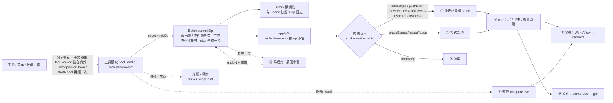

# CatsUp 代码流程图（pipelines）

> created 20261026 by Claude Opus 5.5 · as-of v0.14.70 / 2026-10-26
> 家族规矩（根 CLAUDE.md「代码流程图」节；user 2026-10-26「可以维护一个ai docs讲一下pipeline是什么。然后项目claude.md要求改的时候需要更新。不同操作可以走不同的共用pipeline」「要不pipeline规则升级成家族级别吧 反正就是那种代码流程图」「对，理一下你测的那些性能优化里面每一步都干了啥」）：
> **改流程（新动词 / 新共用流程 / 改某一步 / 新工作流亚种 / 性能改动）同一个 commit 更新这份。** 每一步写：干什么 · 碰多少东西（随**整个模型**涨 = O(N)，还是只随**这次改动**涨 = O(改动)）· 实测。
> 实测口径（下文所有数字）：node / 无头 Chromium，本机；「光滑球」= `tmp` 基准脚本造的 UV 球（1472 / 12096 / 48768 三角，导入成一个组件），挪 / 擦赤道附近一个点 / 一条边。

---

## 0. 总图

---

## 1. 哪个操作走哪条流程（+ 工作流亚种参数）

| op（`src/editor/ops.ts`） | 内核动词 | 流程 | 亚种 / 参数 |
|---|---|---|---|
| `addEdges`（画线 / 矩形 / 圆 / 弧 / 偏移出的线） | `addEdges` | ① 结算（手势边 → 无主胞腔可出生） | `harden`（描过软边变硬，DT90）、`layers` / `curve` |
| `pushpull` | `pushPull` | ① 结算（帽 + 侧壁像） | 帽边不带 `CAP_EXCLUDE`（fold）；被推那块的折线先退回普通边 |
| `move`（挪点 / 挪边 / 挪面） | `moveVertices` | ① 结算（被挪膜的像；不平 → 自动折面） | **`creaseLayers`**：折缝 = 硬线（缺省）/ `["fold"]`（`Mode.workflow.autofold = "fold"` 时 commitOp 统一补上） |
| `followme` | `followMe` | ① 结算（扫掠分片组） | 站环 / 末帽不带 fold |
| `absorb`（复制粘贴 / 移动复制） | `absorb` | ① 结算 | — |
| `transformPool` / `applyScale` / `setAxes`（组件原点） | `transformAll` → `moveVertices` | ① 结算（池里全部顶点） | 镜像变换：`transformAll` 先整体互换两侧（DT8） |
| `mirror`（镜像指令） | `src/editor/mirror.ts mirrorGeometry` → `moveVertices` + `addEdges` | ① 结算 | 删对面 / 消中缝 / 融合阈值（马前炮）；组件 = 负变换实例 |
| `eraseEdges` / `eraseFaces` / `eraseSelection` | `eraseEdges` / `eraseFaces` | ② 擦边裁决 | **橡皮亚种**：`Mode.workflow.eraseNonCoplanar` = `burst`（缺省）/ `fold`（→ `Kernel.foldPlan` 分类：折 = `setEdgeLayers fold`、照常 = `eraseEdges`、非流形 = 拒绝） |
| `setEdgeLayers`（软化 / 硬化 / 折线） | `setEdgeLayer` | 不结算，只改层 → ④ | — |
| `weldEdges` / `explodeCurves` | 曲线登记 | 不结算 | 焊边认回圆（DT88） |
| `makeGroup` / `makeComponent` / `explode` / `copyGroup` | 快照搬家（`extractSnapshot` / `transformSnapshot`）+ ③ 装载 + ① absorb | ③ + ① | 建组件马后炮选原点 |
| `importScene` | ③ 装载（op 带提交前装好的膜） | ③ | 上方向 / 文件单位（马后炮重做） |
| 插件指令 `planar`（老名 `makePlanar`）/ 修复指令 | 规划纯函数（`src/editor/repairs/planar/plan.ts` 等）→ `moveVertices` | ① | 作用域：有选区 = 选区，没选 = 整个物体；含子物体（DT85）。拍平（v0.14.63 DT104）：候选 = 弯折小于阈值的边，硬 / 软 / 折线都算；按候选连成片，**整片每张面和目标平面夹角 ≤ 阈值才拍**，不然当曲面（圆柱侧面）→ 退回只按硬边分片、同样过这关，过不了不拍、报片数 |
| 插件指令 `gridSnap`（吸到格点 DT4 / 拉正 DT101 合租；老名 `snapToGrid`） | 规划纯函数 `src/editor/repairs/grid-snap/plan.ts planGridSnap`（拉正 = 格子坐标里逐根轴：和轴几乎垂直的边两端点这根轴的坐标拉成一样，连成伙取同一个值，范围外的点当锚；圆 / 弧只沿法向那根轴拉平） → 拷贝上试 `moveVertices` → 会破的面先 `addEdges` 三角化对角线 → 真 `moveVertices` | ① | `creaseLayers` = 软边（缺省）/ 硬边；格子 = 物体自己的坐标架（缺省）/ 世界格点；圆 / 弧整条平移（缺省）/ 逐点；还破 = 整步拒绝 |
| 插件指令 `hierarchy`（恢复层级，DT99；老名 `restoreHierarchy`） | 规划纯函数 `src/editor/repairs/hierarchy/plan.ts`（`piecesOf` 连通块 → `classifyShapes` 形状比对：重心对重心 + 两个「离重心距离最少撞车」的点定旋转 + 整件逐点 / 边 / 面 / 层验）→ 场景层搬家（`extractSnapshot` → `mintGroup` / `mintDef` + `mintInstance`）→ 源池 `eraseFaces` / `eraseEdges` | ②（删源块；块是连通分量，碰不到别人） | `dedupe`（形状一样的合成组件，缺省开）、`mirror`（镜像对上的也算一样 = 负变换实例，v0.14.65 缺省开）；坦克全合并 201 块约 0.7 s；含子物体 = 修复逐池跑、**深的池先跑**；菜单只用便宜数法（块数 + 素组数，400 盒 6 ms），真跑 400 盒 141 ms |
| `setDrawFrame`（坐标架）/ `addGuide` / `paintFaces` / `setHidden` / 层表 | 场景字段 / 面层 | 不结算 | `addGuide` 四种：参考线 / 参考点（卷尺 / 量角器）、参考圆 / 参考球（圆规，DT50）；都住池的参考几何层（`scene/guides.ts`），内核零感知，只进「推断 / 吸附」和 ⑦ 渲染 |

**工作流亚种**（`src/editor/mode.ts Mode.workflow`，缺省 = 硬表面 / SketchUp）：同一套代码按工作台分叉，不另抄一份。现在只有两个口：`eraseNonCoplanar`（破 / 折）、`autofold`（硬线 / 折线）。现有三个工作台（物体 / 硬表面建模 / 表面）全用缺省；自由建模工作台（以后）用折线那一支（那边的工具也不叫橡皮，user 10-26）。

---

## ① 像表结算机（`src/kernel/settle.ts`；立宪页 §3）

一句话：**动词不碰图，只交一张像表（「做完以后每张膜长什么样」的多边形）；机器按坐标认领胞腔。** 每一段的计时 = `perf.last["settle.<段>"]`（常开）。

| 段（计时名） | 干什么 | 碰多少 | 实测（4.9 万三角挪一个点；改前 → 现在） |
|---|---|---|---|
| `identity.pre` | 被消耗的膜出库、记旧环边；在**新线段附近**的边上拍「操作前是否二度共线 / 是否裸线」 | O(改动)（空间网格 `edgesNear`） | 0.4 ms |
| `identity.kept` / `identity.bury` | 随葬第一相：被消耗膜的旧环边若不在任何像上、也没有活膜引用 → 现在就删 | O(改动) | ≈ 0 |
| `insert` | 把手势线 / 裸线 / 折缝 / 像的环段插进图（`insertSegment`，sticky 3 µm），记手势边 / 脏边 | O(改动) | 1 ms |
| `planarize` | 只围绕脏边自愈：交叉切开、骑边合并 | O(改动) | 3.5 ms |
| `touched.planes` | 被碰平面 = 像的平面 + 被消耗膜的平面 + **含任一脏边的平面** | **O(平面数)**（扫全部平面；先用「平面穿不穿过脏边包围盒 ± τ」一次判断筛） | 12 → 1.7 ms（v0.14.47 包围盒先筛） |
| `touched.discover` | 从脏顶点上两两相邻的边张出候选平面，登记进平面表（`PlaneRegistry.ensure`） | O(改动) × 登记 | **52 → 0.6 ms**（v0.14.47 平面表按「规范法向 + 距离」分桶，原来每次登记逐条比全部平面） |
| `touched.scope` | 每张被碰平面上这次要用的边集 S（影响域）：① 脏边 + 被消耗膜旧环 ② 沿裸线可达 ③a 像的盒 + 脏边的盒（± 2τ）③b 手势出生胞腔走出整个外环（+ 它的盒）④ 受影响膜的环 ⑤ 双胞平面跨平面认领补边 | O(改动)（不写死尺度，v0.14.46） | 43 → 8–13 ms（v0.14.47：③a 不再罩裸线可达那一大圈——赤道一圈边恰好在 z = 0 上 → 2 m 的盒；⑤ 每张像只查一次盒） |
| `touched`（τ-flatten 轮） | 同一平面组里 3D 相距 (r, 2τ] 的东西投影后相交 / 骑边 → 并成一个，再 planarize + 重算 S，到不动点 | O(改动) | ≈ 1 ms |
| `regions` | 每张被碰平面在 S 上切胞腔（`groupCoplanar` → `findRegions`），清理被碰而没用了的平面 | O(改动) | 8 → 2 ms（v0.14.47 只删被碰的那几张，原来拼全表保留集 + 整表 prune） |
| `identity.rings` | 受影响膜按顶点 id 读环 = 身份像 | O(改动) | 3 ms |
| `claims` | 每张像按绕数认领胞腔（平行 2.6° 内、代表点离像 ≤ τ，认领不到放宽 3τ） | O(像 × 被碰平面的胞腔) | 0.4 ms |
| `decide` | 逐胞腔裁决：有 XOR 参与 = 认领数奇偶，否则 ≥ 1 即填；身份（一对一保 id / DIVIDE / MERGE / BURST / BIRTH）；无主胞腔外环含手势边 = BIRTH | O(改动) | 0.2 ms |
| `faceLinks` | 只给变了的膜重建「边 → 膜」链接 | O(改动) | 0.1 ms |
| `bury` | 随葬第二相：结算后没膜的边只许是用户画的线 | O(改动) | ≈ 0 |
| `dissolve` | ⑪a 新段打层（含折缝 `creaseLayers`）→ ⑩ 因本次操作变成二度共线的顶点并成一条边 | ⑪a 的 `layerSegs` 那一行**扫全部边**（推拉 / 画线才有）；其余 O(改动) | ≈ 0 |
| `layers` | ⑪ 边层 / 曲线清掉删了的边、⑫ 登记新曲线、断弧规则 | O(改动) | **5.6 → 0.01 ms**（v0.14.47 按删除记录增量清，原来扫全部层） |

合计（光滑球挪一个点）：1.2 万三角 0.2 s → **9–14 ms**；4.9 万三角 1.6–1.9 s → **17–38 ms**（v0.14.46 去 1 m 余量 + v0.14.47 上面几段）。
裁判 = 差分 oracle（`test/settle-differential.test.ts`：同一串随机操作，局部机 vs 全局机逐步比；「冂 封口」四个尺度 + 放大档）。

---

**挪点末尾多一步（v0.15.6，FM80）**：本次挪过的顶点的邻边里，软 + 恰两张不同膜 + 两膜同一平面的 → 走 ② 擦边裁决的 MERGE（局部化后 O(被碰平面)），看不见的 180° 软边不留。硬缝不自愈（FM79）。

## ② 擦边裁决（`Kernel.eraseEdges` → `FaceStore.snapshotEraseVerdicts` / `reconcileErase`）

| 步 | 干什么 | 碰多少 |
|---|---|---|
| 曲线展开 | 擦一段 = 整条曲线 | O(改动) |
| 裁决快照 | 每条要擦的边：从它的 faceLinks 取相邻膜（v0.15.4 前扫全部膜），看它在哪个环上 → 外环 = BURST、洞 = ABSORB、同平面两张共享 = MERGE | O(改动) |
| 删边 | `removeEdge` | O(改动) |
| 重算 | **v0.15.4 局部化（Fable 账单 T2，证明 `proofs/20261027-erase-localization.md`）**：只对「并组成员 / 整理膜所在的平面」切胞腔，输入 = 那张平面 τ 内的全部边（一次扫边挑出）；faceLinks 增量维护。v0.15.4 前 = 全部平面重切 | **O(E × 被碰平面数) + O(被碰平面上的边)**（以前 O(模型) 还略超线性） |

实测：光滑球擦一条边（v0.15.4 前）80 三角 14 ms · 350 三角 37 ms · 1472 三角 184 ms · 12096 三角 11 s；**全合并坦克（32220 面 / 48503 边）擦 50 条软边 76 s → 45 ms，200 条 → 76 ms，1 条 45 ms（v0.15.4，local 与 global 面数 / 边数相同）**。剩下随模型涨的只有那一次扫边（48503 条 ≈ 几毫秒）。

---

## ③ 装载 / 导入

- `Kernel.fromBrep(snapshot)`：按存档的路直接装（平面按存储参数精确注册 `PlaneRegistry.restore`，不结算）。打开文件、撤销到快照、op 带装好的膜（`importScene` / 建组件）都走它。
- 外来 glb：`src/format/gltf-import.ts`（glb → 节点树 / 三角，Y-up → Z-up，上方向 / 单位）→ `src/scene/import-build.ts castImport`（共用网格 = 共用定义）→ `src/kernel/from-triangles.ts`（干净的三角走 fromBrep 快路径；骑边 / 交叉 / 同平面盖住的交给 ① 的 absorb 切）。实测：1.2 万三角 ≈ 1.5 s（v0.14.39 起）。

---

## ④ 每步之后（`Kernel.emit`）

1. 事件进日志；面层按事件血缘走（DIVIDE 子膜继承、MERGE 取首个、BURST 清；`FaceLayers.applyEvents`）。
2. **折线卫生**（DT87）：恰好两张不共面的膜，否则退回普通边。O(折线数)。
3. **增量清理**（v0.14.47）：图 / 膜库记删除记录（`drainRemovedEdges` / `drainRemovedFaces`；id 不复用），边层 / 面层 / 曲线只清这批（`pruneIds` / `pruneEdges`）。原来每步全量扫。守卫 = fuzz 的「层不漏」不变量。

---

## ⑤ 拖动预演（`Editor.computeLive`，每帧）

| 步 | 干什么 | 碰多少 | 实测（无头浏览器拖赤道一个点；1.2 万 / 4.9 万三角） |
|---|---|---|---|
| `live.clone` | 当前池的内核整份拷一份（图 + 膜库 + 平面表 + 层 + 曲线） | **O(池)** | 15 / 75 ms |
| `live.run` | 在拷贝上跑这一帧的动词（走 ①） | O(改动) | 25 / 45 ms |
| `liveWorld` | 合成视图：在手里的那份换成拷贝 | O(槽) | — |
| `poolMesh.sync` | 池网格（`editor/pool-mesh.ts`）跟到这一帧的拷贝：沿克隆族谱找原件、并两边的改动日志（`kernel/change-log.ts`）→ 只重建**改过的面 / 边 + 它们顶点周围一圈**（扇内平滑法线会变） | **O(改动)** | 2–13 ms（4.9 万三角）；坦克 0.5–1.4 ms（node，只碰 39 面 55 边） |
| `poolMesh.upload` | 改过的那几段登记成局部上传（`addUpdateRange`，相隔不远的并成一段） | O(改动) | ≈ 0.1 ms |

以前这一行是 `buildKernelGeom`：渲染把拷贝**整池重建几何**，O(池)，4.9 万三角 0.4 s（v0.14.48 修了并查集平方级之后）；v0.14.52 换成上面两行（DT96 渲染那半）。

剩下的（DT96 内核那半，等周二 Fable 审）：内核事务回滚——预演副本每个手势拷一次，每帧回滚上一帧再做这一帧（各表遍历顺序要原样恢复；对拍「回滚 = 没动过」）。现在一帧的大头 = `live.clone` + `live.run`：整份拷内核在全合并坦克（3.2 万面）上 95–166 ms、分件坦克最大的零件（1.1 万面）25–47 ms（node 本机，v0.14.53 之后；渲染那份每帧 ≈ 1 ms）。

---

## ⑥ 马后炮 / 数值小窗（`src/editor/param-panel.ts afterthought` · `Editor.applyVcb`）

- 每个工具落定时 `recordLast(上一步)` → `offerLastAfterthought`：变换类（复制 / 变换中心）、圆 / 弧（段数 + 公差说明行，DT95）、建组件（原点）、导入（上方向 / 单位）、修复（含子物体）、改组件原点（现成位置）。
- 改值 = `undoN(这一步占的操作数)` → 按新值重做 → 重新数操作数；之后又提交别的 / 撤销 = 作废。
- 数值小窗：`undoN(L.ops)` → 按精确值重做；圆 / 弧的重画（`redrawCircle` / `redrawArc`）和段数马后炮共用。

## ⑦ 渲染（`src/scene/world-view.ts` → `src/editor/render3.ts`；v0.17.5 起 render3 本体 = `src/minccino/backend/three/render3.ts`，编辑器那个文件只是转出口）

- WorldView：每个池（根 / 组 / 组件定义）一个「部分」，按 `kernel.rev` 缓存；每份实例一个槽 = 一个矩阵（同一个定义的几份共享几何）。软边 / 平滑边 / 折线集合在部分里。
- render3：每个池一份**池网格**（`editor/pool-mesh.ts`，v0.14.52 / DT96），每槽一个矩阵；选中 / 悬停 = 覆盖层；轮廓线判定在着色器（`profile-edges.ts` 的 GLSL 镜像）；小三轴（选中组件 / 空组件 / 淡的组件原点）共用一个画法。
- **v0.17.3 起（Tron 第一刀步 3，Claude Fable 5.1）：⑦ 切成两半**——编辑器 `draw()` → `provider.setWorld(view, dimSlots)` → render3 `syncPools()` **拉**一帧流（`EditorStreamProvider.pull`：每槽一个放置 + 每份池网格的块，块直接包 pool-mesh 的大数组、带 `dirty` 段和全局单调版本号）→ `uploadFaces / uploadLines`（版本没变不碰显卡；数组换过 / 长大了重建；否则只传改过的段）→ 槽节点。池网格本体、同一帧同一内核只同步一次、两代释放全在提供者；render3 只剩显卡副本（`chunkGpus`）。每步碰多少东西不变（只随这次改动涨）；截图基线 11 张 0 像素差。契约 = `src/minccino/contract/stream.ts`。
- **v0.17.6 起（步 6a）：叠加层的线段族也切成两半**——编辑器 `overlay-lines.ts` 按 ViewState 算线段 + 线性颜色 + 缓存键（内容），引擎经 `OverlayCtx` 给量尺（一像素多长 / 视野多远 / 相机三轴），后端 `overlay-lines.ts` 按 `LINE_STYLES` 画；key 没变不重建。点 / 标记 / 文字 / 选中高亮还在 render3（6b / 6c）。
  - 池网格 = 每张面的三角（+ 扇内平滑法线 + 两侧颜色）、每条看得见的边，直接写进几张大数组（不留 JS 记录；每张面只记环边编号 + 在哪段）：面按块分区（块起点 / 容量对齐 3 = 显卡按三个顶点一个三角读；删了清零 = 退化三角；洞多了字节原样往前搬），线永远挤紧（删一条 = 最后一条搬过来）。位置 32 位浮点、法线 16 位、面颜色 8 位（归一化整数）；全量建完收紧容量。显卡缓冲直接包这些数组，改过哪段传哪段。坦克：缓存 JS 堆 16 MB、显卡数组 5.3 MB。
  - 跟哪个内核：原件 / 预演拷贝 / 撤销快照之间按「克隆族谱 + 改动日志」算差（`diffTo`）；族谱断了、日志说不知道（装载 `fromBrep` 之后）、线稿风格变了、材质槽表不是一边前缀另一边 = 全量（坦克 0.4 s）。
  - 改动日志（`kernel/change-log.ts`）：顶点 / 边 / 膜表和层的集合都换成带记账的 Map / Set，原地改坐标 / 端点 / 环的几处显式记；日志本体 = 一张 Int32Array（一条 4 字节，上限 6.5 万条，多了丢前一半）；
    族谱 = 拷贝 fork 时记「祖先日志的数据 + 分叉那号」最多 16 代，**不引用内核**（v0.14.53；以前的 WeakRef 让导入修复一口气拷的几百份内核在这段同步代码跑完前全放不掉，炮塔零件峰值 770 MB）；守卫 = `test/change-log.test.ts`（变了的都记、没变的不记）+ `test/pool-mesh.test.ts`（增量 = 全量）+ 探针 `probe-pool-mesh.mjs`（逐像素 = 全量、每步都没退回全量）。
  - 淡出（上下文之外）= 同一份几何换一套颜色缓冲（不再是几何变体）。
  - X 光（v0.14.57，DT17）：每个槽的线多挂一份「不做深度测试、35% 不透明」的对象，共用同一份线几何；覆盖层（选中 / 悬停 / 检查）换不做深度测试的材质。拾取：选择工具调 `pickEntity` 时 `xray` = 跳过点 / 边的遮挡判定。
- 不画：软边、折线、隐藏的边。明暗：每个顶点处按硬边分扇、扇内按内角加权（`fanNormal`；硬边在平滑组里也断开）；跨平滑边和折线连续。导出 bake（`smoothNormalsOf`）同一个算法，`test/smooth-normals.test.ts` 对拍「导出的 = 屏幕上的」。

## ⑧ 修复指令（`Editor.repair(kind, scope)`）

> **v0.15.9（2026-10-27 夜，Claude Fable 5.1）**：修复指令改从**指令注册表**取（`src/editor/commands/registry.ts`：`commandById` / `actionById` / `placementsAt`；修复一族的清单 = `repairs/index.ts`，含面板步骤表 `REPAIR_STEPS`）。流程的每一步没变（规划 → 估时 → 提交 → 马后炮），只是「哪条指令」从 `REPAIRS` 数组查改成注册表查，id 从 `weld` 变 `brep.weld`（插件 op 的名字不变，老复现包照开）。浮条上的修复入口 = 放置表 `contextBar` 面上的动作。

**模块化（v0.14.66，user 10-26「这些修复的东西即使可能代码量不大，但是也做成可以扔的模块化的，最好是各种命令都这样」）**：一个修复 = `src/editor/repairs/` 里一个模块（规划 + 参数 + 文案 + 菜单 + 自己那条插件指令的执行），清单 = `repairs/index.ts`（顺序 = 面板里跑的顺序：拉正 → 吸格点 → 清理碎渣 → 焊断口 → 拍平 → 软边变硬 → 补洞 → 改段数 → 恢复层级；改段数 v0.14.69 = 插件指令 `resegment`：现场认回转体（曲线登记的圆 / 网格里的正多边形硬边环）→ 按新段数造快照 → `eraseFaces` + `absorbSnapshot` → 删掉粘的时候多长出来的圈内圆盘；清理碎渣 v0.14.68 = 插件指令 `cleanup` 执行时按顺序再规划（擦悬空线 → 并短边〔拷贝上试、破面整步撤回〕→ 擦同平面硬内线），擦面和面之间的线很慢——坦克实测 `reconcileErase` 每调一次约 95 s、和擦几条几乎无关（50 条 97 s / 800 条 138 s，99% 在 reconcile；周账 F-97 ①）；**v0.14.70 起不为性能跳过**（user「不要因为性能静默不做，宁愿弹警告问yes no。诚实性问题」）：模块报 `erases`，框架按面数平方估时（坦克 3.2 万面 = 95 s 作标尺），≥ 5 s 先弹应用内确认框（做 / 不做；不做照实报），马后炮重做不再问；补洞 v0.14.67 = 只挂一张面的边围成的简单平面环、环外的面不同平面 → 沿环重描走核心 `addEdges`、结算机长面）；编辑器 / 修复面板 / 编辑条照清单遍历，指令层只有插件注册表（`registerOpPlugin`），老指令名在 `ops.ts normalizeLegacy` 里认成插件重放。守卫 `test/repairs-modular.test.ts`：核心只 import 清单和接口、模块只被清单 import。扔一个 = 删它的文件 + 清单一行。

（v0.14.64 加第五种：恢复层级，面板里排最后、默认不勾——它把几何搬进新组，前面几步按池跑，先搬了它们就看不到。）`repairScope`（有选区 = 选区，没选 = 当前物体；含子物体：组件按定义只修一次、锁着的跳过；每个池带「到当前上下文的变换」给世界格点用）→ `repairPlan`（焊断口 / 拍平 / 折得厉害的软边变硬 / 吸到格点）→ 提交（一步）→ 马后炮（含子物体 / 阈值 / 格子 / 坐标架 / 折缝 / 圆弧）。

修复面板（v0.14.56，DT6 + DT9）：编辑条「修复…」→ 右下角马前炮（含子物体 / 检查 / 四步勾选；说明行按现在的样子数每步会碰几处 + 微折软边条数）→ 应用 = 同一步里按固定顺序 吸格点 → 焊断口 → 拍平 → 软边变硬，每步按前一步做完的样子重新规划（`runRepair`，和单条指令共用）→ 马后炮改勾选重做。「检查」= 范围里弯折 ≤ 1° 的软边（折线不算），面板开着时作为 `warnEdges` 进覆盖层画橙色。四步里没有一步修微折软边（拍平从来不碰软边，DT7 拍的）——检查只负责标出来。

吸到格点（v0.14.55）每一步：规划 O(范围里的点)；拷贝上试一遍 = 整份拷池（O(池)，一次性指令不在热路径）；三角化只对会破的面。实测（node）：斜面上随机多边形吸 10 cm 格子，60 个里 58 个不退路就会破（自动折面折不平多边形），三角化退路全救回。

## 推断 / 吸附（`src/editor/solver.ts snapPoint`，悬停和落点每次都走）

一句话：**光标附近长出一堆「约束」（点 / 线 / 面，各带秩和吸附半径），挑选器按秩 → 屏距裁决，两条 1-D 约束可以合成交点。** 每段计时 = `perf.last["snap.<段>"]`（常开）。

| 段 | 干什么 | 碰多少 |
|---|---|---|
| `vertices` | 光标附近的端点（屏幕索引给超集） | O(附近) |
| `edgeTargets` / `nearSeg` / `edges` | 附近的边：线上 / 中点 / 圆心 / 延长线（充能边）… | O(附近) |
| `guides` | 参考线（1-D）/ 参考点（0-D） | O(参考几何) |
| `carriers` | 轴线、对齐线、充能边延长线；两两交点 | O(附近) |
| `guideCurves` | **参考圆 / 参考球（v0.14.62，DT50）**：弯的不进 1-D 合成器，每次只在光标附近产 0-D 点——圆上离光标最近的点、圆 × 参考线 / 附近的边 / 共面的圆、球 ∩ 画图平面那一圈上最近的点、球 × 参考线 / 边、射线先碰到的球面点（秩只比画图平面高一点；在球里面不产）。几何 = `guide-curves.ts` 纯函数 | O(圆球数 ×（参考线 + 附近边）) |
| `nearFace` / `cross` | 附近的面、面 × 面交线 | O(附近) |
| `solve` | 裁决（`solvePoint`）：ε 内的 0-D 候选才做遮挡判定（懒） | O(候选) |

- 吸附半径（`EPS`，基准 8 px 等比缩放）：点 10 / 边 7 / 参考线和参考圆 3.5 / 合成 12。参考圆和参考线同一档（窄，免得画别的东西时老被拽过去）。
- 落点之后编辑器还有一层迟滞（`Editor.applyHysteresis`）：上一帧吸住的，光标在 1.5 倍半径内继续吸住（进窄出宽）。

## ⑨ 文件（`src/format/`）

写：Scene → `scene-doc.ts documentFromScene` → `CatsupDocument` → `write.ts`（`CATSUP_*` 扩展按拍子写 + bake 出别的软件看的网格）→ glb。读：glb → `read.ts` → `migrate/`（每个子结构自己的拍子，`FORMAT` = 唯一 SSoT）→ document → Scene。演示锁住 `CATSUP_desk.locked`（v0.16.53；老 `final / finalRev` 照读照写不起作用）。**加密**（v0.16.55）：图库打开前 `file.isEncrypted()` → `unlock.ts ensureUnlocked`（busy 外弹口令、验尾部 peek）→ `file.open()` 透明解壳；保存时锁着（内存没口令）= 如实拒、改动留内存；加密 / 解除 = `file.encrypt / decrypt`（库：先本地后云 If-Match）。加可选键 = 该子结构 minor +1 + 冻结样本（`scripts/freeze-format-fixtures.mjs`）。

---

## 剩下的随整个模型涨的点（按严重度）

1. ~~**擦边重算全部平面**（② 最后一步）：1.2 万三角擦一条边 11 s。~~ **v0.15.4 局部化，坦克 76 s → 45 ms**；剩一次 O(E) 扫边挑被碰平面上的边。
2. **预演整池拷贝**（⑤ `live.clone`）：4.9 万三角每帧 60–115 ms（渲染那半 v0.14.52 已改成只碰改过的；拷贝那半 = 内核事务回滚，等 Fable 审）。
3. 结算 `touched.planes` 扫全部平面（已用包围盒先筛）：全合并坦克（1.35 万平面）每步 1–3 ms。彻底去掉要给平面加空间索引（多占内存、要维护）——v0.14.58 没加，交 Fable 审（家族周账 F-97½）。`⑪a layerSegs` v0.14.58 改成只看新段附近的边（空间网格），不再扫全部边。同一次量到的推拉大头 = `touched.scope`（影响域：被碰平面上的面）20–33 ms，不是扫全图，但也交 Fable 一起看。
4. OBJ 导入不认折线（Blender 来的不平 n-gon 现在只收边段）。

并到 DT92「初中」（WASM / 数据布局）还是先做，等 user 定。

## 追记 2026-10-27 夜（v0.15.10，Claude Fable 5.1）：mesh 池进渲染 / 拾取 / 吸附

渲染（⑦）和合成视图 / 拾取 / 吸附读内核的那一步改成只认契约 `scene/kernel-view.ts`：`Scene.viewOf(pool)` 派发——brep 池给内核本身（零改动），mesh 池给 `mesh/mesh-view.ts` 的派生视图（表按 rev 缓存 O(n)、改动日志是内核自己的 → 渲染缓存对 mesh 也是增量：挪一个点只重建它周围 3 张面，测过）。mesh 池的渲染多一个分叉：单面 → FrontSide 材质（剔背面）。随模型涨的新点：mesh 视图的派生表重算 O(mesh 大小)（每次 rev 变一次；增量重算 = 以后）。

## 追记 2026-10-27 夜（v0.15.11，Claude Fable 5.1）：文件流程的网格体分叉

保存：mesh 定义 → `meshDocFromKernel`（去空位重编，O(mesh)）→ `encodeMeshItem`（八个 bufferView）+ `bakeMesh`（三角化 O(面数)，给别的查看器）。打开：`decodeMeshItem`（拍子 → 多边形；没 faceStart = 老三角汤 → 每三角一面）→ `kernelFromMeshDoc`（addVertex / addFace O(mesh)；坏环拒开）。brep 定义的那条流程一字没动。

## 追记 2026-10-27 夜（v0.15.12，Claude Fable 5.1）：导入 → 网格体；转换指令

导入（⑨ 文件 / 导入那条）：`castImport` 不再三角形 → 膜，而是每三角一张网格面 + 按角度软 / 平滑（O(三角数)，不再过结算机 = 导入快了）；op 载荷 = 网格载荷；老复现包带膜的照装。新流程「转换」：选中组件 → 物体族指令规划 `castDefinition` → 一步提交；mesh → brep 走 `kernelFromTriangles`（O(三角数)，约 9000 三角 / 秒）+ 共面软边擦边 MERGE（局部化，O(影响域)）；brep → mesh O(面数)。

## 追记 2026-10-27 夜（v0.15.14，Claude Fable 5.1）：预演流程「每帧拷内核」那一步换了

预演（⑤）：以前每帧 `kernel.clone()`（随整个模型涨：9600 膜 66 ms）→ 现在 `Editor.shadowKernel()`：第一帧拷一次，之后每帧 `shadow.rewindTo(真身, mark)`（随上一帧改动量涨：挪一个点 0.32 ms）再跑动词。真身的 rev 变了（提交 / 撤销）或日志丢段 / 全局结算模式 → 重新拷。还随整个模型涨的点：第一帧的那一次 clone。

## 追记 2026-10-27 夜（v0.15.15，Claude Fable 5.1）：提交 / 撤销流程换底子

提交（⑥ 每步之后那条）：以前 = 在真身上 applyOp + 每 8 条整场景 clone。现在 = 拷这个池的内核一份当影子（O(池)）→ op 在影子上跑 → `swapTablesWith`（O(1)）→ `deltaAgainst` 抽触碰集（O(触碰)）→ 记录进栈（+ 一份骨架 O(定义 + 实例)）。结构型 op（建组 / 建组件 / 炸开 / 导入）整份 clone（O(模型)，少见）。撤销 / 重做：差量交换 O(触碰) + 骨架换对象；不再重放。选区变化：0 条 op 的一步。还随整个模型涨的点：提交时那一次拷池（列式后收口）、结构型 op 的整份拷。

## 追记 2026-10-27 夜（v0.15.16，Claude Fable 5.1）：动作路由那条流程 + 网格体的提交记录

- **新共用流程「动作 → 指令调用」**（`Editor.runAction`）：动作 id → 路由表（每种单位一条指令）→ `unitsOf(kind)`（brep / mesh = 活动池 + 几何选区，O(选区)；object = 选中的实例，O(选中数)；perDefinition 的按定义去重）→ 每个单位 `plan`（O(单位的选区)）→ 全部 op 合成一步提交 → 提示 = 各指令的 done 连起来 + 跳过的种类。亚种：只路由 brep 一种 → 修复那条路（作用域 / 含子物体 / 擦线估时）；只路由 object 一种 → 物体那条路（估时 / 去重）。
- **mesh 族的提交**（⑥ 每步之后）：`meshMove` → 拷网格体内核（O(网格)，类型数组）→ 在影子上写位置数组（O(挪的点)）→ swapWith O(1) → 记录 = 旧表；撤销 = 整表互换 O(1)。
- **选区步的记录点变了**：以前在 afterSelect（步深 0 才记）；现在在 step() 结束（没 op 的步才记）——点选 / 框选一次 = 一步 0 op 记录，O(选区) 的快照。
- **进网格体池**：`enterPool` 多一次 KindDef.modes 查表（O(1)）+ 切工作台；选择的点击族在非 brep 池走 `selectExpandView`（KernelView：一下 O(1)、两下 O(环)、三下 O(连通块)）。

## 追记 2026-10-27 深夜（v0.15.17，Claude Opus 5.5）：自由建模工作台的取量型工具（挪 / 转 / 缩 / 拉）

- **预演**（⑤ 那条的网格体亚种）：工具的 `liveMesh` → 编辑器拷一份活动网格体内核（O(网格)，类型数组）→ 在拷贝上跑同一条 op 的算子（挪 / 转 / 缩 = 写 O(目标点) 个坐标；拉 = 挤出 O(区域) + 平移新点）→ `meshViewOf(拷贝)` 当活动槽画（视图派生表按 rev 重算 O(网格)）。brep 那条（影子 + 倒带）不动。
- **提交**：一条 `meshMove` / `meshExtrude` → 撤销记录 = 网格体整表互换（v0.15.16 那条）。拉在提交前先在副本上跑一遍拿新 id（确定性：同一份内核 + 同一组参数 = 同一批 id），提交后用 `ToolCtx.setSelection` 把新几何放进选区。
- 拖动量在「过轴心、垂直视线的平面」上量；锁轴 = 投影（不用 `applyLock` 那条射线–轴线最近点，那条在轴贴近视线时会暴涨）。
- 还随整个模型涨的点：每帧拷整份网格（几千面以内毫秒级；大网格要倒带版，同 brep O1）。工具定义表 = `ai-docs/20261027-freeform-tools.md`。

## 追记 2026-10-27 深夜（v0.15.19，Claude Opus 5.5）：预演的合成视图缓存键加影子 rev；网格 rev 全局时钟

- ⑤ 预演：合成视图（`Editor.worldView`）按「编辑器版本 | 影子身份 | 上下文 | 叠加 | 格子 | 隔离」缓存；v0.15.14 起 brep 影子同一对象每帧倒回复用 → 键里加**影子的 rev**（每帧倒回 + 跑动词都是新号）。不加 = 拖动中一直拿第一帧的视图、渲染器的重建键（视图身份 + 版本）也不变 → 屏幕停在旧帧（user「拖动矩形的时候显示也不对」）。网格体预演每帧新拷一份，身份本来就变。
- 网格内核的 rev 改成全局递增（和 brep 的 revClock 同）：撤销整表互换后再做不会撞旧号，按 (内核, rev) 缓存的视图 / 合成视图 / 渲染不会给旧几何。
- 渲染缓存（`pool-mesh.ts`）：差从「画那一刻存下来的日志族谱」算，不再事后读 src.changes（提交 / 撤销会在内核对象之间整份换日志）。

## 追记 2026-10-27 深夜（v0.15.25，Claude Opus 5.5）：菜单指令带马后炮；改原点的撤销记录

- 「动作 → 指令调用」（`Editor.runAction`）两处改：① **单位只取一次**（`unitsFor` 在步开始时算好，马后炮按新参数重做时用同一批——上一次做完的选区已经换成结果了）；② **从菜单点的、只路由到一条、带参数的指令自动给马后炮**（⑥ 那条：`undoN` 刚才的几条 → 按新参数再 `plan` + 提交）；带参数调用（api / 搜索）不开界面。指令的默认值可以看这次的单位（`Command.defaults(env, units)`；插入的宽度 = 最小面上限的五分之一，O(选中面的边数)）。
- 新指令：`mesh.inset`（右键面 → 插入；`meshInset`，O(选中面的点)）、`mesh.originToSelection`（右键 → 设置原点到选择中心；一条 `setAxes`）。
- `setAxes` 落在定义根上（换组件 / 网格体的原点）：内核层 `retransformDefinition` 多一个网格体分支（每个点乘 M⁻¹，O(网格的点)；每份实例补 M，O(场景实例数)）；**撤销记录从骨架改成整份场景拷**（O(整个场景)，少见操作）——骨架记录共享内核，撤销只换回实例矩阵、几何留在挪过的地方 = 世界里错位（v0.15.15 起的 bug，测试 `test/draw-frame.test.ts` 钉住）。还随整个模型涨的点：这一条的撤销记录（整份拷）；要省就给它做「定义换坐标」的专用自反记录（只记 M）。
- 右键「新建」只在自由建模；硬表面那条「新网格体组件」流程（op `addMeshObject`）撤了。

## 追记 2026-10-28（v0.15.33–34，Claude Opus 5.5）：网格体的默认平滑 + 导出法向

- **「这条边平滑吗 / 画线吗」只问一处** `mesh/edge-smooth.ts`（`edgeSmooth` / `edgeSoft`）：手标优先，没手标的按网格体的「默认平滑」（按角度 / 全部平滑 / 全部是棱）。读它的：`mesh/mesh-view.ts` 的软 / 平滑表（→ 渲染、拾取、吸附）、`bakeMesh`（导出的线和法向）、`scene/kinds.ts` 转换、`import-build.ts` 导入。改默认平滑 = `MeshKernel.setSmoothDefault`：所有边和面记进改动日志、rev 涨 → 视图表重算 O(mesh)，渲染整池重建一次（不是每帧）。
- **导出（⑨ 保存的 bake 那半）**：`bakeMesh` 改成「内核 → 视图 → 每个材质一组」：三角化走 `triangulateFace`（按面自己的绕向，v0.15.33 修一半三角朝里）；每个角的法向 = 渲染同一个分扇函数（`scene/fan-normal.ts`，棱两侧分开、平滑区共用），角按「顶点 + 量化法向」去重 → 每组自己的 POSITION + NORMAL；线 = 画线的边（不平滑的 + 裸线，隐藏的不出）。O(角数)，随这个网格体的大小涨（保存时一次）。
- **右键「手标 ›」「默认平滑 ›」** = 注册表 mesh 族指令 → op `meshEdgeMarks` / `meshSmoothDefault` → 走网格体那条撤销记录（自反交换，O(这个网格体)）。挤出面的帽子 / 区域内部的新边带原来的手标（`extrudeFaces` inheritMarks），插入不带；溶解二度点并出来的边手标取交集。
- **自由建模显示**：正在编辑的网格体的平滑边 = 一层淡线（`render3 softEdges`，键 = 合成视图身份，几何变了才重建，O(这个网格体的边)）；拾取对这个池放开平滑边（`softActive`）。

## 追记 2026-10-28（v0.15.37，Claude Opus 5.5）：倒角

- **倒角** = 网格体 op `meshBevel` / `meshBevelVerts` → `mesh/ops/bevel.ts`：先按原位置算全部新点（每个端点绕一圈排角，O(端点的度)）、再一次性改受影响的面的环、补倒角带和角上的补片、删掉没边的老点。碰的东西 = 倒的边两端那些点的一圈面（随这次改动涨，不随整个网格涨）；撤销走网格体那条记录（自反交换，O(这个网格体)）。
- 入口三个、同一条 op：右键指令（`mesh-edits/` 规划时在副本上倒一遍拿新面 id、算夹宽，带马后炮）/ 插入那一格拖（预演每帧在影子上倒一遍）/ Ctrl+B 键盘起手（同一个工具）。
- 拾取：自由建模点的半径常量（`MESH_VERT_HIT_PX`），挤出 / 插入没选区时只认面（`pickFace`，射线最近的面，O(光标附近的面)）。

## 追记 2026-10-28（v0.15.38，Claude Opus 5.5）：网格体镜像

- **镜像编辑** = 提交口（`Editor.commitIn`）改写 `meshMove`：配对（空间散列，O(这个网格体)）→ 对面的点补进同一条 op（进日志的是改写后的 = 重放一致）。预演：影子上同一道（每帧 O(这个网格体)）。
- **强行对称** = 提交口在这条 op 之后、同一步里补 `meshSymmetrize`：先拷一份「之前」判动了哪边（O(网格体)）→ 已经对称就不补（不乱换另一半的 id）→ 否则删另一半、镜回来（O(网格体)）。撤销一下 = 两条一起撤。随整个网格体涨：每一步一次 O(网格体)，网格大了再说。
- **护栏**：镜像编辑开着、要提交改拓扑的 op → 工具提交口挡下（这一下工具自己的提示 / 选区不作数）→ 应用内确认 → 关掉镜像、新的一步提交同一条 op。右键指令 / 删除在入口问。

## 追记 2026-10-28（v0.15.39，Claude Opus 5.5）：细分

- **细分** = 网格体 op `meshSubdivide` → `mesh/ops/subdivide.ts catmullClark`：先读出全部新点（面点 / 边点 / 点）和新面，再清空、按「点 → 边点 → 面点」的顺序加回来（id 全重编，改动日志照常记）。O(角数)，随整个网格体涨，每次 × 4；面数估到 20 万以上先问（指令的 estimate）。撤销走网格体那条记录。
- 网格体指令的单位：没选区 = 整个网格体（sel = null），指令自己决定要不要选区。

## 追记 2026-10-28 晚（v0.16.5，Claude Fable 5.1）：挪点在镜像下的纪律（设计稿 `20261028-mirror-redo-design.md`；账本 UX31）

- **提交口 `Editor.commitIn` 改写 `meshMove`，两种模式都走**（以前只有镜像编辑改写、强行对称不碰）：`mesh/mirror.ts mirrorMoves(m, moves, axis, mode)` 按挪之前的位置分边 → R1 中缝上的点钉回镜像面 → R3 想穿过去的夹在面上 → R2 落到中缝的点和孪生点（+ 落点处本来就有的中缝点）并成一个 → 镜像编辑另外补对面的点。碰多少东西：配对 O(这个网格体的点)，其余 O(挪的点)。
- **并点 = 同一步里紧跟的 `meshMerge`**（op 加了可选 `to`：并到落点，不是中心），`mirrorMerging` 旗让这几条不各自触发对称化；然后才是整步最后那一次 `meshSymmetrize`（强行对称）。撤销一下 = 挪 + 并 + 对称化全回。
- **预演同一道**（`mirrorPreview`）：影子内核上做同一套钉 / 夹 / 并（`mergeVerts` 在影子上），拖到中缝眼睛看到的就是并好的样子；松手前拖回去 = 影子从真身重算、自然分开。
- **对称化多一步 R4**（`symmetrize` → `removeSeamWalls`）：整张躺在镜像面上、每条边都夹在 ≥ 3 张面之间的面（镜完变成夹层）删掉；孤零零躺在镜像面上的平面不碰。`sideOfChange` 挪到中缝上的点按它来的那一边投票（不然对称化会把这一边删了）。
- **披露**：并了几处 / 夹住几个 / 对面找不到几个进提示行；工具拖动那条路在步结束（`closeStep`）补一条。
- 已知边角（设计稿 §5.5）：落在中缝一条边的中间（不在点上）这版不劈那条边，面会捏一下。

## 追记 2026-10-28 晚（v0.16.6，Claude Fable 5.1）：对称属性进文件

- 「对称」（镜像编辑 / 强行对称 + 镜像面）= `Scene.meshMirrors`（按定义 id；克隆共享 = 不进撤销）→ 写文件时进 mesh 项 `mirror`（`CATSUP_mesh` 1.1 → 1.2，可选键；老读者提示一次照开）→ 读回来填表。改设置 = `Editor._revision++`（存盘钮亮）。碰多少东西：O(网格体定义数)。

## 追记 2026-10-28 晚（v0.16.8，Claude Opus 5.5）：⑨ 文件分成「工程」和「模型」两条（导出设计稿 `20261028-export-design.md`；账本 UX39）

- **工程**（保存 / 另存 / ☰「导出工程文件」）= 同一条：`Session.encode()` → `writeCatsup`，后缀 **`.catsup`**（老 `.glb` 工程照开、改名保留后缀；认工程靠内容 `CATSUP_document`）。「导出工程文件」= `encode()` 逐字下载，永不清脏。碰多少东西：照旧（随整个模型）。
- **模型**（☰「导出模型…」模态 sheet → glb）= `writeGltfModel(doc, { textures, lines, only? })`：只写 glTF 2.0 core——只烤够得着的定义（整个模型 = 从根往下；选中的物体 = 从那几份往下）、节点树、材质（贴图可关）、LINES 可关；不写 `CATSUP_*` / 缩略图 / 参考牌组 / 携带键 / B-rep 流。bake 加 `BakeOptions.lines`。碰多少东西：随导出范围。OBJ 照旧走 `obj-io.ts`（整个模型）。
- 名字：`src/app/doc-names.ts`（`docSuffixOf` / `bareName` / `fullName(dir, stem, ext = .catsup)`）；云库种类表两行同一个 kind（`.catsup` 新、`.glb` 老，`app-store.ts DOC_KINDS`）；新名字查占用时同主干的 `.glb` 也算（不造双胞胎）。

## 追记 2026-10-28 晚（v0.16.9，Claude Opus 5.5）：放置表吃左柱和 ☰

- 左柱 / ☰ 的「放哪、第几」= `src/controller/placement.ts` 一张表（纯数据，node 直测）；`main.ts renderSlots` / ☰ 的 `items` 按表画、`menuRow(id)` 给每行长相。每次渲染 O(表长)，和以前一样。注册表的放置面加了「谁画」的登记（`SURFACE_RENDERERS`）。

## 追记 2026-10-28 晚（v0.16.10，Claude Opus 5.5）：自由建模按下三分法

- 「按下作用在什么上」（`tools/selecting.ts pressTarget`）多一次按下处拾取（有选区时也拾，O(1) 一次 pick）+ 「在不在选区上」判定（O(选中面的点 / 边)）；换选区不在按下时做，挪到三把工具的落定里（`adoptPress` → 同一步里先换选区再 commitOp）。

## 追记 2026-10-28 晚（v0.16.11，Claude Opus 5.5）：套索

- 框选那条路的命中换成「区域」（`marquee.ts ScreenArea` = 框 | 套索，`areaTest`）：每个顶点投影一次 + 区域判断（框 O(1)、套索 O(轨迹点数)，轨迹 3 px 一个点）；遮挡判定同框选。随模型涨的点没变（还是全体顶点投影一遍）。

## 追记 2026-10-29（v0.16.49，Claude Opus 5.5）：软编辑笔刷

- **走哪条**：⑤ 预演的网格体亚种（`liveMesh` → 拷活动网格体 → 写位置数组）+ ⑥ 提交 `meshMove`（和挪 / 转 / 缩同一条，镜像编辑在提交口改写）。笔刷自己只管「这一笔碰了哪些点、现在在哪」（`MeshBrushTool.stroke.pos`）。
- **每一下（dab）**：打光标下的面（拾取 O(屏幕索引那一格) + 那张面扇形三角求交）→ 半径里的点（**扫整个网格体 O(V)**，按现在的位置量）→ 按种类算新位置（鼓起 / 压平要点的法向 = 连着的面 Newell，O(邻面)；抹平要邻接表，第一下建一次 O(E)）。一次拖动事件按 ¼ 半径的间距可能刷好几下。
- **还随整个模型涨的点**：每一下扫全部点找半径里的（O(V)）；每帧预演拷整个网格体（O(V)）。几千点无感；上万点再按屏幕 / 空间索引筛（先量再优）。
