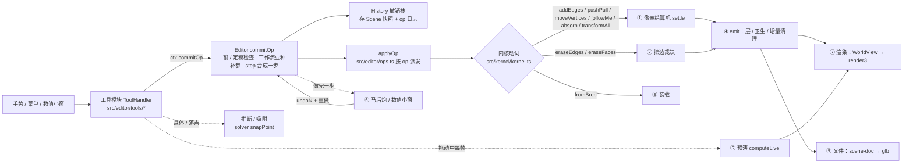

# CatsUp 代码流程图（pipelines）

> created 20261026 by Claude Opus 5.5 · as-of v0.14.63 / 2026-10-26
> 家族规矩（根 CLAUDE.md「代码流程图」节；user 2026-10-26「可以维护一个ai docs讲一下pipeline是什么。然后项目claude.md要求改的时候需要更新。不同操作可以走不同的共用pipeline」「要不pipeline规则升级成家族级别吧 反正就是那种代码流程图」「对，理一下你测的那些性能优化里面每一步都干了啥」）：
> **改流程（新动词 / 新共用流程 / 改某一步 / 新工作流亚种 / 性能改动）同一个 commit 更新这份。** 每一步写：干什么 · 碰多少东西（随**整个模型**涨 = O(N)，还是只随**这次改动**涨 = O(改动)）· 实测。
> 实测口径（下文所有数字）：node / 无头 Chromium，本机；「光滑球」= `tmp` 基准脚本造的 UV 球（1472 / 12096 / 48768 三角，导入成一个组件），挪 / 擦赤道附近一个点 / 一条边。

---

## 0. 总图

---

## 1. 哪个操作走哪条流程（+ 工作流亚种参数）

| op（`src/editor/ops.ts`） | 内核动词 | 流程 | 亚种 / 参数 |
|---|---|---|---|
| `addEdges`（画线 / 矩形 / 圆 / 弧 / 偏移出的线） | `addEdges` | ① 结算（手势边 → 无主胞腔可出生） | `harden`（描过软边变硬，DT90）、`layers` / `curve` |
| `pushpull` | `pushPull` | ① 结算（帽 + 侧壁像） | 帽边不带 `CAP_EXCLUDE`（fold）；被推那块的折线先退回普通边 |
| `move`（挪点 / 挪边 / 挪面） | `moveVertices` | ① 结算（被挪膜的像；不平 → 自动折面） | **`creaseLayers`**：折缝 = 硬线（缺省）/ `["fold"]`（`Mode.workflow.autofold = "fold"` 时 commitOp 统一补上） |
| `followme` | `followMe` | ① 结算（扫掠分片组） | 站环 / 末帽不带 fold |
| `absorb`（复制粘贴 / 移动复制） | `absorb` | ① 结算 | — |
| `transformPool` / `applyScale` / `setAxes`（组件原点） | `transformAll` → `moveVertices` | ① 结算（池里全部顶点） | 镜像变换：`transformAll` 先整体互换两侧（DT8） |
| `mirror`（镜像指令） | `src/editor/mirror.ts mirrorGeometry` → `moveVertices` + `addEdges` | ① 结算 | 删对面 / 消中缝 / 融合阈值（马前炮）；组件 = 负变换实例 |
| `eraseEdges` / `eraseFaces` / `eraseSelection` | `eraseEdges` / `eraseFaces` | ② 擦边裁决 | **橡皮亚种**：`Mode.workflow.eraseNonCoplanar` = `burst`（缺省）/ `fold`（→ `Kernel.foldPlan` 分类：折 = `setEdgeLayers fold`、照常 = `eraseEdges`、非流形 = 拒绝） |
| `setEdgeLayers`（软化 / 硬化 / 折线） | `setEdgeLayer` | 不结算，只改层 → ④ | — |
| `weldEdges` / `explodeCurves` | 曲线登记 | 不结算 | 焊边认回圆（DT88） |
| `makeGroup` / `makeComponent` / `explode` / `copyGroup` | 快照搬家（`extractSnapshot` / `transformSnapshot`）+ ③ 装载 + ① absorb | ③ + ① | 建组件马后炮选原点 |
| `importScene` | ③ 装载（op 带提交前装好的膜） | ③ | 上方向 / 文件单位（马后炮重做） |
| `makePlanar` / 修复指令 | 规划纯函数（`src/editor/planar.ts` 等）→ `moveVertices` | ① | 作用域：有选区 = 选区，没选 = 整个物体；含子物体（DT85）。拍平（v0.14.63 DT104）：候选 = 弯折小于阈值的边，硬 / 软 / 折线都算；按候选连成片，**整片每张面和目标平面夹角 ≤ 阈值才拍**，不然当曲面（圆柱侧面）→ 退回只按硬边分片、同样过这关，过不了不拍、报片数 |
| `snapToGrid`（吸到格点…，DT4） | 规划纯函数 `src/editor/snap-grid.ts planGridSnap` → 拷贝上试 `moveVertices` → 会破的面先 `addEdges` 三角化对角线 → 真 `moveVertices` | ① | `creaseLayers` = 软边（缺省）/ 硬边；格子 = 物体自己的坐标架（缺省）/ 世界格点；圆 / 弧整条平移（缺省）/ 逐点；还破 = 整步拒绝 |
| `setDrawFrame`（坐标架）/ `addGuide` / `paintFaces` / `setHidden` / 层表 | 场景字段 / 面层 | 不结算 | `addGuide` 四种：参考线 / 参考点（卷尺 / 量角器）、参考圆 / 参考球（圆规，DT50）；都住池的参考几何层（`scene/guides.ts`），内核零感知，只进「推断 / 吸附」和 ⑦ 渲染 |

**工作流亚种**（`src/editor/mode.ts Mode.workflow`，缺省 = 硬表面 / SketchUp）：同一套代码按工作台分叉，不另抄一份。现在只有两个口：`eraseNonCoplanar`（破 / 折）、`autofold`（硬线 / 折线）。现有三个工作台（物体 / 硬表面建模 / 表面）全用缺省；自由建模工作台（以后）用折线那一支（那边的工具也不叫橡皮，user 10-26）。

---

## ① 像表结算机（`src/kernel/settle.ts`；立宪页 §3）

一句话：**动词不碰图，只交一张像表（「做完以后每张膜长什么样」的多边形）；机器按坐标认领胞腔。** 每一段的计时 = `perf.last["settle.<段>"]`（常开）。

| 段（计时名） | 干什么 | 碰多少 | 实测（4.9 万三角挪一个点；改前 → 现在） |
|---|---|---|---|
| `identity.pre` | 被消耗的膜出库、记旧环边；在**新线段附近**的边上拍「操作前是否二度共线 / 是否裸线」 | O(改动)（空间网格 `edgesNear`） | 0.4 ms |
| `identity.kept` / `identity.bury` | 随葬第一相：被消耗膜的旧环边若不在任何像上、也没有活膜引用 → 现在就删 | O(改动) | ≈ 0 |
| `insert` | 把手势线 / 裸线 / 折缝 / 像的环段插进图（`insertSegment`，sticky 3 µm），记手势边 / 脏边 | O(改动) | 1 ms |
| `planarize` | 只围绕脏边自愈：交叉切开、骑边合并 | O(改动) | 3.5 ms |
| `touched.planes` | 被碰平面 = 像的平面 + 被消耗膜的平面 + **含任一脏边的平面** | **O(平面数)**（扫全部平面；先用「平面穿不穿过脏边包围盒 ± τ」一次判断筛） | 12 → 1.7 ms（v0.14.47 包围盒先筛） |
| `touched.discover` | 从脏顶点上两两相邻的边张出候选平面，登记进平面表（`PlaneRegistry.ensure`） | O(改动) × 登记 | **52 → 0.6 ms**（v0.14.47 平面表按「规范法向 + 距离」分桶，原来每次登记逐条比全部平面） |
| `touched.scope` | 每张被碰平面上这次要用的边集 S（影响域）：① 脏边 + 被消耗膜旧环 ② 沿裸线可达 ③a 像的盒 + 脏边的盒（± 2τ）③b 手势出生胞腔走出整个外环（+ 它的盒）④ 受影响膜的环 ⑤ 双胞平面跨平面认领补边 | O(改动)（不写死尺度，v0.14.46） | 43 → 8–13 ms（v0.14.47：③a 不再罩裸线可达那一大圈——赤道一圈边恰好在 z = 0 上 → 2 m 的盒；⑤ 每张像只查一次盒） |
| `touched`（τ-flatten 轮） | 同一平面组里 3D 相距 (r, 2τ] 的东西投影后相交 / 骑边 → 并成一个，再 planarize + 重算 S，到不动点 | O(改动) | ≈ 1 ms |
| `regions` | 每张被碰平面在 S 上切胞腔（`groupCoplanar` → `findRegions`），清理被碰而没用了的平面 | O(改动) | 8 → 2 ms（v0.14.47 只删被碰的那几张，原来拼全表保留集 + 整表 prune） |
| `identity.rings` | 受影响膜按顶点 id 读环 = 身份像 | O(改动) | 3 ms |
| `claims` | 每张像按绕数认领胞腔（平行 2.6° 内、代表点离像 ≤ τ，认领不到放宽 3τ） | O(像 × 被碰平面的胞腔) | 0.4 ms |
| `decide` | 逐胞腔裁决：有 XOR 参与 = 认领数奇偶，否则 ≥ 1 即填；身份（一对一保 id / DIVIDE / MERGE / BURST / BIRTH）；无主胞腔外环含手势边 = BIRTH | O(改动) | 0.2 ms |
| `faceLinks` | 只给变了的膜重建「边 → 膜」链接 | O(改动) | 0.1 ms |
| `bury` | 随葬第二相：结算后没膜的边只许是用户画的线 | O(改动) | ≈ 0 |
| `dissolve` | ⑪a 新段打层（含折缝 `creaseLayers`）→ ⑩ 因本次操作变成二度共线的顶点并成一条边 | ⑪a 的 `layerSegs` 那一行**扫全部边**（推拉 / 画线才有）；其余 O(改动) | ≈ 0 |
| `layers` | ⑪ 边层 / 曲线清掉删了的边、⑫ 登记新曲线、断弧规则 | O(改动) | **5.6 → 0.01 ms**（v0.14.47 按删除记录增量清，原来扫全部层） |

合计（光滑球挪一个点）：1.2 万三角 0.2 s → **9–14 ms**；4.9 万三角 1.6–1.9 s → **17–38 ms**（v0.14.46 去 1 m 余量 + v0.14.47 上面几段）。
裁判 = 差分 oracle（`test/settle-differential.test.ts`：同一串随机操作，局部机 vs 全局机逐步比；「冂 封口」四个尺度 + 放大档）。

---

## ② 擦边裁决（`Kernel.eraseEdges` → `FaceStore.snapshotEraseVerdicts` / `reconcileErase`）

| 步 | 干什么 | 碰多少 |
|---|---|---|
| 曲线展开 | 擦一段 = 整条曲线 | O(改动) |
| 裁决快照 | 每条要擦的边：它在每张相邻膜的哪个环上 → 外环 = BURST、洞 = ABSORB、同平面两张共享 = MERGE | O(改动) |
| 删边 | `removeEdge` | O(改动) |
| 重算 | `regionsByPlane(g, reg, tol)` **不带影响域 = 全部平面重切胞腔**，给存活 / 合并的膜找后继区域 | **O(模型)，还略超线性** |

实测（光滑球擦一条边）：80 三角 14 ms · 350 三角 37 ms · 1472 三角 184 ms · **12096 三角 11 s**。**剩下的头号随模型涨的点**（DT96 后续）：要给擦边写一套局部化（只重切被碰平面、影响域同 ①），和 ① 的定理一起审。

---

## ③ 装载 / 导入

- `Kernel.fromBrep(snapshot)`：按存档的路直接装（平面按存储参数精确注册 `PlaneRegistry.restore`，不结算）。打开文件、撤销到快照、op 带装好的膜（`importScene` / 建组件）都走它。
- 外来 glb：`src/format/gltf-import.ts`（glb → 节点树 / 三角，Y-up → Z-up，上方向 / 单位）→ `src/scene/import-build.ts castImport`（共用网格 = 共用定义）→ `src/kernel/from-triangles.ts`（干净的三角走 fromBrep 快路径；骑边 / 交叉 / 同平面盖住的交给 ① 的 absorb 切）。实测：1.2 万三角 ≈ 1.5 s（v0.14.39 起）。

---

## ④ 每步之后（`Kernel.emit`）

1. 事件进日志；面层按事件血缘走（DIVIDE 子膜继承、MERGE 取首个、BURST 清；`FaceLayers.applyEvents`）。
2. **折线卫生**（DT87）：恰好两张不共面的膜，否则退回普通边。O(折线数)。
3. **增量清理**（v0.14.47）：图 / 膜库记删除记录（`drainRemovedEdges` / `drainRemovedFaces`；id 不复用），边层 / 面层 / 曲线只清这批（`pruneIds` / `pruneEdges`）。原来每步全量扫。守卫 = fuzz 的「层不漏」不变量。

---

## ⑤ 拖动预演（`Editor.computeLive`，每帧）

| 步 | 干什么 | 碰多少 | 实测（无头浏览器拖赤道一个点；1.2 万 / 4.9 万三角） |
|---|---|---|---|
| `live.clone` | 当前池的内核整份拷一份（图 + 膜库 + 平面表 + 层 + 曲线） | **O(池)** | 15 / 75 ms |
| `live.run` | 在拷贝上跑这一帧的动词（走 ①） | O(改动) | 25 / 45 ms |
| `liveWorld` | 合成视图：在手里的那份换成拷贝 | O(槽) | — |
| `poolMesh.sync` | 池网格（`editor/pool-mesh.ts`）跟到这一帧的拷贝：沿克隆族谱找原件、并两边的改动日志（`kernel/change-log.ts`）→ 只重建**改过的面 / 边 + 它们顶点周围一圈**（扇内平滑法线会变） | **O(改动)** | 2–13 ms（4.9 万三角）；坦克 0.5–1.4 ms（node，只碰 39 面 55 边） |
| `poolMesh.upload` | 改过的那几段登记成局部上传（`addUpdateRange`，相隔不远的并成一段） | O(改动) | ≈ 0.1 ms |

以前这一行是 `buildKernelGeom`：渲染把拷贝**整池重建几何**，O(池)，4.9 万三角 0.4 s（v0.14.48 修了并查集平方级之后）；v0.14.52 换成上面两行（DT96 渲染那半）。

剩下的（DT96 内核那半，等周二 Fable 审）：内核事务回滚——预演副本每个手势拷一次，每帧回滚上一帧再做这一帧（各表遍历顺序要原样恢复；对拍「回滚 = 没动过」）。现在一帧的大头 = `live.clone` + `live.run`：整份拷内核在全合并坦克（3.2 万面）上 95–166 ms、分件坦克最大的零件（1.1 万面）25–47 ms（node 本机，v0.14.53 之后；渲染那份每帧 ≈ 1 ms）。

---

## ⑥ 马后炮 / 数值小窗（`src/editor/param-panel.ts afterthought` · `Editor.applyVcb`）

- 每个工具落定时 `recordLast(上一步)` → `offerLastAfterthought`：变换类（复制 / 变换中心）、圆 / 弧（段数 + 公差说明行，DT95）、建组件（原点）、导入（上方向 / 单位）、修复（含子物体）、改组件原点（现成位置）。
- 改值 = `undoN(这一步占的操作数)` → 按新值重做 → 重新数操作数；之后又提交别的 / 撤销 = 作废。
- 数值小窗：`undoN(L.ops)` → 按精确值重做；圆 / 弧的重画（`redrawCircle` / `redrawArc`）和段数马后炮共用。

## ⑦ 渲染（`src/scene/world-view.ts` → `src/editor/render3.ts`）

- WorldView：每个池（根 / 组 / 组件定义）一个「部分」，按 `kernel.rev` 缓存；每份实例一个槽 = 一个矩阵（同一个定义的几份共享几何）。软边 / 平滑边 / 折线集合在部分里。
- render3：每个池一份**池网格**（`editor/pool-mesh.ts`，v0.14.52 / DT96），每槽一个矩阵；选中 / 悬停 = 覆盖层；轮廓线判定在着色器（`profile-edges.ts` 的 GLSL 镜像）；小三轴（选中组件 / 空组件 / 淡的组件原点）共用一个画法。
  - 池网格 = 每张面的三角（+ 扇内平滑法线 + 两侧颜色）、每条看得见的边，直接写进几张大数组（不留 JS 记录；每张面只记环边编号 + 在哪段）：面按块分区（块起点 / 容量对齐 3 = 显卡按三个顶点一个三角读；删了清零 = 退化三角；洞多了字节原样往前搬），线永远挤紧（删一条 = 最后一条搬过来）。位置 32 位浮点、法线 16 位、面颜色 8 位（归一化整数）；全量建完收紧容量。显卡缓冲直接包这些数组，改过哪段传哪段。坦克：缓存 JS 堆 16 MB、显卡数组 5.3 MB。
  - 跟哪个内核：原件 / 预演拷贝 / 撤销快照之间按「克隆族谱 + 改动日志」算差（`diffTo`）；族谱断了、日志说不知道（装载 `fromBrep` 之后）、线稿风格变了、材质槽表不是一边前缀另一边 = 全量（坦克 0.4 s）。
  - 改动日志（`kernel/change-log.ts`）：顶点 / 边 / 膜表和层的集合都换成带记账的 Map / Set，原地改坐标 / 端点 / 环的几处显式记；日志本体 = 一张 Int32Array（一条 4 字节，上限 6.5 万条，多了丢前一半）；
    族谱 = 拷贝 fork 时记「祖先日志的数据 + 分叉那号」最多 16 代，**不引用内核**（v0.14.53；以前的 WeakRef 让导入修复一口气拷的几百份内核在这段同步代码跑完前全放不掉，炮塔零件峰值 770 MB）；守卫 = `test/change-log.test.ts`（变了的都记、没变的不记）+ `test/pool-mesh.test.ts`（增量 = 全量）+ 探针 `probe-pool-mesh.mjs`（逐像素 = 全量、每步都没退回全量）。
  - 淡出（上下文之外）= 同一份几何换一套颜色缓冲（不再是几何变体）。
  - X 光（v0.14.57，DT17）：每个槽的线多挂一份「不做深度测试、35% 不透明」的对象，共用同一份线几何；覆盖层（选中 / 悬停 / 检查）换不做深度测试的材质。拾取：选择工具调 `pickEntity` 时 `xray` = 跳过点 / 边的遮挡判定。
- 不画：软边、折线、隐藏的边。明暗：每个顶点处按硬边分扇、扇内按内角加权（`fanNormal`；硬边在平滑组里也断开）；跨平滑边和折线连续。导出 bake（`smoothNormalsOf`）同一个算法，`test/smooth-normals.test.ts` 对拍「导出的 = 屏幕上的」。

## ⑧ 修复指令（`Editor.repair(kind, scope)`）

`repairScope`（有选区 = 选区，没选 = 当前物体；含子物体：组件按定义只修一次、锁着的跳过；每个池带「到当前上下文的变换」给世界格点用）→ `repairPlan`（焊断口 / 拍平 / 折得厉害的软边变硬 / 吸到格点）→ 提交（一步）→ 马后炮（含子物体 / 阈值 / 格子 / 坐标架 / 折缝 / 圆弧）。

修复面板（v0.14.56，DT6 + DT9）：编辑条「修复…」→ 右下角马前炮（含子物体 / 检查 / 四步勾选；说明行按现在的样子数每步会碰几处 + 微折软边条数）→ 应用 = 同一步里按固定顺序 吸格点 → 焊断口 → 拍平 → 软边变硬，每步按前一步做完的样子重新规划（`runRepair`，和单条指令共用）→ 马后炮改勾选重做。「检查」= 范围里弯折 ≤ 1° 的软边（折线不算），面板开着时作为 `warnEdges` 进覆盖层画橙色。四步里没有一步修微折软边（拍平从来不碰软边，DT7 拍的）——检查只负责标出来。

吸到格点（v0.14.55）每一步：规划 O(范围里的点)；拷贝上试一遍 = 整份拷池（O(池)，一次性指令不在热路径）；三角化只对会破的面。实测（node）：斜面上随机多边形吸 10 cm 格子，60 个里 58 个不退路就会破（自动折面折不平多边形），三角化退路全救回。

## 推断 / 吸附（`src/editor/solver.ts snapPoint`，悬停和落点每次都走）

一句话：**光标附近长出一堆「约束」（点 / 线 / 面，各带秩和吸附半径），挑选器按秩 → 屏距裁决，两条 1-D 约束可以合成交点。** 每段计时 = `perf.last["snap.<段>"]`（常开）。

| 段 | 干什么 | 碰多少 |
|---|---|---|
| `vertices` | 光标附近的端点（屏幕索引给超集） | O(附近) |
| `edgeTargets` / `nearSeg` / `edges` | 附近的边：线上 / 中点 / 圆心 / 延长线（充能边）… | O(附近) |
| `guides` | 参考线（1-D）/ 参考点（0-D） | O(参考几何) |
| `carriers` | 轴线、对齐线、充能边延长线；两两交点 | O(附近) |
| `guideCurves` | **参考圆 / 参考球（v0.14.62，DT50）**：弯的不进 1-D 合成器，每次只在光标附近产 0-D 点——圆上离光标最近的点、圆 × 参考线 / 附近的边 / 共面的圆、球 ∩ 画图平面那一圈上最近的点、球 × 参考线 / 边、射线先碰到的球面点（秩只比画图平面高一点；在球里面不产）。几何 = `guide-curves.ts` 纯函数 | O(圆球数 ×（参考线 + 附近边）) |
| `nearFace` / `cross` | 附近的面、面 × 面交线 | O(附近) |
| `solve` | 裁决（`solvePoint`）：ε 内的 0-D 候选才做遮挡判定（懒） | O(候选) |

- 吸附半径（`EPS`，基准 8 px 等比缩放）：点 10 / 边 7 / 参考线和参考圆 3.5 / 合成 12。参考圆和参考线同一档（窄，免得画别的东西时老被拽过去）。
- 落点之后编辑器还有一层迟滞（`Editor.applyHysteresis`）：上一帧吸住的，光标在 1.5 倍半径内继续吸住（进窄出宽）。

## ⑨ 文件（`src/format/`）

写：Scene → `scene-doc.ts documentFromScene` → `CatsupDocument` → `write.ts`（`CATSUP_*` 扩展按拍子写 + bake 出别的软件看的网格）→ glb。读：glb → `read.ts` → `migrate/`（每个子结构自己的拍子，`FORMAT` = 唯一 SSoT）→ document → Scene。定稿指纹 `final.ts`。加可选键 = 该子结构 minor +1 + 冻结样本（`scripts/freeze-format-fixtures.mjs`）。

---

## 剩下的随整个模型涨的点（按严重度）

1. **擦边重算全部平面**（② 最后一步）：1.2 万三角擦一条边 11 s。
2. **预演整池拷贝**（⑤ `live.clone`）：4.9 万三角每帧 60–115 ms（渲染那半 v0.14.52 已改成只碰改过的；拷贝那半 = 内核事务回滚，等 Fable 审）。
3. 结算 `touched.planes` 扫全部平面（已用包围盒先筛）：全合并坦克（1.35 万平面）每步 1–3 ms。彻底去掉要给平面加空间索引（多占内存、要维护）——v0.14.58 没加，交 Fable 审（家族周账 F-97½）。`⑪a layerSegs` v0.14.58 改成只看新段附近的边（空间网格），不再扫全部边。同一次量到的推拉大头 = `touched.scope`（影响域：被碰平面上的面）20–33 ms，不是扫全图，但也交 Fable 一起看。
4. OBJ 导入不认折线（Blender 来的不平 n-gon 现在只收边段）。

并到 DT92「初中」（WASM / 数据布局）还是先做，等 user 定。
