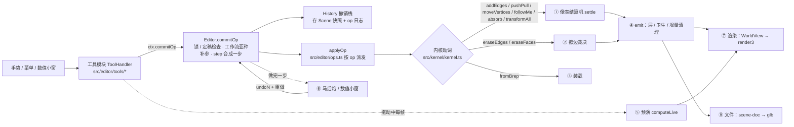

# CatsUp 代码流程图（pipelines）

> created 20261026 by Claude Opus 5.5 · as-of v0.14.51 / 2026-10-26
> 家族规矩（根 CLAUDE.md「代码流程图」节；user 2026-10-26「可以维护一个ai docs讲一下pipeline是什么。然后项目claude.md要求改的时候需要更新。不同操作可以走不同的共用pipeline」「要不pipeline规则升级成家族级别吧 反正就是那种代码流程图」「对，理一下你测的那些性能优化里面每一步都干了啥」）：
> **改流程（新动词 / 新共用流程 / 改某一步 / 新工作流亚种 / 性能改动）同一个 commit 更新这份。** 每一步写：干什么 · 碰多少东西（随**整个模型**涨 = O(N)，还是只随**这次改动**涨 = O(改动)）· 实测。
> 实测口径（下文所有数字）：node / 无头 Chromium，本机；「光滑球」= `tmp` 基准脚本造的 UV 球（1472 / 12096 / 48768 三角，导入成一个组件），挪 / 擦赤道附近一个点 / 一条边。

---

## 0. 总图

---

## 1. 哪个操作走哪条流程（+ 工作流亚种参数）

| op（`src/editor/ops.ts`） | 内核动词 | 流程 | 亚种 / 参数 |
|---|---|---|---|
| `addEdges`（画线 / 矩形 / 圆 / 弧 / 偏移出的线） | `addEdges` | ① 结算（手势边 → 无主胞腔可出生） | `harden`（描过软边变硬，DT90）、`layers` / `curve` |
| `pushpull` | `pushPull` | ① 结算（帽 + 侧壁像） | 帽边不带 `CAP_EXCLUDE`（fold）；被推那块的折线先退回普通边 |
| `move`（挪点 / 挪边 / 挪面） | `moveVertices` | ① 结算（被挪膜的像；不平 → 自动折面） | **`creaseLayers`**：折缝 = 硬线（缺省）/ `["fold"]`（`Mode.workflow.autofold = "fold"` 时 commitOp 统一补上） |
| `followme` | `followMe` | ① 结算（扫掠分片组） | 站环 / 末帽不带 fold |
| `absorb`（复制粘贴 / 移动复制） | `absorb` | ① 结算 | — |
| `transformPool` / `applyScale` / `setAxes`（组件原点） | `transformAll` → `moveVertices` | ① 结算（池里全部顶点） | 镜像变换：`transformAll` 先整体互换两侧（DT8） |
| `mirror`（镜像指令） | `src/editor/mirror.ts mirrorGeometry` → `moveVertices` + `addEdges` | ① 结算 | 删对面 / 消中缝 / 融合阈值（马前炮）；组件 = 负变换实例 |
| `eraseEdges` / `eraseFaces` / `eraseSelection` | `eraseEdges` / `eraseFaces` | ② 擦边裁决 | **橡皮亚种**：`Mode.workflow.eraseNonCoplanar` = `burst`（缺省）/ `fold`（→ `Kernel.foldPlan` 分类：折 = `setEdgeLayers fold`、照常 = `eraseEdges`、非流形 = 拒绝） |
| `setEdgeLayers`（软化 / 硬化 / 折线） | `setEdgeLayer` | 不结算，只改层 → ④ | — |
| `weldEdges` / `explodeCurves` | 曲线登记 | 不结算 | 焊边认回圆（DT88） |
| `makeGroup` / `makeComponent` / `explode` / `copyGroup` | 快照搬家（`extractSnapshot` / `transformSnapshot`）+ ③ 装载 + ① absorb | ③ + ① | 建组件马后炮选原点 |
| `importScene` | ③ 装载（op 带提交前装好的膜） | ③ | 上方向 / 文件单位（马后炮重做） |
| `makePlanar` / 修复指令 | 规划纯函数（`src/editor/planar.ts` 等）→ `moveVertices` | ① | 作用域：有选区 = 选区，没选 = 整个物体；含子物体（DT85） |
| `setDrawFrame`（坐标架）/ `addGuide` / `paintFaces` / `setHidden` / 层表 | 场景字段 / 面层 | 不结算 | — |

**工作流亚种**（`src/editor/mode.ts Mode.workflow`，缺省 = 硬表面 / SketchUp）：同一套代码按工作台分叉，不另抄一份。现在只有两个口：`eraseNonCoplanar`（破 / 折）、`autofold`（硬线 / 折线）。现有三个工作台（物体 / 硬表面建模 / 表面）全用缺省；自由建模工作台（以后）用折线那一支（那边的工具也不叫橡皮，user 10-26）。

---

## ① 像表结算机（`src/kernel/settle.ts`；立宪页 §3）

一句话：**动词不碰图，只交一张像表（「做完以后每张膜长什么样」的多边形）；机器按坐标认领胞腔。** 每一段的计时 = `perf.last["settle.<段>"]`（常开）。

| 段（计时名） | 干什么 | 碰多少 | 实测（4.9 万三角挪一个点；改前 → 现在） |
|---|---|---|---|
| `identity.pre` | 被消耗的膜出库、记旧环边；在**新线段附近**的边上拍「操作前是否二度共线 / 是否裸线」 | O(改动)（空间网格 `edgesNear`） | 0.4 ms |
| `identity.kept` / `identity.bury` | 随葬第一相：被消耗膜的旧环边若不在任何像上、也没有活膜引用 → 现在就删 | O(改动) | ≈ 0 |
| `insert` | 把手势线 / 裸线 / 折缝 / 像的环段插进图（`insertSegment`，sticky 3 µm），记手势边 / 脏边 | O(改动) | 1 ms |
| `planarize` | 只围绕脏边自愈：交叉切开、骑边合并 | O(改动) | 3.5 ms |
| `touched.planes` | 被碰平面 = 像的平面 + 被消耗膜的平面 + **含任一脏边的平面** | **O(平面数)**（扫全部平面；先用「平面穿不穿过脏边包围盒 ± τ」一次判断筛） | 12 → 1.7 ms（v0.14.47 包围盒先筛） |
| `touched.discover` | 从脏顶点上两两相邻的边张出候选平面，登记进平面表（`PlaneRegistry.ensure`） | O(改动) × 登记 | **52 → 0.6 ms**（v0.14.47 平面表按「规范法向 + 距离」分桶，原来每次登记逐条比全部平面） |
| `touched.scope` | 每张被碰平面上这次要用的边集 S（影响域）：① 脏边 + 被消耗膜旧环 ② 沿裸线可达 ③a 像的盒 + 脏边的盒（± 2τ）③b 手势出生胞腔走出整个外环（+ 它的盒）④ 受影响膜的环 ⑤ 双胞平面跨平面认领补边 | O(改动)（不写死尺度，v0.14.46） | 43 → 8–13 ms（v0.14.47：③a 不再罩裸线可达那一大圈——赤道一圈边恰好在 z = 0 上 → 2 m 的盒；⑤ 每张像只查一次盒） |
| `touched`（τ-flatten 轮） | 同一平面组里 3D 相距 (r, 2τ] 的东西投影后相交 / 骑边 → 并成一个，再 planarize + 重算 S，到不动点 | O(改动) | ≈ 1 ms |
| `regions` | 每张被碰平面在 S 上切胞腔（`groupCoplanar` → `findRegions`），清理被碰而没用了的平面 | O(改动) | 8 → 2 ms（v0.14.47 只删被碰的那几张，原来拼全表保留集 + 整表 prune） |
| `identity.rings` | 受影响膜按顶点 id 读环 = 身份像 | O(改动) | 3 ms |
| `claims` | 每张像按绕数认领胞腔（平行 2.6° 内、代表点离像 ≤ τ，认领不到放宽 3τ） | O(像 × 被碰平面的胞腔) | 0.4 ms |
| `decide` | 逐胞腔裁决：有 XOR 参与 = 认领数奇偶，否则 ≥ 1 即填；身份（一对一保 id / DIVIDE / MERGE / BURST / BIRTH）；无主胞腔外环含手势边 = BIRTH | O(改动) | 0.2 ms |
| `faceLinks` | 只给变了的膜重建「边 → 膜」链接 | O(改动) | 0.1 ms |
| `bury` | 随葬第二相：结算后没膜的边只许是用户画的线 | O(改动) | ≈ 0 |
| `dissolve` | ⑪a 新段打层（含折缝 `creaseLayers`）→ ⑩ 因本次操作变成二度共线的顶点并成一条边 | ⑪a 的 `layerSegs` 那一行**扫全部边**（推拉 / 画线才有）；其余 O(改动) | ≈ 0 |
| `layers` | ⑪ 边层 / 曲线清掉删了的边、⑫ 登记新曲线、断弧规则 | O(改动) | **5.6 → 0.01 ms**（v0.14.47 按删除记录增量清，原来扫全部层） |

合计（光滑球挪一个点）：1.2 万三角 0.2 s → **9–14 ms**；4.9 万三角 1.6–1.9 s → **17–38 ms**（v0.14.46 去 1 m 余量 + v0.14.47 上面几段）。
裁判 = 差分 oracle（`test/settle-differential.test.ts`：同一串随机操作，局部机 vs 全局机逐步比；「冂 封口」四个尺度 + 放大档）。

---

## ② 擦边裁决（`Kernel.eraseEdges` → `FaceStore.snapshotEraseVerdicts` / `reconcileErase`）

| 步 | 干什么 | 碰多少 |
|---|---|---|
| 曲线展开 | 擦一段 = 整条曲线 | O(改动) |
| 裁决快照 | 每条要擦的边：它在每张相邻膜的哪个环上 → 外环 = BURST、洞 = ABSORB、同平面两张共享 = MERGE | O(改动) |
| 删边 | `removeEdge` | O(改动) |
| 重算 | `regionsByPlane(g, reg, tol)` **不带影响域 = 全部平面重切胞腔**，给存活 / 合并的膜找后继区域 | **O(模型)，还略超线性** |

实测（光滑球擦一条边）：80 三角 14 ms · 350 三角 37 ms · 1472 三角 184 ms · **12096 三角 11 s**。**剩下的头号随模型涨的点**（DT96 后续）：要给擦边写一套局部化（只重切被碰平面、影响域同 ①），和 ① 的定理一起审。

---

## ③ 装载 / 导入

- `Kernel.fromBrep(snapshot)`：按存档的路直接装（平面按存储参数精确注册 `PlaneRegistry.restore`，不结算）。打开文件、撤销到快照、op 带装好的膜（`importScene` / 建组件）都走它。
- 外来 glb：`src/format/gltf-import.ts`（glb → 节点树 / 三角，Y-up → Z-up，上方向 / 单位）→ `src/scene/import-build.ts castImport`（共用网格 = 共用定义）→ `src/kernel/from-triangles.ts`（干净的三角走 fromBrep 快路径；骑边 / 交叉 / 同平面盖住的交给 ① 的 absorb 切）。实测：1.2 万三角 ≈ 1.5 s（v0.14.39 起）。

---

## ④ 每步之后（`Kernel.emit`）

1. 事件进日志；面层按事件血缘走（DIVIDE 子膜继承、MERGE 取首个、BURST 清；`FaceLayers.applyEvents`）。
2. **折线卫生**（DT87）：恰好两张不共面的膜，否则退回普通边。O(折线数)。
3. **增量清理**（v0.14.47）：图 / 膜库记删除记录（`drainRemovedEdges` / `drainRemovedFaces`；id 不复用），边层 / 面层 / 曲线只清这批（`pruneIds` / `pruneEdges`）。原来每步全量扫。守卫 = fuzz 的「层不漏」不变量。

---

## ⑤ 拖动预演（`Editor.computeLive`，每帧）

| 步 | 干什么 | 碰多少 | 实测（无头浏览器拖赤道一个点；1.2 万 / 4.9 万三角） |
|---|---|---|---|
| `live.clone` | 当前池的内核整份拷一份（图 + 膜库 + 平面表 + 层 + 曲线） | **O(池)** | 15 / 75 ms |
| `live.run` | 在拷贝上跑这一帧的动词（走 ①） | O(改动) | 25 / 45 ms |
| `liveWorld` | 合成视图：在手里的那份换成拷贝 | O(槽) | — |
| `buildKernelGeom` | 渲染把拷贝**整池重建几何**：平滑法线（并查集 + 朝向统一 + 按顶点累加）、每张面三角化、拼顶点缓冲 | **O(池)** | **1.2 s → 0.1 s** / 0.4 s（v0.14.48：平滑法线的并查集没路径压缩 = 平方级 → `kernel/dsu.ts`，四份抄写一起换） |

剩下的（DT96，待定时机）：① 内核事务回滚——预演副本每个手势拷一次，每帧回滚上一帧再做这一帧（各表遍历顺序要原样恢复；对拍「回滚 = 没动过」）② 渲染差量——原件几何缓存着，画「原件 − 改过的面 + 改过的面（含邻圈）单独一小块」= 高中那套懒渲染 / 渲染树的第一步（DT92）。

---

## ⑥ 马后炮 / 数值小窗（`src/editor/param-panel.ts afterthought` · `Editor.applyVcb`）

- 每个工具落定时 `recordLast(上一步)` → `offerLastAfterthought`：变换类（复制 / 变换中心）、圆 / 弧（段数 + 公差说明行，DT95）、建组件（原点）、导入（上方向 / 单位）、修复（含子物体）、改组件原点（现成位置）。
- 改值 = `undoN(这一步占的操作数)` → 按新值重做 → 重新数操作数；之后又提交别的 / 撤销 = 作废。
- 数值小窗：`undoN(L.ops)` → 按精确值重做；圆 / 弧的重画（`redrawCircle` / `redrawArc`）和段数马后炮共用。

## ⑦ 渲染（`src/scene/world-view.ts` → `src/editor/render3.ts`）

- WorldView：每个池（根 / 组 / 组件定义）一个「部分」，按 `kernel.rev` 缓存；每份实例一个槽 = 一个矩阵（同一个定义的几份共享几何）。软边 / 平滑边 / 折线集合在部分里。
- render3：每个内核对象一份几何（按对象身份 + rev 缓存），每槽一个矩阵；选中 / 悬停 = 覆盖层；轮廓线判定在着色器（`profile-edges.ts` 的 GLSL 镜像）；小三轴（选中组件 / 空组件 / 淡的组件原点）共用一个画法。
- 不画：软边、折线、隐藏的边。明暗：跨平滑边和折线连续（导出 bake 同一套）。

## ⑧ 修复指令（`Editor.repair(kind, scope)`）

`repairScope`（有选区 = 选区，没选 = 当前物体；含子物体：组件按定义只修一次、锁着的跳过）→ `repairPlan`（焊断口 / 拍平 / 折得厉害的软边变硬）→ 提交（一步）→ 马后炮（含子物体 / 阈值）。

## ⑨ 文件（`src/format/`）

写：Scene → `scene-doc.ts documentFromScene` → `CatsupDocument` → `write.ts`（`CATSUP_*` 扩展按拍子写 + bake 出别的软件看的网格）→ glb。读：glb → `read.ts` → `migrate/`（每个子结构自己的拍子，`FORMAT` = 唯一 SSoT）→ document → Scene。定稿指纹 `final.ts`。加可选键 = 该子结构 minor +1 + 冻结样本（`scripts/freeze-format-fixtures.mjs`）。

---

## 剩下的随整个模型涨的点（按严重度）

1. **擦边重算全部平面**（② 最后一步）：1.2 万三角擦一条边 11 s。
2. **预演整池拷贝 + 整池重建几何**（⑤）：4.9 万三角每帧 ≈ 0.5 s。
3. 结算 `touched.planes` 扫全部平面（已用包围盒先筛，4.9 万三角 1.7 ms）；`⑪a layerSegs` 扫全部边（推拉 / 画线时）。
4. OBJ 导入不认折线（Blender 来的不平 n-gon 现在只收边段）。

并到 DT92「初中」（WASM / 数据布局）还是先做，等 user 定。
